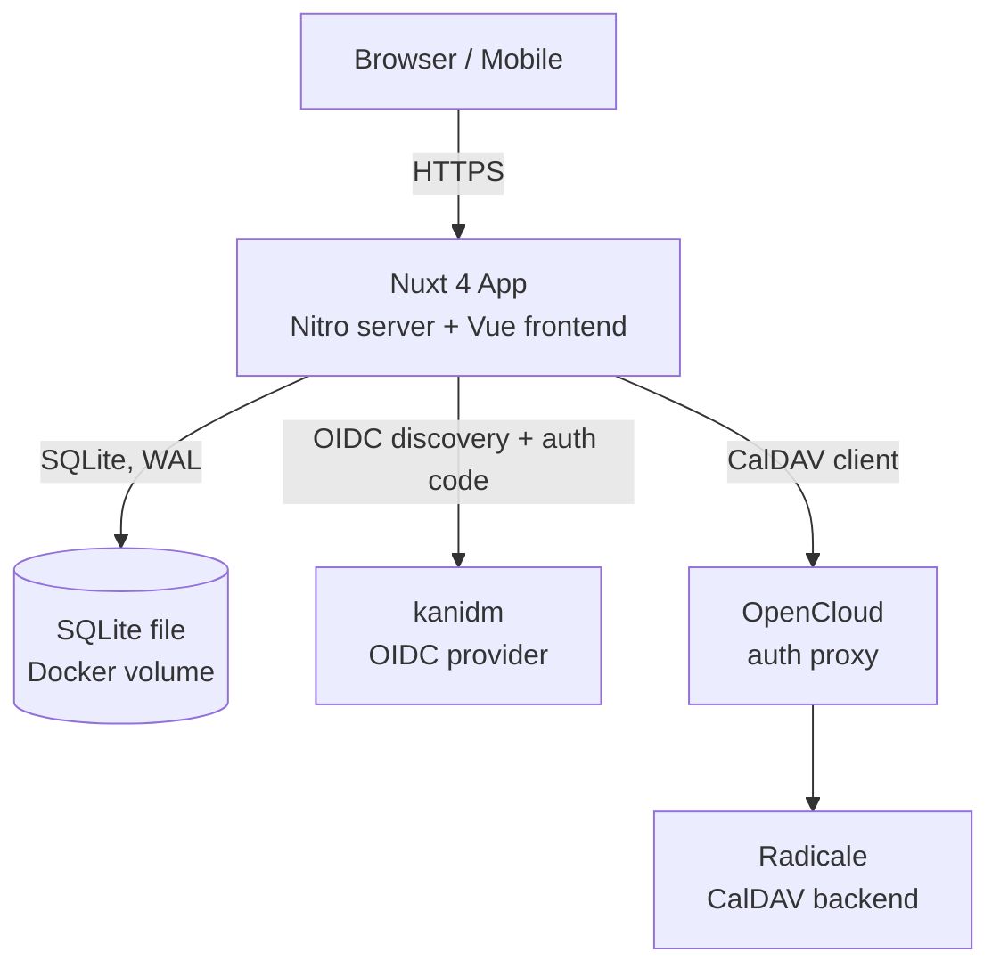
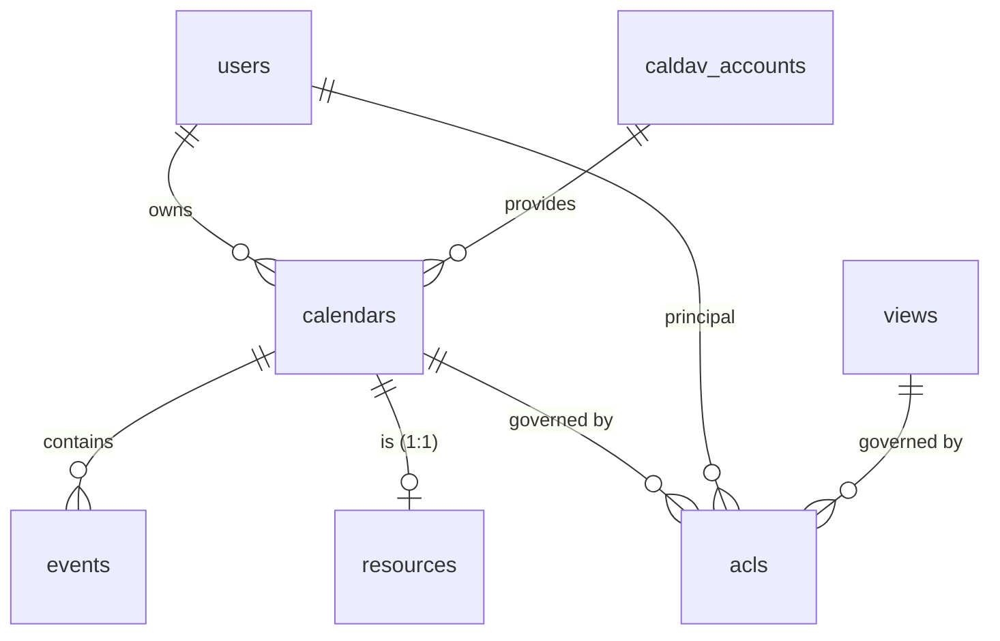
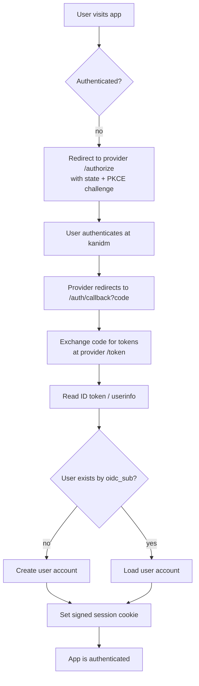
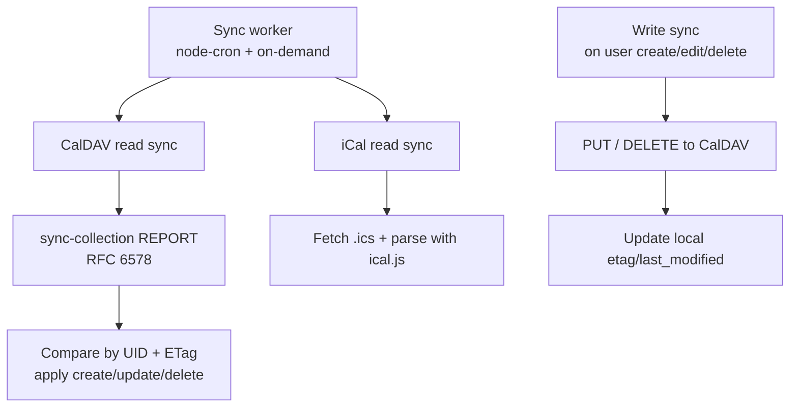

# Web Calendar — Design

> Status: **Draft v1.0** — companion to `requirements.md` (Draft v1.2).
> This document turns the requirements into a concrete technical design.

---

## 1. Overview

A **standalone, self-hosted**, web-based calendar for teams/organizations
(30–50 users) whose defining strength is **aggregating entries from multiple
calendars into a single, unified view**. It replaces GroupOffice calendar.

Key decisions (from the requirements review):

- **License** — **AGPLv3** (frontend + backend fully AGPLv3-compliant), which lets
  us use **FullCalendar Premium** under its AGPLv3 license.
- **Stack** — **Nuxt 4** (Vue 3 frontend + Nitro backend) in a **single Docker
  container**.
- **Database** — **SQLite** (single file; fits the single-container model and the
  minimal concurrency).
- **Auth** — **generic OIDC** (currently **kanidm**).
- **CalDAV backend** — **Radicale** behind **OpenCloud** as an auth proxy; the app
  is a **CalDAV client**; **two-way sync is planned for the initial release** (may slip to a follow-up).

---

## 2. Licensing

- The project is licensed **AGPLv3**. Both the frontend and backend are fully
  AGPLv3-compliant.
- **FullCalendar Premium** is used under its **AGPLv3 license** (FullCalendar v7),
  with the license key:
  ```js
  schedulerLicenseKey: 'AGPL-My-Frontend-And-Backend-Are-Open-Source'
  ```
- **Implication** — all dependencies must be **AGPLv3-compatible**. AGPLv3 is
  compatible with GPLv3 and permissive licenses (MIT, BSD, Apache-2.0). We must
  **audit any new dependency** for AGPLv3 compatibility before adding it (see §12).
- The app is currently run **internally** by the org, so the AGPLv3 network-use
  copyleft is not yet a distribution concern — but we keep the project
  AGPLv3-compliant so the FullCalendar Premium license is valid and so we can
  distribute later if we choose.

---

## 3. Tech Stack

| Layer          | Choice                                                                   | Notes                                                                    |
| -------------- | ------------------------------------------------------------------------ | ------------------------------------------------------------------------ |
| Framework      | **Nuxt 4** (Vue 3)                                                       | Frontend + Nitro backend in one codebase/deployable                      |
| Calendar UI    | **FullCalendar v7** (Premium, AGPLv3)                                    | `@fullcalendar/vue3` + `@fullcalendar/vue3-scheduler`; license key above |
| Database       | **SQLite** via `better-sqlite3`                                          | Single file; WAL mode for concurrent access                              |
| Auth           | **OIDC** via `nuxt-auth-utils` https://github.com/atinux/nuxt-auth-utils | Generic (discovery); currently kanidm                                    |
| CalDAV client  | **`ts-caldav`** https://github.com/KlautNet/ts-caldav                    | Two-way sync (read + write)                                              |
| iCal parsing   | **`ical.js`**                                                            | For `.ics` sources (read-only)                                           |
| Sync scheduler | **`node-cron`**                                                          | In-process; periodic + on-demand                                         |
| Runtime        | **Node.js** (LTS)                                                        | Nitro runtime                                                            |
| Packaging      | **Docker** (single container)                                            | + `docker-compose.yml` example                                           |

---

## 4. Architecture

A single Nuxt 4 process serves both the **frontend** (SSR/SPA) and the **backend**
(Nitro server routes). It talks to three external systems: the OIDC provider
(kanidm), the CalDAV backend (Radicale via OpenCloud), and a local SQLite file.



**Components inside the container:**

- **Nitro server routes** — the API: auth (OIDC callback, session), calendars,
  views, resources, events, ACLs, sync.
- **Vue frontend** — the UI: sidebar, view types, FullCalendar, split view.
- **Sync worker** — an in-process scheduler that periodically syncs connected
  CalDAV/iCal sources.
- **SQLite** — a single file on a mounted volume (persists across container
  restarts).

**Why one container** — the app is self-hosted and small (30–50 users, minimal
concurrency). One container keeps deployment simple (a single `docker run` /
`docker compose up`). The external systems (kanidm, Radicale/OpenCloud) are
separate services the app connects to.

---

## 5. Data Model

SQLite (single file). The model reflects the requirements and the **Q12 decision**
(a resource is its own calendar, ACL-gated).

**Why SQLite (not no-DB)** — we need to persist _and query_ users, calendars,
views, resources, events, and ACLs. SQLite (a single file, WAL mode) does this
cleanly and handles the expected concurrency (≤10) without a separate database
server — a good fit for the single-container model. A no-DB (flat-file) approach
is possible but would make querying (e.g. "which calendars can this user see?")
and concurrent access messier.



**Tables** (key columns; all have `created_at`/`updated_at` where noted):

- **users** — `id` (PK), `oidc_sub` (unique), `name`, `email`, `last_login_at`.
- **teams** — `id` (PK), `name`, `description`.
- **team_members** — `user_id` (FK), `team_id` (FK).
- **roles** — `id` (PK), `name` (e.g. `admin`, `user`), `description`.
- **user_roles** — `user_id` (FK), `role_id` (FK).
- **caldav_accounts** — `id` (PK), `user_id` (FK), `url` (Radicale via OpenCloud),
  `username`, `password` (encrypted at rest).
- **calendars** — `id` (PK), `name`, `type` (`caldav` | `ical` | `resource`),
  `source_url`, `owner_id` (FK, nullable), `color`, `resource_type` (nullable,
  e.g. `room`/`car`), `caldav_account_id` (FK, nullable).
- **views** — `id` (PK), `name`, `owner_id` (FK, nullable), `is_admin` (bool),
  `definition` (JSON: which calendars are shown/hidden + colors).
- **resources** — `id` (PK), `calendar_id` (FK → calendars, 1:1; the resource's
  own calendar), `name`, `type` (`room`/`car`/…). _A resource is its own calendar_
  (Q12).
- **events** — `id` (PK), `calendar_id` (FK), `uid` (iCal UID, unique per
  calendar), `title`, `start`, `end`, `description`, `location`, `status`,
  `booked_by_calendar_id` (FK, nullable — for resource bookings, the calendar that
  created the booking), `resource_id` (FK, nullable — for events that book a
  resource), `etag`, `last_modified`.
- **acls** — `id` (PK), `target_type` (`calendar` | `resource` | `view`),
  `target_id` (FK), `principal_type` (`user` | `team` | `role` | `public`),
  `principal_id` (FK, nullable for `public`), `permission` (`read` | `write` |
  `admin`).

**Resource model (Q12 — hybrid):**

- A **resource is its own calendar** (a `calendars` row with `type = 'resource'`,
  1:1 with a `resources` row). It can hold **booking events** that mark it
  unavailable for a time range.
- An event in **another** calendar can **reference/book** a resource
  (`events.resource_id`). Booking a resource creates a **booking event** in the
  resource's calendar with `booked_by_calendar_id` set to the booking calendar.
- **ACL rule** — when rendering a resource calendar, a user sees **full details**
  of a booking only if they have `read` access to the **`booked_by_calendar_id`**;
  otherwise the booking shows as a **"blocked"** (free/busy-only, no details)
  entry.

---

## 6. Authentication (generic OIDC)

Standard OIDC **authorization code flow with PKCE**, provider-agnostic via
**discovery** (`/.well-known/openid-configuration`). Currently pointed at
**kanidm**; switching providers is a config change.



- **User mapping** — the OIDC `sub` is the stable key. On first login, create a
  `users` row; on later logins, look up by `sub`.
- **Roles/teams** — read from OIDC claims (configurable claim names, e.g.
  `groups`/`roles`), with an admin able to override.
- **Session** — a **signed cookie** (stateless) — simple for a single container;
  a `sessions` table is the fallback if we need server-side invalidation.
- **Security** — `state` for CSRF protection; PKCE for the code; validate the ID
  token signature and `aud`/`iss`.

---

## 7. CalDAV / iCal Sync

The app is a **CalDAV client** (two-way) and an **iCal reader** (read-only).



- **Read sync** — use the CalDAV `sync-collection` REPORT (RFC 6578) to fetch
  changed events since the last sync; compare with the local DB by `uid` +
  `etag`; apply create/update/delete. For iCal sources, fetch the `.ics` and parse
  with `ical.js` (read-only).
- **Write sync (two-way, planned for initial release)** — when a user creates/edits/deletes
  an event, write it to the CalDAV server (`PUT`/`DELETE`) and update the local
  `etag`/`last_modified`.
- **Conflict resolution** — **last-write-wins** by `last-modified` (simple,
  predictable for low concurrency). Revisit if conflicts become a problem.
- **Schedule** — `node-cron` runs a periodic sync (e.g. every 5 min) for all
  connected accounts; a **refresh** control triggers an on-demand sync.
- **Graceful degradation** (NFR-4) — if a source is unreachable, the app keeps
  serving the last synced data and surfaces a "stale" indicator.

---

## 8. Access Control

A single **`acls`** table enforces access at every granularity (FR-14):
**per-user, per-team, per-role, per-calendar, and public**.

- **Principals** — `user`, `team`, `role`, `public`.
- **Permissions** — `read`, `write`, `admin`.
- **Targets** — `calendar`, `resource`, `view`.
- **Enforcement** (FR-15) — the API checks the ACL on every read/write: which
  calendars a user can see, which events they can see (and with what detail), and
  which calendars they can write to.
- **Resource ACL rule (Q12)** — a resource calendar shows **full details** of a
  booking only to users with `read` access to the **booking calendar**
  (`booked_by_calendar_id`); otherwise the booking is a **"blocked"**
  (free/busy-only) entry. This keeps a resource's calendar from leaking the
  details of bookings made by calendars the viewer can't access.

---

## 9. Frontend / UI

Built on the **GroupOffice** baseline (FR-21…FR-25), mobile-friendly (FR-20).

- **Left sidebar** (top → bottom): **views** (icon + `⋯` menu), **calendars**
  (visibility toggle), **resources** (visibility toggle), **categories** (add
  control), **filters** (add control + chooser).
- **View-type switcher** (FR-22): **day, 5-day, week, month, year, split, list**.
- **Date navigation** (FR-23): previous / **today** / next.
- **Quick-add** (FR-24) and **overflow (`⋮`) menu** (FR-25).
- **FullCalendar** (`@fullcalendar/vue3`, v7 Premium) renders the day/week/month/
  list views.
- **Split view (FR-6)** — **every** calendar in the selected view gets its **own
  horizontal band** (stacked, no overlap). Implementation: **one FullCalendar
  instance per calendar**, stacked vertically, with **synchronized date
  navigation**; a band that is **empty for the current view** is **hidden** to
  save space. Extending split to **all** view types is a **planned experiment**
  (post-initial-release), not a requirement.
- **Mobile** — responsive layout; the sidebar collapses; the split view stacks
  bands vertically (already the natural mobile layout).

---

## 10. Deployment

A **single Docker container** (Nuxt 4 / Nitro) + a **`docker-compose.yml`**
example. The SQLite file lives on a mounted volume so it persists across restarts.

```yaml
# docker-compose.yml (example)
services:
  web-calendar:
    image: web-calendar:latest
    restart: unless-stopped
    ports:
      - '3000:3000'
    environment:
      # OIDC (generic; currently kanidm)
      NUXT_OIDC_ISSUER: 'https://kanidm.example.com'
      NUXT_OIDC_CLIENT_ID: 'web-calendar'
      NUXT_OIDC_CLIENT_SECRET: '${NUXT_OIDC_CLIENT_SECRET}'
      NUXT_OIDC_REDIRECT_URI: 'http://localhost:3000/auth/callback'
      # CalDAV backend (Radicale behind OpenCloud)
      NUXT_CALDAV_BASE_URL: 'https://opencloud.example.com/radicale'
      # Sync
      NUXT_SYNC_INTERVAL_MIN: '5'
    volumes:
      - web-calendar-data:/data # SQLite file
volumes:
  web-calendar-data:
```

- **Config via env vars** (OIDC issuer/credentials, CalDAV base URL, sync
  interval). Secrets (OIDC client secret, CalDAV passwords) are injected at
  runtime, not baked into the image.
- **Persistence** — the SQLite file is on a named volume (`/data`).
- **Build** — a multi-stage Dockerfile (build the Nuxt app, then run it on a slim
  Node image). `better-sqlite3` ships prebuilt binaries, so no native build is
  needed in the image.

---

## 11. Phasing

Aligned with the requirements' delivery phasing (all requirements are in scope;
this is the **order**):

| Phase                        | Focus                                                                                 | Key requirements             | Design pieces                                                                       |
| ---------------------------- | ------------------------------------------------------------------------------------- | ---------------------------- | ----------------------------------------------------------------------------------- |
| **1 — UI shell / mock-up**   | The webpage + a mock-up of all UI (sidebar with views at top, view types incl. split) | FR-21…FR-25, FR-6, FR-20     | §9 (sidebar, view types, split view mock-up, mobile)                                |
| **2 — Core calendar + auth** | Calendar features + authentication                                                    | FR-7…FR-13, FR-3…FR-5, FR-20 | §6 (OIDC), §7 (CalDAV/iCal sync, two-way), §5 (calendars/events), §4 (architecture) |
| **3 — Organizational**       | Grouping/views (templates for calendar groups), resources                             | FR-1…FR-2, FR-14…FR-19       | §8 (ACL), §5 (views/resources, resource ACL rule)                                   |

---

## 12. Open Items / Risks

- **AGPLv3 dependency audit** — confirm every dependency is AGPLv3-compatible
  before adding it (the core stack above is; new deps must be checked).
- **Radicale + OpenCloud integration** — verify the CalDAV client (`ts-caldav`)
  works against Radicale behind the OpenCloud auth proxy (auth flow,
  `sync-collection` support).
- **Split view implementation** — prototype the "one FullCalendar instance per
  calendar + synchronized navigation + hide empty bands" approach; confirm it
  stays readable at 10–20 calendars (NFR-1).
- **Two-way sync conflicts** — last-write-wins is the starting point; revisit if
  real-world conflicts need a smarter strategy.
- **SQLite under concurrency** — WAL mode handles the expected load (≤10
  concurrent); if load grows, migrate to Postgres (the data model is portable).

---

## 13. Phase 1 — Implementation Steps

Phase 1 is the **UI shell / mock-up**: a working mock-up of **all** the UI
(sidebar with views at the top, every view type incl. split, mobile), driven by
**mock data** — no real backend, auth, or sync yet. It satisfies **FR-21…FR-25,
FR-6, FR-20** (design §9).

| Step | What                       | Requirements               |
| ---- | -------------------------- | -------------------------- |
| 1    | Project scaffolding        | —                          |
| 2    | Mock data layer            | —                          |
| 3    | App shell / layout         | FR-20                      |
| 4    | Sidebar                    | FR-21                      |
| 5    | Top bar                    | FR-22, FR-23, FR-24, FR-25 |
| 6    | Main area — standard views | FR-22                      |
| 7    | Split view                 | FR-6                       |
| 8    | Mobile                     | FR-20                      |
| 9    | Polish / review            | all of the above           |

**Step 1 — Project scaffolding**

- Initialize a **Nuxt 4** project; add **FullCalendar v7** (`@fullcalendar/vue3`
  - the Premium packages) wired with the AGPLv3 license key (§2).
- Add the **Docker** container + `docker-compose.yml` (§10) and a dev workflow
  (`npm run dev`).
- _Acceptance:_ `npm run dev` serves the app; `docker compose up` builds and runs
  the container.

**Step 2 — Mock data layer**

- A single mock-data module that provides **views, calendars, resources,
  categories, filters, and events** — enough to populate every UI section and to
  exercise the split view (incl. some **empty** calendars to test band-hiding).
- _Acceptance:_ the module exports the mock data; the UI can import it.

**Step 3 — App shell / layout**

- The overall layout: **left sidebar + top bar + main area**, responsive (sidebar
  collapses on mobile).
- _Acceptance:_ the three regions render and resize correctly.

**Step 4 — Sidebar (FR-21)**

- Sections top → bottom: **views** (icon + `⋯` menu), **calendars** (visibility
  toggle), **resources** (visibility toggle), **categories** (add control),
  **filters** (add control + chooser) — all from mock data.
- _Acceptance:_ every section renders with mock data; toggles/menus are
  interactive.

**Step 5 — Top bar (FR-22, FR-23, FR-24, FR-25)**

- **View-type switcher** (day, 5-day, week, month, year, split, list), **date
  navigation** (prev / today / next), **quick-add**, **overflow (`⋮`) menu**.
- _Acceptance:_ switching view type and navigating dates updates the main area;
  quick-add and overflow open their UI.

**Step 6 — Main area, standard views (FR-22)**

- Integrate **FullCalendar** to render **day, 5-day, week, month, year, list**
  with mock events.
- _Acceptance:_ each standard view renders with mock events; switching between
  them works.

**Step 7 — Split view (FR-6)**

- **One FullCalendar instance per calendar**, stacked vertically, with
  **synchronized date navigation**; **hide bands that are empty** for the current
  view.
- _Acceptance:_ every calendar in the selected view gets its own band; empty
  bands are hidden; navigation is synchronized across bands.

**Step 8 — Mobile (FR-20)**

- Responsive layout (sidebar collapses); the split view stacks bands vertically
  (the natural mobile layout).
- _Acceptance:_ the UI is usable on a mobile viewport.

**Step 9 — Polish / review**

- Review the mock-up against **FR-21…FR-25, FR-6, FR-20**; polish styling/spacing.
- _Acceptance:_ the mock-up matches the requirements and looks production-ready.

**Definition of done (Phase 1)** — a single Docker container runs a Nuxt 4 app
that shows the full sidebar (views/calendars/resources/categories/filters), the
top bar (view-type switcher, date nav, quick-add, overflow), every standard view
plus the split view (with empty-band hiding), all from mock data, and is usable
on a mobile viewport.
