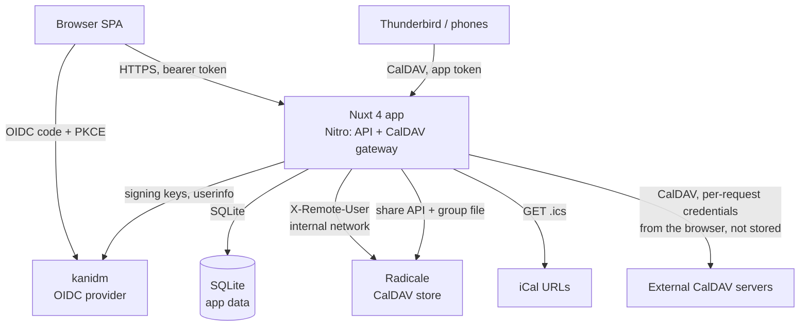
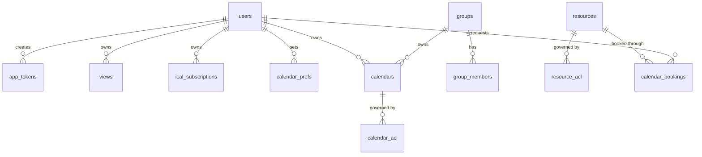
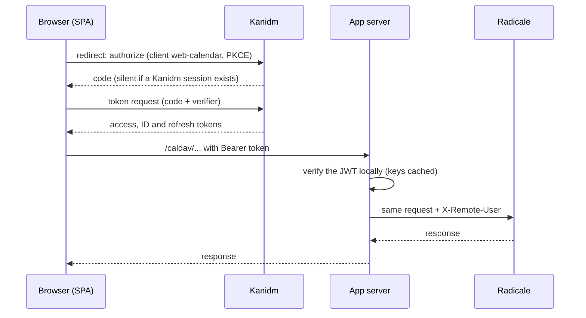

# Web Calendar — Design

> Status: **Draft v1.9** — companion to `requirements.md` (Draft v1.4).
> This document turns the requirements into a concrete technical design.
> v1.2 (2026-10-29), after spike S1: the app bundles Radicale and exposes its own authenticated
> `/caldav/` endpoint (bearer tokens verified locally, app tokens for other clients). Access rules
> are administered in the app and enforced by Radicale. External CalDAV servers are reached from the
> browser. Earlier versions are in git history (v1.2: commit `8b1da20`; v1.1: `f7bdfc8`; v1.0:
> `97a8e44` and earlier).
> v1.3 (2026-10-29), implementation started: Phase 1 steps 4–7 (sidebar, top bar, standard views,
> split view) and the Phase 2 groundwork (SQLite layer, app tokens, token verifier, CalDAV gateway)
> are built. Spikes S2 and S6 are done (§12); the deployment files follow this design (§10).
> v1.4 (2026-11-01): no CI for now; releases are gated by a manual run of the checks on the
> maintainer's machine (§12, Security backlog; README "Release checks").
> v1.5 (2026-11-01): the external-account proxy and the time-zone ranges and writes are marked as
> built, not planned (§4, §7); the `calendar-timezone` hint is still planned.
> v1.6 (2026-11-02): a Forgejo Actions workflow publishes the release image to Codeberg's registry;
> the checks still run on the maintainer's machine (§12, Security backlog).
> v1.7 (2026-11-05): a GitHub Actions workflow publishes the same image to GitHub's registry (§12).
> v1.8 (2026-11-05): groups and group calendars: the app keeps groups (its own and imported from
> Kanidm), members create and share the calendars their group owns (§5, §8, §9).
> v1.9 (2026-11-05): groups come from the groups claim of each person's sign-in, not from a Kanidm
> service account: the group sync is gone, admins pick which provider groups to import, the app
> writes Radicale's group file from its database and builds the group of everyone from sign-ins;
> an app token needs a sign-in within a window (default 30 days); token verification is
> provider-neutral and user ids are any id Radicale accepts, case-sensitive (§5, §6, §8, §9, §10;
> [oidc-providers.md](oidc-providers.md)).

---

## 1. Overview

A **standalone, self-hosted**, web-based calendar for teams/organizations
(30–50 users) whose defining strength is **aggregating entries from multiple
calendars into a single, unified view**. It replaces GroupOffice calendar.

Key decisions (from the requirements review and the 2026-10-29 interviews):

- **License** — **AGPLv3** (frontend + backend fully AGPLv3-compliant), which lets
  us use **FullCalendar Premium** under its AGPLv3 license.
- **Stack** — **Nuxt 4** (Vue 3 frontend + Nitro backend). The logged-in app is a
  **SPA** (`ssr: false`); Nitro serves the API and the CalDAV gateway. Deployed with
  **Radicale** in one `docker-compose.yml`.
- **Authentication** — **generic OIDC** (currently **kanidm**) with the app's **own
  OAuth2 client**. The SPA runs the login in the browser and keeps its tokens there.
  The server **verifies every token locally** (signature, issuer, audience, expiry
  and scope) against an **allow-list of clients** and stores none.
- **CalDAV** — **Radicale** is the calendar store and is reachable **only** through
  the app. The app's server is the **gateway**: `/caldav/` accepts OIDC bearer
  tokens (the SPA) or Basic auth with **app tokens** (Thunderbird, phones), sets
  `X-Remote-User`, and proxies to Radicale. OpenCloud is not in the CalDAV path.
- **Access control** — administered **in the app** (users, groups, per calendar) and
  **enforced by Radicale** through shares and group files the app maintains, for every client. The app
  never filters events itself.
- **External accounts** — the user can add other CalDAV servers (basic or no auth;
  OIDC later). The server keeps the non-secret part; the password exists only as a sealed
  credential in the browser and is **never stored on the server**; each request goes
  through a stateless pass-through proxy in the app (§6, §7).
- **Database** — **SQLite** for **app-level data only**: calendars, access rules,
  views, categories, filters, subscriptions, app tokens and preferences. Events are
  **not** stored.
- **Data freshness** — events are read **live** from Radicale; the browser keeps fetched
  events in memory for 30 s. **No stale data** is ever served: an unreachable source
  shows an error.
- **UI components** — **Nuxt UI v4** (MIT; Reka UI + Tailwind CSS v4), **adopted**
  after trial S3, with the conditions in §9 and §12. Installed.
- **Events** — recurring events are common; the organization uses **one time zone**
  (`TZ`, default `Europe/Berlin`). Editing a recurring event asks what to change (§7).

---

## 2. Licensing

- The project is licensed **AGPLv3**. Both the frontend and backend are fully
  AGPLv3-compliant.
- **FullCalendar Premium** is used under its **AGPLv3 license** (FullCalendar v7),
  with the license key:
  ```js
  schedulerLicenseKey: 'AGPL-My-Frontend-And-Backend-Are-Open-Source'
  ```
- **Implication** — all dependencies must be **AGPLv3-compatible**. AGPLv3 is
  compatible with GPLv3 and permissive licenses (MIT, BSD, Apache-2.0). We must
  **audit any new dependency** for AGPLv3 compatibility before adding it (see §12).
  That includes the transitive dependencies of Nuxt UI (about 60 direct
  dependencies). Trial S3 checked them: see §12 for the result and the one open
  license gap (`vaul-vue`).
- The app is currently run **internally** by the org, so the AGPLv3 network-use
  copyleft is not yet a distribution concern — but we keep the project
  AGPLv3-compliant so the FullCalendar Premium license is valid and so we can
  distribute later if we choose.

---

## 3. Tech Stack

| Layer                   | Choice                                      | Notes                                                                                                                                                                           |
| ----------------------- | ------------------------------------------- | ------------------------------------------------------------------------------------------------------------------------------------------------------------------------------- |
| Framework               | **Nuxt 4** (Vue 3)                          | Nitro backend and Vue SPA in one codebase; `ssr: false` for the app, SSR only per route if the public view needs it                                                             |
| UI components           | **Nuxt UI v4** (Reka UI, Tailwind CSS v4)   | Adopted after trial S3. Slideover, dropdown menu, modal, date inputs; keyboard and screen-reader behavior for NFR-3. MIT. Skip `UDrawer` (§9)                                   |
| Calendar UI             | **FullCalendar v7** (Premium, AGPLv3)       | `@fullcalendar/vue3` plus `@fullcalendar/vue3-scheduler` for the split view and narrow day columns (both 7.1.3, subpath imports); dark mode through the palette stylesheet (§9) |
| Database                | **SQLite** via `better-sqlite3`             | App-level data only; WAL mode; migrations are numbered `.sql` files applied by a small runner at startup, with hand-written types                                               |
| Login (browser)         | An OIDC client library, code flow with PKCE | Candidate `oidc-client-ts` (unverified, licence to check). Tokens in memory or `sessionStorage`; renewal by silent redirect or refresh grant                                    |
| Token check (server)    | A JOSE library, asymmetric JWTs             | Candidate `jose` (unverified, licence to check). Verifies against the issuer's published keys (cached, found through discovery); no call to the provider per request            |
| CalDAV store            | **Radicale** (3.9 in the test stack)        | Bundled in compose, internal network only; `http_x_remote_user` auth; static rights file, sharing by map, `htgroup` groups                                                      |
| CalDAV gateway          | A **Nitro route** (`/caldav/**`)            | Proxies any WebDAV method with streamed bodies (h3 `proxyRequest`, untested). Header hygiene is security-critical (§7)                                                          |
| CalDAV client (browser) | `ts-caldav` or `tsdav`                      | _To be verified in a browser_ (custom auth header, XML parsing, bundle size)                                                                                                    |
| iCal parsing            | **`ical.js`**                               | `.ics` URL subscriptions (read-only), and recurrence expansion where Radicale cannot do it                                                                                      |
| Caching                 | In-process, short TTL                       | The provider's signing keys and iCal fetches on the server; fetched events for 30 s in the SPA. No stale fallback                                                               |
| Runtime                 | **Node.js** (LTS)                           | Nitro runtime                                                                                                                                                                   |
| Packaging               | **Docker Compose**                          | `web-calendar` and `radicale`; Kanidm is external                                                                                                                               |

---

## 4. Architecture

A single Nuxt 4 process serves the **SPA**, the **app API** and the **CalDAV
gateway**. It talks to Radicale on an internal network, to Kanidm for token checks,
to plain iCal URLs, and to a local SQLite file. Browsers and third-party CalDAV
clients only ever talk to the app.



**Components inside the app:**

- **SPA** — sidebar, view types, FullCalendar, split view, account settings, app
  tokens, access administration.
- **App API** (`/api/**`) — views, categories, filters, iCal subscriptions,
  resources, calendars and access rules, app tokens. Every call carries a bearer
  token that is checked as described in §6.
- **CalDAV gateway** (`/caldav/**`, `/.well-known/caldav`) — §7.
- **Sharing writer** — keeps Radicale's map shares in line with the access rules (§8).
- **Group file writer** — writes Radicale's group file from the database: the app's groups, the
  groups imported from the identity provider and the group of everyone who signed in lately
  (§8, Groups).
- **iCal proxy** — fetches `.ics` subscriptions for the browser, which cannot read
  arbitrary URLs cross-origin.
- **External-account proxy** — forwards CalDAV requests to a user-added server
  with the credentials the browser sends per request; stores and logs none (§6, §7;
  `server/api/external/[id]/`).
- **Caches** — Kanidm signing keys and iCal fetches (server); fetched events for
  30 s (SPA). Nothing is served stale.

**Why a gateway in the app** — Radicale has no OIDC of its own, and OpenCloud's
proxy accepts tokens from one Kanidm client only (spike S1). With the gateway in the
app, the one trusted party checks tokens, and the same endpoint serves the SPA and
third-party clients.

---

## 5. Data Model

SQLite (single file) holds **app-level data only**. Calendars and events live in
Radicale (or in iCal files and external servers) and are identified by the
calendar's collection path and the event's iCal `UID`; events are never copied
into SQLite.

**Why SQLite (not no-DB)** — we need to persist _and query_ calendars, access
rules, views, categories, filters, subscriptions and app tokens. SQLite (a single
file, WAL mode) does this cleanly and handles the expected concurrency (≤10)
without a separate database server.



**Tables** (key columns; all have `created_at`/`updated_at`):

- **users** — `id` (PK), `oidc_sub` (unique), `username`, `name`, `email`,
  `is_admin` (a note, never authorization), `last_seen_at`, `time_zone` (an override of the browser's
  zone, FR-32; NULL means the browser's), `sidebar_order` (the order the user keeps the sidebar's
  sections in, FR-21: a JSON list of section ids; NULL means the default order). Created on first use. `oidc_sub` is the provider's user id,
  any id Radicale accepts as a user name, case-sensitive (§6). `last_seen_at` is the **sign-in
  window** (§6): it is renewed by a bearer call to `/api/**` and by an OIDC bearer call to `/caldav/`,
  never by an app token. There is no roles table: admin comes from the identity provider's groups
  claim (§6).
- **app_tokens** — `id` (PK), `user_id` (FK), `label`, `token_hash`, `expires_at`,
  `last_used_at`. Only the hash is stored; the token is shown once (FR-31). It works only while its
  owner's `last_seen_at` is inside the sign-in window (§6).
- **calendars** — `id` (PK), `name`, `kind` (`personal` | `shared` | `resource`),
  `owner_id` (FK, nullable: shared and resource calendars have no personal owner),
  `group_id` (FK to `groups`, nullable: set for the calendars a group owns, `kind = 'shared'`,
  no `owner_id`; a group with calendars cannot be deleted), `color`, `collection_path` (where
  Radicale stores it).
- **groups** — `id` (PK, never reused), `name` (unique across all sources; the htgroup name, 1 to
  64 letters, digits, `_`, `.`, `-`, starting with a letter or digit, checked in SQL as well),
  `source` (`app`: created here, members edited by admins | `oidc`: imported from the identity
  provider by an admin, read-only, members follow each sign-in | `everyone`: the built-in group
  `web_calendar_users`, one row inserted by the migration), `external_id` (the provider's own key of
  an imported group: its id where the claim has one, else its path, SPN or name; set exactly for
  `oidc`, unique). A CHECK ties the name `web_calendar_users` to `source = 'everyone'` and to nothing
  else.
- **group_members** — `group_id` (FK, cascade), `sub` (the provider's user id, as the provider sends
  it; by `sub` and not by `users.id`). Primary key (`group_id`, `sub`). Written for `app` groups
  (by admins, who can pick only people who signed in once) and `oidc` groups (by the import at each
  sign-in); **never for `everyone`**, whose members are the people with `users.last_seen_at` inside
  the window.
- **oidc_group_candidates** — `external_id` (PK), `name` (the claim's entry made safe for the group
  file, same shape as `groups.name`), `conflict` (1 when another key has the same name), `first_seen_at`,
  `last_seen_at`. What the groups claim has shown at sign-ins: the list an admin picks from. A
  candidate grants nothing. Rows not seen for 90 days are removed, those of imported groups excepted.
- **calendar_acl** — `id` (PK), `calendar_id` (FK), `principal_type` (`user` |
  `group` | `authenticated` | `public`), `principal` (a user's `sub` as the provider sends it, or a
  group's short name), `permission` (`free_busy` | `read` | `write` | `admin`), `applied_at`
  (set by the sharing writer only after Radicale confirmed the share; NULL means not yet
  applied). Source of truth for the rules in §8.
- **views** — `id` (PK), `name`, `icon`, `owner_id` (FK, nullable), `is_admin`
  (bool), `definition` (JSON: ordered list of calendar refs — a `calendars.id`, an
  `ical_subscriptions.id` or an external account's calendar URL — plus colors).
  Admin views are visible to everyone; calendars the viewer cannot access are
  omitted.
- **calendar_prefs** — `user_id` (FK), `calendar_ref`, `color`, `visible`. Per-user
  sidebar toggles and color overrides.
- **categories** — `id` (PK), `name`, `color`, `owner_id` (FK, nullable). Events
  carry categories through the iCal `CATEGORIES` property.
- **filters** — `id` (PK), `owner_id` (FK), `name`, `kind` (`text` | `category` |
  `status`), `value`.
- **ical_subscriptions** — `id` (PK), `owner_id` (FK, nullable = shared), `name`,
  `url`, `color`.
- **resources** — `id` (PK), `name`, `type` (`room` | `car` | `equipment`), `location`,
  `capacity`, `description`, `active`. A resource has no calendar of its own (Q12, below).
- **resource_acl** — `id` (PK), `resource_id` (FK), `principal_type` (`user` | `group` |
  `authenticated`; `public` is not allowed), `principal`, `right` (`read` | `book` | `manage`;
  quote the column, it is an SQL keyword). The default booking right is data: creating a resource
  inserts `authenticated → book`, which managers can narrow.
- **calendar_bookings** — `id` (PK), `resource_id` (FK, RESTRICT), `requester_id` (FK, RESTRICT),
  `start_at`, `end_at` (UTC), `status` (`pending` | `approved` | `declined` | `cancelled`),
  `approver_id` and `decided_at`, `event_calendar_path` and `event_uid` (the booker's event; the
  path is the collection as the booker sees it, `/<sub>/<name>/`, a share included, with no
  foreign key, so a calendar the discovery has not seen yet or a share can be named), `block_ref` (unique; the opaque id in the availability
  block), `orphaned_at` and `reconcile_attempts`.
- **audit_log** — `id` (PK), `at`, `actor_sub` (text, no FK, so entries outlive users), `action`,
  `target`, `details` (JSON), `request_id`. Append-only (a trigger aborts every `UPDATE`;
  `DELETE` stays possible for a later retention job).
- **published_calendars** _(planned, FR-26/27)_ — `calendar_id`, `published_by`
  (FK), publish settings.
- **calendar_links** (migrations 011 and 012, §8 "Calendar links") — `id` (PK), `user_id` (FK,
  cascade: the maker), `collection_path` (the calendar as it is read: in the maker's own home,
  `/<sub>/<collection>/`, or the owner's collection for a link of the access page, decoded),
  `calendar_name` and `calendar_color` (a copy for the page and the list), `label`, `slug_hash`
  (unique, SHA-256 hex of the random part of the address), `password_hash` (`scrypt$…`),
  `last_used_at`; from 012 `level` (`read` | `free_busy`), `reads_as` (`maker` | `owner`),
  `calendar_id` (FK to `calendars`, cascade, null when the calendar is not one of the access page)
  and `secret_sealed` (the address and password, sealed, for showing them again; null for links
  made before 012). No secret is stored in the clear.
- **external_accounts** — `id` (PK), `user_id` (FK, cascade), `name`, `url`, `origin`,
  `auth_mode` (`none` | `basic`), `username`, `color`; unique on (`user_id`, `url`), at most
  10 per user (FR-8). Views and preferences refer to `ext:<account id>:<url>`, so they survive a
  change of device.

**Not stored on the server:** the passwords of external CalDAV accounts, and their sealed
credentials. The sealed credential (AES-256-GCM, bound to the user, the account and the origin) is
kept by the browser: in memory, or with "Remember on this device" also in `localStorage` under
`web-calendar:external-seal:<encodeURIComponent(sub)>:<account id>` (copies of accounts that are
gone are removed when the list is read, and another user's copies are never loaded). An admin can
ship **preset accounts** through runtime config.

Compared with v1.1, `sessions` is gone (no server-side tokens) and `calendars`,
`calendar_acl` and `app_tokens` are back or new. `shared/types/calendar.ts` and the
mock data still follow the v1.0 model (local ids, `etag`, `isBlocked`) and are
adapted in Phase 2.

**Built** (`server/db`, migrations `001_init.sql` to `006_access_and_resources.sql`, then `008_booking_sync.sql`, `009_groups.sql`, `010_sidebar_order.sql`, `011_calendar_links.sql` and `012_calendar_link_levels.sql`; there is no 007): every table above except `published_calendars`. Migration 009 was edited in place on 2026-11-05 (sources, `external_id`, the candidates table, the everyone row), because the groups feature had not been released; a development database that ran the earlier 009 has to be deleted (the runner applies a migration by name and does not notice a change). Beyond
the list: ids are `AUTOINCREMENT` (views refer to calendar ids in JSON, so ids are never reused);
`users.username` is unique case-insensitively; `updated_at` is kept by triggers; `calendar_acl` has CHECKs
tying `principal` to `principal_type`; a personal calendar needs an owner; deleting a user cascades to
their tokens, views, preferences, filters, categories and subscriptions, but is refused while they own
a calendar. App tokens (`wcal_` + 32 random bytes) are stored as HMAC-SHA256 and expire after a year;
at most 10 unexpired ones per user; revoking deletes the row. Nitro does not await plugins, so the DB
plugin exits the process when it cannot start and holds requests until the database is ready.

**Phase 3 schema** (migrations 005, 006 and 008; run on a copy of the dev database on 2026-11-01:
the integrity and foreign-key checks are clean, a second run applies nothing, and 006 refuses to
run over old rows in `calendar_acl` or `resources` and leaves 001 to 005 applied; that database held
no rows, so no data was converted).
`005_audit_log.sql` adds `audit_log`. `006_access_and_resources.sql` recreates `calendar_acl`
(principals are the provider's ids, plus `applied_at`) and `resources` (no `calendar_id`), and adds
`resource_acl` and `calendar_bookings` with triggers. A temporary guard table aborts the
migration with a named CHECK message if the old `calendar_acl` or `resources` hold rows (names are
not `sub`s and resource calendars are not resources, so they cannot be converted); a deployment
with such rows fails to start until they are removed. `calendars.kind` is unchanged. Rules of the
model: "orphaned" is not a status but `orphaned_at` plus `reconcile_attempts`, so a booking keeps
its status and slot during retries; status moves are `pending → approved | declined | cancelled`
and `approved → cancelled`, `declined` and `cancelled` are final (also a trigger), and approval
only goes through `approveBooking`, which returns the ids it auto-declined; triggers on insert and
on update of status, slot or resource refuse an overlap of approved bookings (half-open slots), which
is the unique-slot guarantee of FR-17; deleting a resource is refused while it has bookings
(deactivate instead), a requester cannot be deleted either, an approver or a booking calendar that
goes away is set to NULL. The default limits (24 h, 10 bookings per requester and UTC day, 365 days
ahead) are placeholders. DB modules: `calendar-acl.ts`, `resources.ts`, `resource-acl.ts`,
`bookings.ts`, `audit-log.ts`. Principal case is kept as sent: Radicale tells `Ab` and `ab` apart, so ids are case-sensitive everywhere.

**Resource model (Q12 — revised 2026-10-31, Phase 3):**

A resource is a **first-class entity, not a calendar**. A calendar is a collection
of events owned by someone; a resource is a thing (room, car, equipment) with
metadata (name, type, location, capacity) whose availability is **derived from
bookings**, not stored as its own events. This removes the "two things pretending
to be one" problem, the CalDAV modeling leak (clients no longer see a resource as
an ordinary calendar they own), and the "bookers need write access to a collection
they don't own" problem.

- **Booking.** A booking is a row in `calendar_bookings` (resource, slot,
  requester, status, approver, …). The booker's event in their own calendar
  references the resource and the booking through custom properties:
  - `X-WEB-CALENDAR-RESOURCE: res:<id>`
  - `X-WEB-CALENDAR-BOOKING: <booking id>`
  - `X-WEB-CALENDAR-BOOKING-STATUS: pending|approved|declined|cancelled`
    The app preserves unknown X- properties on events it creates/edits (so its own
    metadata survives round-trips) but **strips all event-level X- properties on import**
    (the allow-list `IMPORT_ALLOWED_X_PROPERTIES` is empty; privacy/security). The booking
    marks are read only with the reader option `trustBookingProperties`, which the loader sets
    for the built-in CalDAV service and never for an external account or a subscription; a "this
    and following" split drops them from the new series.
- **App DB is the source of truth** for booking state; the event's properties are a
  self-describing copy for third-party clients and for recovery. A third-party edit
  that drops or alters those properties does not auto-cancel; only the app's own
  reconcile pass does.
- **Accept/decline (FR-19) is app-side state with an audit trail**, not CalDAV
  scheduling (which would admit arbitrary iTIP input). A pending booking does not
  hard-block the slot: it shows as a warning/hint in the web client, and managers
  decide which overlapping request to approve. Approving one auto-declines the
  overlapping pending ones (with a notification). Managers are per-resource
  (users and groups) with `manage` rights; booking itself is open to any
  authenticated user. Permissions live in a dedicated `resource_acl` table
  mirroring `calendar_acl` (`read`/`book`/`manage`), defaulting
  `authenticated → book`.
- **Availability for third-party clients** is a **derived artifact**: a calendar
  collection owned by the `_resources` service principal, shared to the resource's
  `read` audience (default: the `web_calendar_users` group; managers may restrict
  it). Approved blocks are written as `BUSY`; pending blocks as `BUSY-TENTATIVE`
  (a VEVENT cannot carry that value, so a pending block has `STATUS:TENTATIVE` and an
  approved one has no `STATUS`; free/busy derives the rest); declined/cancelled blocks are
  removed. Blocks stay opaque (`SUMMARY:Reserved`,
  `TRANSP:OPAQUE`, `CLASS:CONFIDENTIAL`, plus the back-reference id in the property
  `X-WEB-CALENDAR-BLOCK:<block_ref>`; UID `<block_ref>@resources.web-calendar.invalid`;
  `DTSTAMP` is the booking's `updated_at`, so the block is deterministic) — details come
  from an API that checks the caller's access to the booking calendar first
  (FR-18).
- **Reconcile on move/delete.** Detection is ctag-gated (only when a calendar's
  ctag/sync-token changed) plus a soft "orphaned" state with retry before
  cancelling, and a manager queue for anything ambiguous; auto-cancel only when
  the event is definitively gone or the slot changed and the user confirms (a
  single consolidated toast: "Your booking for <resource> moved — re-approval
  requested"). Manager-mediated cancellation (never auto-cancel) stays available
  behind a flag that can be turned off later.
- **Built (part 1, server side; unit tests pass).** No migration or stored block
  state: the desired block follows from the booking status, so `syncBlock` is idempotent and
  `repairBlocks` retries bookings ending within the last 24 h or later (at start and every
  10 minutes, `server/plugins/resources.ts`; off in demo mode and without Radicale). The block is
  written through `createResourceBlockStore()` of the sharing writer, as `_resources`, into
  `/_resources/availability/<id>.ics`; the reconcile keeps that collection shared with `f` to
  `web_calendar_users`, and members see it as `/<sub>/resource-availability/`. A store failure
  keeps the booking, is logged (error type only) and audited (`resource_booking.block_failed`).
  State change, audit entry and rights check are one transaction; the store call comes after.
  Rights: no right on the resource gives 404; `read` only gives 403 on booking; a booking is
  visible to its requester and to managers (others get 404); accept and decline need `manage`;
  cancel is for the requester, or for a manager while `NUXT_RESOURCES_MANAGER_CANCEL` is not
  `false` (on by default); the booking's event calendar must belong to the
  booker. Routes: `GET /api/resources`, `GET /api/resources/:id`,
  `GET|POST /api/resources/:id/bookings`, `POST /api/resources/:id/bookings/:bookingId/{accept,decline,cancel}`
  (booking rate limit 10 burst, one more per 2 s per user); admin (`defineAdminHandler`):
  `GET|POST /api/admin/resources`, `PUT /api/admin/resources/:id`, `POST .../:id/deactivate`,
  `GET|PUT .../:id/acl` (only `read`/`book`/`manage` for user, group, authenticated). Auto-declines
  are audited as `declined` with `automatic: true`. Known limits: a managers' group right removed in
  Kanidm lingers up to the 60 s userinfo cache; managers of a deactivated resource cannot list its
  bookings (they can act by id).
- **Built (part 2, server half; unit tests pass).** `GET /api/resources/availability`
  gives the booked slots of the resources a caller may see in a range. Details (title, requester)
  go only to a caller who can read the event's calendar, decided by the sharing module's path
  pre-check with the caller's userinfo groups; everyone else gets exactly `bookingId, start, end,
status, blocked, mine`, and an event without a calendar counts as blocked. `GET
/api/resources/requests` is the manager queue (pending, or orphaned and pending or approved, of
  resources with `manage`; oldest first). `GET /api/resources/updates` lists the caller's bookings
  changed after a given time (at most 200), each with the reason `decision`, `overlap`,
  `event_removed` or `event_moved` from the latest audit entry. All three are `no-store`; the
  shapes are in `shared/types/resources-api.ts`. Known limits: the pre-check also accepts
  `free_busy` grants, so a calendar outside the caller's own home must have one non-`free_busy`
  rule, which is imprecise for mixed grants; groups come from userinfo (60 s cache) while the
  pre-check normally reads the htgroup file, so the two can disagree briefly.
- **Built (part 2, client; unit tests pass, the e2e spec runs against mocked answers).** Each resource becomes a read-only
  calendar `res:<id>`, hidden by default. For the visible ones the loader asks the availability
  route in pieces of at most 62 days and shows approved and blocked slots as hatched "Busy",
  pending ones as tentative "Busy (pending)", the rest as "Booked by <name>" or the event's title.
  The "Add" dialog (top bar, beside Quick add, which stays lean and has no resource fields) and the
  event edit form have the resource fields and the "book right away" checkbox;
  the booking is requested after the save, and a refusal keeps the saved event and says why.
  **Series rule:** a new repeating event, or an edit with a scope other than "This event", is
  saved without booking (the marks would cover the whole series); one occurrence can be booked.
  The page `/resources/requests` (the sidebar links it for everybody) lists pending
  requests with accept and decline, an overlap hint and an orphaned note (managers only), and
  "My bookings" with cancel. Nobody is sent away from it: a person who manages nothing and has no
  booking reads "You have no upcoming bookings." (it used to send them back to the calendar, which
  looked like a crash; `tests/resources-requests-page.test.ts`). One toast on sign-in reports bookings that changed (seen-state in `localStorage`). Known
  limits: "My bookings" takes one request per resource; with several resources only the first
  booked one is marked on the event; a pending, blocked slot has no hatched tentative look.
  **Administration page** `/admin/resources` (menu entry "Resources", admins only, beside "Calendar
  access"): lists active and inactive resources; adds, edits (name, type, location, capacity,
  description), deactivates and reactivates them (`PUT` with `active: true`; there is no separate
  route); and shows and changes the rules of one resource (a person, a group or everyone signed in
  with can see / can book / can manage), reusing the add form of the access page. "Edit" and
  "Access" of a resource open one pop-up, as editing an event does, with two tabs, Resource and
  Access, to switch between them without closing it; a saved edit closes it, rule changes keep it
  open, and what was typed on one tab stays while the other is shown. It warns when no
  rule has `manage`, because administrators are not managers by default and nobody could accept a
  request. After each change the calendar data is reloaded. A page was needed because resources
  could only be created through the API; it is one menu item, with no new control elsewhere.
  The booking body carries the event's calendar by its path (`eventCalendarPath`, required, only
  for the built-in service; an event on another server is not booked). The server stores the path
  as given if it is in the booker's own home (`/<sub>/...`, else 400 `invalid_event`) and the
  booker can read that calendar: their own, or a share with a `read` or `write` grant, judged by
  the same rule as the availability details (a `free_busy`-only or unknown share gives 403
  `calendar_not_readable`). A share such as `/<sub>/shared-12/` is therefore linked like any other
  calendar, and the reconcile can follow it.
- **Built (part 3, reconcile; unit tests pass, its Radicale reader checked live, §11).** `server/plugins/resources.ts` runs it
  90 s after start and then every `NUXT_RESOURCES_RECONCILE_INTERVAL_SEC` (300 s, at most 900 s;
  off in demo mode and without Radicale). It reads the event of each active booking (pending or
  approved, not ended) as the booker at the stored path, through the internal client with the
  sharing client's principal and path guards. Per path it compares `ctag|sync-token` with the
  table `booking_sync` (migration 008, keyed by `collection_path`, pruned at the end of a run) and
  reads events only when it changed or a booking is in retry. An unchanged event clears the
  orphaned state. An event that cannot be read marks the booking orphaned for up to 3 looks and
  never cancels. A collection the booker can no longer read (403, or 404 on the collection, which
  is what a revoked, disabled or deleted calendar looks like) is ambiguous: the booking goes
  straight to the manager queue (`resource_booking.orphaned`, `reason: 'calendar_unavailable'`,
  `cause: 'forbidden'` or `'missing'`), is never cancelled, and its stored stamp is cleared. Only a
  UID that is absent from a readable collection and from every other calendar of the booker's
  home (all listings ok, none forbidden) counts as gone; at the third look that cancels the booking, removes
  its block and is audited as `resource_booking.cancelled` with `reason: 'event_removed'`, actor
  `system:resources`. The same UID in another calendar of the booker with the same slot and marks
  is followed, and the new path (a share included) is stored. A changed slot or resource, or
  stripped marks, goes straight to the manager queue (`resource_booking.orphaned`, `reason:
'event_moved'`) and is never cancelled. A booking younger than 10 minutes with missing marks is
  left alone, because the client writes the marks after the booking.
- **Booking creation UX.** Booking is attempted automatically when an event with a
  resource attached is first saved, gated by a checkbox next to the save/booking
  control that is checked by default ("book right away"). Explicit add/remove of a
  resource on an existing event remains available for drafts, recurring events and
  multi-resource cases.

---

## 6. Authentication

Standard OIDC **authorization code flow with PKCE**, provider-agnostic via
**discovery**. Currently pointed at **kanidm**; switching providers is a config
change. Three kinds of callers reach the app:

**1. The SPA (own login).** It uses the app's own Kanidm client, **`web-calendar`**
(public, PKCE, consent shown once). The browser is redirected to Kanidm; with an
existing Kanidm session the redirect is silent, otherwise Kanidm shows its login.
The SPA then exchanges the code for tokens itself (Kanidm sends CORS headers on its
OAuth2 endpoints) and keeps them in memory or `sessionStorage`. It sends the access
token as `Authorization: Bearer` to same-origin `/api/**` and `/caldav/**`.



**2. Third-party CalDAV clients.** HTTP **Basic** with the username and an **app
token** the user created in the SPA (FR-31). The server hashes the presented token
and looks it up. Clients that support OIDC may use a bearer token instead; that also renews the sign-in window and
refreshes the person's groups in the background (§8), which a Basic login does not. Each token row
records the version of the hash key that made it (`app_tokens.key_version`). The key is
`NUXT_TOKEN_HASH_KEY` (version 1), or a list `NUXT_TOKEN_HASH_KEYS=2:<new>,1:<old>` whose first
entry is current; a login with an older version re-hashes the token to the current one. To rotate:
generate a key (`openssl rand -base64 48`), set `NUXT_TOKEN_HASH_KEYS=2:<new key>` and keep
`NUXT_TOKEN_HASH_KEY`, restart, let tokens move as they are used, check what is left on version 1
(`SELECT key_version, COUNT(*) FROM app_tokens WHERE expires_at > strftime('%Y-%m-%dT%H:%M:%fZ', 'now') GROUP BY key_version`), then
remove the old key. A token whose version is no longer configured is unknown. The next rotation
is `3:<newer>,2:<new>`; to go back, list the old key first again rather than deleting entries.

**3. External CalDAV accounts (generic).** Decided 2026-10-30: a **stateless
pass-through proxy** with **sealed credentials**. The account's non-secret part is stored in the
database. The password is typed once; the server seals it (`base64url(0x01 ‖ nonce12 ‖
ciphertext ‖ tag16)`, AES-256-GCM, AAD `v1|<sub>|<account id>|<origin>`, plaintext
`username:password`, key `NUXT_EXTERNAL_SEAL_KEY`) and hands the text to the browser, which
sends it with every request as `X-Upstream-Authorization: Sealed <text>` (never `Authorization`,
which carries the app's own token). The proxy opens it, compares the sealed user name with the
account's, and forwards the login to the account's origin and nowhere else. A script in the page
can neither read the password nor replay it to another origin, because the seal opens only for
that user, account and origin. Changing the origin, user name or none-to-basic needs the password
again; rotating the seal key voids every seal (users re-enter passwords through
`POST /api/external-accounts/:id/credential`). Logins are basic and https only; without the key
only accounts with no login work. Why not call the server from the browser: CORS is enforced only
by browsers, so most CalDAV servers (which only serve native clients) do not send CORS headers;
native clients reach any server. Controls (details in §7 and the security review): authenticated
users only; the target origin comes only from the stored account; the SSRF guard of the iCal
proxy plus an administrator host list, `NUXT_OUTBOUND_ALLOWED_HOSTS` (it also gates
iCal subscriptions, which closes the channel through which a script could send data to a host of
its choosing; empty means any public host, which production refuses to start with unless
`NUXT_OUTBOUND_ALLOW_ANY_HOST=true`, review 2026-11-01); method, header and size allow-lists; same-origin
redirects only; per-user rate limits; the page's `connect-src` stays `'self'`.

**Server-side token check** (SPA and bearer clients) — decided: **local JWT
verification only**, with no introspection and no per-request call to the provider. It is
provider-neutral: what a provider has to meet, and which ones were run (Kanidm and Keycloak) or are
from documentation, is in [oidc-providers.md](oidc-providers.md).

- The config holds the **issuer** and an **allow-list of clients** (`NUXT_OIDC_CLIENT_ID`,
  `NUXT_OIDC_ALLOWED_CLIENTS`). The issuer is used exactly as the provider publishes it, a trailing
  slash included. Kanidm has one issuer per client (`https://<kanidm>/oauth2/openid/<client>`), so
  for it another client's issuer is the configured one with the last segment replaced; other
  providers' clients share the issuer. The allow-list is the audience restriction: a token from any
  other client is rejected, however valid it is.
- The keys come from the **discovery document** (`<issuer>/.well-known/openid-configuration`: HTTP
  200, at most 64 KiB, 5 s, no redirects, its `issuer` equal to the setting, https for an https
  issuer), whose `jwks_uri` must be on the issuer's host unless `NUXT_OIDC_JWKS_HOSTS` names another.
  Kanidm's keys are at `<issuer>/public_key.jwk`.
- Checks on every request: the algorithm is asymmetric (`RS*`, `PS*`, `ES*`, `EdDSA`; `none` and
  `HS*` never) and one the selected key's own type allows; the signature checks against the key
  named by `kid` (public signing keys only, RSA of at least 2048 bits); `iss` equals the allowed
  issuer exactly; the token is an access token (header `typ` absent, `at+jwt` or `jwt`; payload `typ`
  absent or `Bearer`; `token_use`, if present, `access`); it names an allowed client in `client_id`,
  `azp`, `cid` or `appid`, or has an `aud` that holds the client id or a value of `NUXT_OIDC_AUDIENCE`;
  `exp` and `nbf` (with 60 s tolerance); and the required **scope** (`NUXT_OIDC_REQUIRED_SCOPE`,
  default `caldav`) is in `scope` or `scp`. An ID token carries no scope, which is what keeps it out
  where nothing else tells it apart. Kanidm accepts a custom scope name in a scope map and returns
  it in the token (tested).
- Keys are cached and refetched, rate-limited, when a token names an unknown `kid`
  (key rotation). Once keys are cached, a provider outage does not affect bearer
  requests.
- **Revocation and the sign-in window.** A revoked bearer token keeps working until it expires
  (15 minutes for Kanidm). This is the accepted trade-off for no cache and no provider call per
  request. App tokens are looked up in SQLite and are revoked immediately by their owner,
  individually or all at once. They also **work only while their owner has signed in within the
  sign-in window**: `NUXT_SIGNIN_WINDOW_DAYS`, default 30, a whole number from 1 to 365, no way to
  turn it off, an invalid value stops the server at start. `users.last_seen_at` is renewed by a
  bearer call to `/api/**` (the web app) and by a valid OIDC bearer call to `/caldav/` (written at
  most once per five minutes per person), and **never by using an app token**, so a token cannot
  keep its own owner active. A token past the window is refused (`401`), not deleted, and works
  again once the owner signs in; the app-token panel in Settings says how many days (`/api/config`
  returns `signinWindowDays`). This replaced the rule that deleted the app tokens of everyone who left
  `web_calendar_users` at the next group sync (review 2026-11-01, finding 2): the gateway never asks
  the provider about an app token, and a request to one's own calendar checks no group, so something
  must end a leaver's token, and the window does it without a credential at the provider. The cost:
  a leaver's token works until the window ends (up to 30 days after their last sign-in by default),
  where the sync cut it within about a minute but only with the sync's service account. The window
  bounds app tokens and the group of everyone (§8), **nothing else**: imported and app groups do
  not expire with it.
- Introspection (a confidential client sees `active: true` for tokens of any client)
  was tested in S1 and would add revocation checks; it was not chosen.
- **User mapping** — the token's `sub` is the stable key: look up or create the
  `users` row. App tokens map to their owner directly.
- **Radicale user id** — decided: the token's **`sub`**, exactly as the provider sends it, goes into
  `X-Remote-User`. It survives renames; the paths made from it are seen only by the app and by
  clients' discovery. Any id Radicale accepts as a user name is allowed (printable ASCII without a
  space, 1 to 255 characters, none of `/ \ : ' " * ? ,`, at most one `@` and not at either end, not
  starting with `.`, not ending with `~`; `server/utils/auth/subject.ts`, probed against Radicale
  3.9.0), and **case is kept**: Radicale tells `Ab` and `ab` apart, so the app compares ids exactly
  everywhere. The app's own principals are refused as a person (`_resources`, anything starting
  `_group-`, the entries of `NUXT_SHARING_SHARED_OWNERS`): Radicale treats them like any user, so a
  provider id equal to one would own their calendars. A token whose `sub` breaks this rule, or names one of these principals, gets `401`.
- **Groups and admin** — the browser asks for the scopes in `NUXT_OIDC_SCOPE` (default `openid
profile email groups caldav`; `groups` is Kanidm's name, others differ, see the provider notes).
  The claim that lists the person's groups (`NUXT_OIDC_GROUPS_CLAIM`, default `groups`; a plain
  property lookup, so `cognito:groups` or a URL works) is read from the **userinfo response** for the
  caller's own bearer token (the endpoint named in the discovery document). Only where userinfo
  cannot give groups is the claim of the **signature-verified access token** used: the provider
  publishes no userinfo endpoint, userinfo answers 200 without the claim, or its endpoint is on
  another origin than the issuer and refuses the token with `401` or `403` (Entra's is Microsoft
  Graph, which takes only a Graph token). A `401` from the issuer's own origin never falls back: a
  revoked Kanidm token still verifies locally and only userinfo notices. A network error, a timeout,
  a `5xx` or a bad answer leaves the groups unknown. Kanidm keeps groups out of the access token; the
  scopes `groups` (UUID and SPN pairs), `groups_name` and `groups_spn` put them in the ID token and
  userinfo. For **admin** routes the server asks fresh (uncached) on every request and compares
  `NUXT_OIDC_ADMIN_GROUP` with the entries of the claim: the entry as written, the part before the one
  `@` of an SPN, or a Keycloak path joined with dots; case, blanks and symbols count (a group
  "calendar admins" is not `calendar_admins`: where people can name groups a looser match would hand
  out admin). No claim from either source, or another group, is "not an admin". The same
  claim feeds the groups import at each sign-in (§8).

**Token lifetime** — access tokens last 900 s. The SPA renews by a silent redirect
(loses unsaved UI state, so the app must save state first) or by the refresh grant,
which works with Kanidm. Keeping a refresh token in the browser raises the impact of
an XSS bug, so it is kept in memory only. **Kanidm rotates the refresh token on every
use**; replaying an old one fails with `invalid_grant` and also kills the newest token
(the whole chain). Two renewals at once ended the session in a test, so the SPA renews
through one shared in-flight request. Kanidm's discovery lists no `end_session_endpoint`,
so a logout clears the local state and shows a signed-out page (going straight back to the
app would sign the user in again through Kanidm's own session). Logout first revokes the
token at Kanidm's `revocation_endpoint` (RFC 7009; capped at 3 s, never blocks the sign-out,
no token is logged). Kanidm answers `200 text/plain`, which oidc-client-ts rejects unless
`revokeTokenAdditionalContentTypes` lists `text/plain`; revoking either token ends that login
session, another tab's login is unaffected, and an access token that was already copied still
passes the gateway for up to 15 minutes.

**Libraries** — the browser login uses an OIDC client library (candidate
`oidc-client-ts`, unverified, licence to check). The server verifies JWTs with a JOSE
library (candidate `jose`, unverified, licence to check).

**Security** — built: `state` and PKCE on the code flow, tokens in memory only, login
state per tab, the bearer token attached only to the app's own origin, a validated
`returnTo`; the token-hashing key comes from the environment (the app holds no credential at the
identity provider); app tokens are long random strings, hashed, expiring and revocable; failed
Basic logins are throttled (§7). Every response carries security headers
(`server/utils/security`): a strict `Content-Security-Policy` for pages (`script-src 'self'` plus
the SHA-256 hashes of the page's three inline scripts, computed per response in the `render:html`
hook; no `unsafe-inline` or `unsafe-eval` for scripts; `connect-src` only the app and the
identity provider; `frame-ancestors 'none'`; styles keep `unsafe-inline` because FullCalendar and
Nuxt UI set style attributes), `default-src 'none'; sandbox` for everything else, `nosniff`,
`Referrer-Policy: no-referrer`, `X-Frame-Options: DENY`, `Permissions-Policy`, `no-store` on pages
(keeps a signed-out page out of the back/forward cache). Off in development (Vite needs inline
scripts). HSTS belongs to the reverse proxy. Icons are served by the app itself (Nuxt Icon's
default for `ssr: false` is the public Iconify API, which is switched off). The audit scope
and the per-feature controls for Phase 3 are in `docs/security-review.md`; the open items are in
§12 and the prerequisites in §8. `users.is_admin` is informational only: admin routes ask the provider and
fail closed when the groups claim is missing from both userinfo and the token (`requireAdmin`).

---

## 7. CalDAV gateway and access

The app is the **only** way to Radicale. It is also a **CalDAV client** (in the SPA)
and an **iCal reader**. Events are read **live** and no long-lived copy is kept.

**Gateway (`/caldav/**`, `/.well-known/caldav`)**

- Authenticates as in §6, then forwards to Radicale with `X-Remote-User` set to the
  resolved user and `X-Script-Name: /caldav`. A request authenticated with an OIDC bearer token
  also starts, in the background and at most once per five minutes per person, a refresh of that
  person's sign-in window and groups (§8, Groups); it never delays or fails the request.
- **Header hygiene (security-critical):** drop any inbound `X-Remote-User`,
  `X-Script-Name` and `Authorization` before forwarding; never forward cookies;
  allow only the WebDAV/CalDAV methods (`OPTIONS`, `GET`, `HEAD`, `PUT`, `DELETE`,
  `PROPFIND`, `PROPPATCH`, `REPORT`, `MKCOL`, `MKCALENDAR`, `COPY`, `MOVE`); only the
  `/caldav/` prefix reaches Radicale; limit body sizes.
- `/.well-known/caldav` redirects to `/caldav/` so clients can discover the service
  from the host name.
- **No CORS** for the SPA (same origin). An optional allow-list of origins serves
  external browser apps. Unauthenticated `OPTIONS` preflights are answered by the
  gateway; its 401 responses carry the same CORS headers, so a browser sees the
  status instead of a network error.
- The SPA tracks token expiry itself and renews before it lapses.
- **As built (S6)** — `server/utils/gateway`, `server/utils/auth`, tested against the real Kanidm and
  Radicale. Departures from the sketch above:
  - Request headers go through an **allow-list**, not a deny-list: Radicale 3.9 switches to
    reverse-proxy mode on `X-Forwarded-For/-Host/-Proto/-Server` and also reads `X-Remote-Addr`.
  - Radicale reads a body only by `Content-Length` and treats a chunked body as empty, so the gateway
    buffers bodies of unknown length (up to `maxBodyBytes`) and sends the length. h3's `proxyRequest`
    skips bodies for `PROPFIND`/`REPORT`, so the glue calls Node's `fetch` itself (`duplex: 'half'`).
  - Radicale gets the path without `/caldav` plus `X-Script-Name: /caldav`; `Destination` of
    `COPY`/`MOVE` is rewritten to a path-only `/caldav/...` and a foreign host is ignored. The query
    string is dropped, `//` is rejected, a first path segment starting with `.` (`.sharing`, `.web`) is
    404, and a 401 from Radicale becomes 502.
  - With a cold key cache and the provider unreachable the answer is **503** with `Retry-After`, not 401. The token must name an allowed client (`client_id`, `azp`, `cid`, `appid` or `aud`, §6).
  - `/caldav` and `/caldav/` need their own route file (`[...path]` does not match them).
    `requireUser(event)` for `/api/**` accepts bearer tokens only (app tokens are for CalDAV clients).
    The gateway creates no `users` row; the API layer does that.
  - Closed after the first review (2026-10-30):
    - _Key refresh:_ cached keys are also refetched in the background once older than
      `oidc.keyMaxAgeSec` (1 h), with retries at 30 s, 60 s, … if Kanidm is unreachable. A
      successful refresh replaces the set, so a removed key stops being trusted; a failed one
      keeps the cached keys, so an outage does not affect bearer requests.
    - _Failed Basic logins_ are throttled in memory, and only failures are counted: every Basic
      login is **verified first**, so a correct credential is never refused, whatever the counters
      say, and it clears its (address, user) counter. The 5th failure within 10 minutes for the
      same (client address, lower-cased user) is answered `429` with `Retry-After` (no verdict
      about the credential), and so is every failure after it. Failures of one address are also
      rate limited (token bucket, burst 30, 10 per second). Bearer requests and malformed headers
      do not count; tables are bounded. A `401` carries two `WWW-Authenticate` lines (`Basic` first,
      no `charset`, then `Bearer`). **Behind a reverse proxy set `gateway.trustForwardedFor`**
      (`NUXT_GATEWAY_TRUST_FORWARDED_FOR=true`; the proxy must overwrite `X-Forwarded-For`, the
      last hop is used); without it every client shares the proxy's address, which now only means
      that strangers' failures share one budget (the gateway logs one warning). Addresses in one
      IPv6 /64 share one counter and one bucket. `npm run test:gateway:prod` builds the app into a
      temporary directory and runs the gateway integration suites (including raw-socket cases)
      against that production server with a fake Radicale and a fake identity provider.

**SPA reads and writes**

- **Discovery** — `PROPFIND` the user's principal and `calendar-home-set` (the
  principal path is whatever Radicale returns; read it from
  `current-user-principal`). Cached for a few minutes.
- **Event reads** — a `calendar-query` `REPORT` with a `time-range` for the visible
  range, one request per visible calendar, in parallel with a concurrency limit.
  Kept in the SPA's memory for **30 s** per calendar and range (decided), cleared on
  refresh and after the user's own writes. Cost: 10–20 requests per view change.
- **Busy times only** — the calendar listing asks for `current-user-privilege-set`; Radicale names
  `read-free-busy` alone for a free/busy share (`f`) and adds `read` for every other (checked
  against Radicale 3.9 on the test stack). Such a calendar is `freeBusyOnly` (and read-only): its
  read is a `free-busy-query` `REPORT` instead of a `calendar-query` (which Radicale refuses with
  403 there), cached like the others, and its periods become "Busy" blocks without titles in the
  viewer's zone (`app/utils/ical/free-busy.ts`, also used by calendar links); a tentative busy time
  keeps the dashed edge. Unlike a resource's blocked time, such a block names its calendar (in its
  accessible name and in the event sheet), which the viewer has in the sidebar anyway. A text filter
  never matches a blocked entry: it has no text of its own. A calendar link to it offers "Busy
  times only" alone (§8).
- **Recurrence (FR-28)** — the browser expands every series (`RRULE`, `RDATE`, `EXDATE` and the
  `RECURRENCE-ID` overrides, `app/utils/ical/read.ts`): the built-in calendars, the external
  accounts and the calendar links are all read as stored. Radicale's own `<C:expand>` works (S4),
  but on a calendar of about 4,100 events over ten years (measured 2026-11-06, Radicale 3.9.0) it
  took 3.3 s for a week and 3.6 s for a month against 0.9–1.4 s for the same query without it, and
  a year failed: Radicale refuses an expansion past 10000 occurrences (`max_expand_occurrence`,
  400 "REPORT occurrences limit of 10000 hit"). Expanding the week in the browser took 20–40 ms,
  the year 180–250 ms. The query itself costs about the same for any range, because Radicale
  checks every event against it; a whole calendar without a time range took 0.35 s (2.1 MB), the
  basis of a later cache. `use_mtime_and_size_for_item_cache` gained 5–10 %.
- **Time zones (FR-29, FR-32)** — two zones, and nothing else names one.
  - _Organization zone_: the server reads `TZ` (an IANA name, default `Europe/Berlin`; an
    invalid value stops the container at start) and serves it in `/api/config`
    (`useOrgTimeZone()`). It is the zone floating times are read in, the fallback display
    zone and the "organization time" label. Later, the default zone for new events.
  - _Display zone_: the viewer's own, the browser's `Intl` zone (`useDisplayTimeZone()`),
    falling back to the organization zone. The user's own setting comes first: the display
    zone is the user's setting, else the browser's, else the organization's, and a stored zone
    this browser does not know is skipped. `/api/me` returns `timeZone` and
    `PUT /api/me/time-zone` takes `{ timeZone: string | null }` (at most 64 characters, a
    character gate, then `Intl`; stored as sent, because V8 renames some zones). The live loader
    sets `useUserTimeZone()` from `/api/me` and reloads events in the new zone;
    `useDisplayZoneFollow()` moves demo events and the "today" anchor. In demo mode the setting
    lives in memory only.
  - _Conversion is client-side_: iCal stores UTC instants or `TZID` times and the
    gateway passes them through, so the server converts nothing. The mapper turns each
    event into wall-clock strings in the display zone (`app/utils/time-zone.ts`; an
    ambiguous or missing local time is read as RFC 5545 §3.3.5 says), so
    `CalendarEvent.start/end`, "today", FullCalendar's `timeZone` and quick-add all work in
    the display zone. **All-day events are dates and do not move.** A weekly 09:00 Berlin
    meeting follows Berlin's daylight saving, not the viewer's; for a viewer in Sydney it
    can fall on another weekday.
  - _Ranges_: the visible range is a range in the display zone; it is sent to
    Radicale as UTC instants, padded by a day (`padDays` in `app/utils/caldav/reader.ts`;
    Radicale matches floating times and all-day events as if they were UTC, see S10).
  - _Third-party clients_ show events in their device's zone; nothing server-side is
    needed. Planned: the app sets `calendar-timezone` on calendars it creates as a hint for
    floating times; Radicale stores it but does not use it (S10) and most clients ignore
    it, so floating events from such clients stay a known limitation.
  - _Writes_: new events carry `TZID` of the author's zone plus a `VTIMEZONE`,
    so a recurrence follows that zone's daylight saving; an edit keeps the event's own
    `TZID`. `ical.js` ships no time zone data, so the `VTIMEZONE` is generated from the
    runtime's own zone data (`app/utils/ical/vtimezone.ts`, Temporal over `Intl`, no added
    dependency): one observance per offset change, from the year before to 25 years after the
    event's year.
- **Writes** — `PUT`/`DELETE` with `If-Match` ETags. On `412` (changed meanwhile)
  tell the user and reload the event. **Editing a recurring event asks what to
  change** (decided): this instance, this and following, or the whole series, with
  "this instance" preselected. As built (`app/utils/ical/write*.ts`, pure functions on the raw
  resource text): the resource is **patched line by line**, not re-serialised, so everything the
  user did not change stays byte for byte (`ical.js` refolds lines, moves parameters and
  re-encodes escapes); `SEQUENCE`, `DTSTAMP` and `LAST-MODIFIED` are updated.
  - _This instance_: an override with the same `UID` and a `RECURRENCE-ID`, or an `EXDATE`
    for a delete. _This and following_: the original series gets `UNTIL` (and loses `COUNT`),
    a new series with a new `UID` starts at the chosen occurrence, later overrides and
    `EXDATE`s move to it; at the first occurrence it is the whole series. _Whole series_:
    changes the master; moving the start shifts overrides and exclusions with it (a rule
    that does not follow `DTSTART`, such as "last weekday", cannot be moved by whole days:
    the UI offers "this instance").
  - _Zones_: a new timed event gets `TZID` of the author's display zone and a `VTIMEZONE`
    generated from Intl (event year −1 to +25, explicit observances; no dependency); an
    edit keeps the event's own zone (UTC stays UTC, floating stays floating, read in the
    organization zone). The occurrence id is `CalendarEvent.recurrenceId`.
- **File import** (FR-7) — runs in the browser and keeps nothing on the server (C-6). The file
  is cut into one resource per `UID` (master and overrides together) from the original lines,
  keeping the file's `PRODID`, dropping `METHOD` and `X-WR-*`, and copying in the `VTIMEZONE`s
  the events reference; an event without `UID` gets a hash of its lines, so a re-import finds it
  again. The resource name is 128 bits of the `UID`'s SHA-256 plus `.ics` (UIDs are untrusted).
  `PUT` with `If-None-Match: *`: a `412`, or a `409` (`no-uid-conflict`), means "already there".
  A `PROPFIND` of the target comes first, because a missing collection also answers `409`. The
  target may be a new calendar: "New calendar…" in the choice makes it with `MKCALENDAR` in the
  person's own home when Import is pressed (named after the file's calendar name or file name,
  at most 100 characters), the calendar sources are loaded again so that it shows in the sidebar, and
  "Import again" fills the calendar made, not a second one.
  Concurrency 4; it stops on `401`, `403` or `404` or after 5 outage failures in a row, while
  `400` and `413` cost only that event. Skipped and counted: to-dos, journal entries, free/busy
  blocks, events without a start, damaged components and duplicates. vCalendar 1.0 is refused,
  recurrence rules are never expanded, and it needs a secure context (`crypto.subtle`).
- **iCal subscriptions** — fetched by the server (conditional `GET`, cached for a
  few minutes, read-only) because browsers cannot read arbitrary URLs. As built
  (`server/utils/ical-proxy`): http, https and webcal only; every resolved address must be
  public (IPv6 only `2000::/3`), checked again when the socket connects so DNS rebinding
  does not help; at most 3 redirects, each re-checked; size and time limits while streaming;
  no stale copy is served after an error. `NUXT_ICAL_PROXY_ALLOW_PRIVATE=true` is for tests.
  The host list (`NUXT_OUTBOUND_ALLOWED_HOSTS`: exact names and `*.suffix`) is enforced on
  create, update, every fetch and every redirect hop, for subscriptions and external accounts alike.
  An empty list is refused in production unless `NUXT_OUTBOUND_ALLOW_ANY_HOST=true` (the server
  does not start; outside production an empty list still means every public host).
  Listed hosts may be private, but loopback, link-local, unspecified, multicast and the Radicale
  host are always refused.
- **External accounts** (FR-8) — server: `GET/POST /api/external-accounts`,
  `PUT/DELETE /api/external-accounts/:id`, `POST …/:id/credential`; the proxy is
  `/api/external/<id><origin-relative path>` (`api-guards` lets these paths end in `/`). It takes
  PROPFIND, REPORT, GET, HEAD and OPTIONS only (read-only), forwards `Accept`, `Content-Type` and
  `Depth` plus a fixed `User-Agent`, returns a header allow-list (no `Set-Cookie`, no
  `WWW-Authenticate`) with `X-Upstream-Status`, follows at most 3 redirects within the origin, and
  buffers at most 10 MiB under a 20 s deadline and holds the request's slot until the answer has been sent (a 20 s write timeout), refuses a 303 for a PROPFIND or REPORT; limits are 8 requests in flight per user, 32 in
  total, and a bucket of 60 with 20 per second. An upstream `401` is answered as `502
upstream_login_failed`, so a `401` always means the app's token is bad. Own failures are
  `{ error }`: `invalid_path`, `invalid_request`, `method_not_allowed`, `host_not_allowed`,
  `account_not_found`, `length_required`, `request_too_large`, `credential_required` (428),
  `rate_limited` (429), `redirect_refused`, `bad_response`, `unreachable`, `timeout`, `too_large`.
  An update that changes nothing the seal depends on returns `sealed: null`: keep the seal.
  Browser (`app/utils/external`): one `fetch` per account rewrites only URLs on the account's
  origin to the proxy and throws for anything else; discovery tries the address as a calendar, then
  as a principal (`calendar-home-set`), then lists it, then follows `current-user-principal`; reads
  are cached 30 s, 3 at a time per account and 6 over all accounts, and the browser expands
  recurrences (servers differ in honouring `expand`). Accounts load on their own track, so a slow
  account delays nothing else, and each failure is one entry in the sidebar problems list with
  "Enter password again" where it applies. A write to the built-in service reloads without the
  accounts. Calendar refs are `ext:<id>:<collection URL>`.
- **Graceful degradation** (NFR-4) — a failing calendar shows an error with a retry
  and never blocks the others. **No stale data is served** (decided). Once the
  signing keys are cached, a Kanidm outage does not affect bearer requests, and app
  tokens never involve Kanidm.

---

## 8. Access Control

**Security prerequisites for everything below** (from the security review, in build order):
`requireAdmin` as the only admin check; an `audit_log` table written by every admin mutation, the
sharing writer and the groups import; the CSP and security headers; the throttle fix; startup
validation of all security settings. Per feature, the controls that must exist before it ships:
the **sharing writer** talks to Radicale through a separate internal client, uses `sub` ids
(never free-text names), reconciles and removes unknown shares (fail closed), records
`applied_at`, and the gateway adds a path-level pre-check from SQLite as defence in depth;
the **group file writer** validates the content, writes atomically and keeps the old file when a
write fails (and the app holds no credential at the provider, so there is none to protect);
**resource blocks** are written by the server (users never get write on resource
calendars), carry no content, and booking conflicts are decided in one transaction; the
**public view** is a dedicated endpoint behind a `_public` principal with shares for exactly the
published calendars, a property allow-list, random slugs, rate limits and a short cache;
**external accounts** bind credentials to their origin. Details and first tests:
`docs/security-review.md` §7. Status of these controls (built; unit and e2e tests pass):
`requireAdmin` and `defineAdminHandler`, the `audit_log`, the sharing writer with its gateway
pre-check, the group file writer and the groups import, the access administration and the
resource blocks exist; the security
headers, the throttle fix and the startup validation were built earlier; the public view and the
external-account origin binding of the list above are not part of Phase 3 yet.

**Administered in the app, enforced by Radicale.** The `calendar_acl` table is the
source of truth. The app turns it into Radicale's own mechanisms, so the web app and
third-party clients behave identically and the gateway only has to authenticate. A
transparent proxy cannot filter individual events, which is why Radicale is the
enforcement point. The mechanics below were **tested in spike S5** (Radicale 3.9.0,
2026-10-29).

| Radicale mechanism                           | Tested behavior                                                                                                                                                                                                                                                               |
| -------------------------------------------- | ----------------------------------------------------------------------------------------------------------------------------------------------------------------------------------------------------------------------------------------------------------------------------- |
| Rights file (`from_file`)                    | Read **once at startup**. A new rule had no effect until a restart; `SIGHUP` stops the server instead of reloading. Keep the file **static**                                                                                                                                  |
| Group file (`htgroup`)                       | Re-read on every request: adding or removing a member took effect immediately                                                                                                                                                                                                 |
| Free/busy permission `f` (rights file)       | The user gets the calendar's metadata and `free-busy-query` (a `VFREEBUSY` without titles), while `calendar-query` and `GET` return 403. This is the "blocked" view of FR-18                                                                                                  |
| Sharing by map (`/.sharing/v1/map/<action>`) | **Live**, no restart. Maps a calendar into another user's home, or into every member of a group (`User: ':group'`, `PathOrToken: '/{user}/name/'`), with per-share permissions. Writes through a `rw` share land in the owner's calendar                                      |
| Share visibility                             | A mapped share appears in `PROPFIND` of the member's home as an ordinary calendar collection, and disappears when the member leaves the group. A **user** share first needs the owner to enable it and the user to accept and unhide it; a **group** share needs none of that |

**Design**

- **Audit log and admin routes** — every admin route is a `defineAdminHandler`: authentication, a
  per-`sub` token bucket (burst 20, 1 per second, so about 60 per minute; checked before the
  userinfo call, `429` with `Retry-After`), then `requireAdmin`. The handler context offers
  `audit(action, target?, details?)`, which writes one `audit_log` row with the actor's `sub` and
  a request id (`X-Request-Id` if it matches `[A-Za-z0-9._:-]{1,64}`, else a UUID). Details are
  redacted before they are stored (keys that look like secrets become `[redacted]`, Bearer and JWT
  patterns inside strings are replaced, depth above 8 is omitted, more than 8192 bytes is truncated
  to a preview). The limiter is per process. A retention job may `DELETE` old rows; nothing can
  `UPDATE` them.
- **Static rights file** — owner-only rules, as in Phase 2 (the stack's
  `radicale/rights`). It is never edited per share.
- **Calendar access** — for each `calendar_acl` entry the app creates a **map share**
  through Radicale's sharing API, acting as the calendar's owner (`X-Remote-User`),
  with `Enabled: true` and `Hidden: false`. `read` → `r`, `write` → `rw`, `free_busy` → `f`;
  `admin` and `public` rules never reach Radicale. Built in `server/utils/sharing/` (unit
  tests pass; the Radicale API shapes were checked against Radicale 3.9.0, see §11):
  - _Reconcile._ Desired shares come from `calendar_acl` (a pure function), the actual ones from one
    `list` per owner (plus the `token` list, whose shares are all removed because the app never
    creates one); the diff is applied, re-read and compared, and any difference alarms. It runs at
    start, after every access change (`requestSharingReconcile()`, debounced 2 s, wired by
    `server/plugins/access-wiring.ts`) and every `sharing.reconcileIntervalSec` (default 300, at
    most 900). A share's identity is (owner, `PathMapped`, user); a different `PathOrToken` or
    permission is deleted and recreated; several rules for one recipient merge to the highest
    permission. User shares are accepted (`enable` and `unhide` as the member) when created, when
    the list shows them disabled or hidden, and while a rule behind them is unapplied. Group lists
    get `epu` appended by Radicale; the comparison ignores those letters. Unreachable Radicale:
    the run fails, nothing is marked, retry after 5 s, 10 s, 20 s up to the interval;
    `getSharingState()` exposes the failure count. `applied_at` is set in one synchronous block
    after the verified re-read, only for rules unchanged since the run began; `admin` and `public`
    rules are marked once their owner verified clean, rules of calendars missing in Radicale and
    invalid principals stay unapplied.
  - _Names in a member's home._ A user share is `/<sub>/shared-<calendarId>/`, a group share
    `/{user}/shared-<calendarId>-<group>/`, the availability collection
    `/{user}/resource-availability/`. The calendar id in the name is what the gateway pre-check
    looks up, so no extra table was needed; a member therefore cannot own a calendar named
    `shared-<digits>[-x]`.
  - _Calendars table._ Discovery fills `calendars` (personal for users' homes, shared for
    `sharing.sharedOwners`, for example `_team`); rows are never deleted, `_resources` is not
    mirrored.
  - _Gateway pre-check_ (defence in depth, `precheck.ts`, `membership.ts`): the root is allowed;
    one's own home is allowed, but `shared-<id>*` names need a rule that grants the caller (write
    methods need `write`); `resource-availability` is read-only and open to any authenticated caller (it is the share of
    `web_calendar_users`);
    another principal's home itself is `403` and its calendars need a rule (found by
    `collection_path`); `COPY`/`MOVE` destinations are checked as well. For a group rule,
    membership comes from the htgroup file the app writes (the file Radicale reads), re-read when its
    mtime or size changes; a missing file means no groups (fail closed, one warning). A rule of type
    `authenticated` is granted to any caller who got past authentication, without reading the
    file.
  - _Nightly audit job_ (first run 2 minutes after start, then `sharing.auditIntervalHours`,
    default 24): the same desired-share computation against each home listed as each user.
  - _Audit._ Actor `system:sharing-writer`; actions `sharing.removed_unknown`, `sharing.replaced`,
    `sharing.mismatch` (once per distinct set of differences), `sharing.failing` (five failed runs),
    `sharing.recovered`, `sharing.audit_mismatch`.
- **Groups** — the app keeps the groups, writes Radicale's group file from them, and learns what the
  identity provider says about a person only from that person's own sign-in. It holds no service
  account at the provider and polls nothing. Three kinds of group exist (`groups.source`, §5): `app`
  (made by an admin, members chosen by admins), `oidc` (imported from the provider; read-only) and
  `everyone` (the built-in `web_calendar_users`, below). Everything that decides who may do what
  reads these tables, never the htgroup file or the claim of the moment. The file is a copy that
  Radicale reads.
  - _Import at sign-in._ At each `GET /api/me` (the web app's sign-in) and, for a calendar app that
    signs in to `/caldav/` with an OIDC bearer token, in the background at most every five minutes
    per person, the person's groups claim is read (§6) and the app does three things in one
    transaction. (1) Every group in the claim that is not on the ignore list becomes, or stays, a
    **candidate** (`oidc_group_candidates`: key, safe name, last seen). (2) The person's membership of
    the **imported** groups is replaced with the claim: they join the imported groups it lists and
    leave the others; an empty list removes them from all; a claim that is absent (no groups scope,
    userinfo failed, Entra's over-200-groups pointer) changes nothing. (3) An imported group that the
    provider renamed (same key, new name) is renamed here, and in the rules that name it, unless the
    new name is taken by another group or reserved; it then keeps its name and one warning is logged.
    When nothing changed the import only reads. A change writes one audit entry, `groups.import`,
    actor `system:group-import`, with names and counts, never a member list. A failure of the import is
    logged and never fails `/api/me`.
  - _Claim shapes and keys._ A candidate is keyed by the provider's stable id when the claim has one:
    Kanidm's `groups` sends UUID and SPN pairs (key the UUID, name the SPN before the `@`; with
    `groups_name` also the name) and Entra sends object ids (key and name the GUID). Otherwise the key
    is the path, SPN or name: Keycloak writes paths (`/team/ops`, name `team.ops`), Authentik, Authelia,
    Okta and Cognito write names, Zitadel an object keyed by role. A name is made safe for the group
    file (letters, digits, `_`, `.`, `-`, at most 64, starting with a letter or digit). Two keys with
    one safe name are both marked `conflict`, and neither can be imported until the provider changes
    one. The built-in groups of Kanidm (`idm_*`, `system_*`, `domain_*`; `NUXT_OIDC_GROUPS_IGNORE`,
    exact names or `prefix*`, case ignored) are never candidates. A claim is bounded: entries over 255
    characters are skipped and only the first 200 groups are kept. Candidates not seen for 90 days are
    removed, imported groups' excepted. Name-keyed groups have a weakness that id-keyed ones do not: a
    rename at the provider makes a new group, and a deleted and re-created name inherits the old
    group's calendars and rules (`docs/security-review.md` §7.2, `docs/oidc-providers.md`).
  - _Admins pick._ A candidate grants nothing. Admins see the candidates on the Groups page (§9,
    `GET /api/groups/oidc`), import one (`POST /api/groups/oidc` with `{ externalId }`, `201`) and stop
    importing one (`DELETE /api/groups/oidc/:id`, the imported group's id). Importing creates an
    `oidc` group with the candidate's name and **no members**: people join as each of them signs in
    again. Stopping deletes the group, its members and the rules that name it (the sharing writer
    removes the shares) and keeps the candidate, so it can be imported again; it is refused with
    `409 has_calendars` while the group owns calendars. Not offered in the list, and refused on import
    (`404`, like an unknown key): names on the ignore list, the admin group's name and
    `web_calendar_users` (a group already imported stays in the list, so stopping it always works).
    Refused with `409`: a candidate that is already imported, one in `conflict`, one whose name
    another group has (an app group wins a name), and any import beyond 200 groups (`limit_reached`).
    All three routes are admin routes (`defineAdminHandler`); the two that change something are
    audited, as `group.oidc_imported` and `group.oidc_import_stopped`. `GET` returns `candidates` (each with `id`, `name`, `imported`, `groupId`,
    `memberCount`, `lastSeenAt` and `blocked`, which is `conflict`, `name_taken` or null) and
    `truncated`; at most 1000 candidates.
  - _Bearer sighting._ A valid OIDC bearer call to `/caldav/` creates the `users` row if the person
    never opened the web app, renews `last_seen_at`, and refreshes the groups through userinfo with
    that person's own token. Throttled per person (five minutes, 10 000 people remembered and the table
    cleared when full, four refreshes at once), started after the request is authenticated and never
    awaited. The token is held in memory for that call only, never stored or logged. Not done for an
    app-token login, so a token cannot keep its owner active, and not in demo mode. A calendar app
    whose token lacks the groups scope sends no claim, so nothing changes for it.
  - _Stale while offline (accepted)._ Membership changes only at a person's next sign-in or refresh.
    A person removed from a provider group keeps the membership until then; a person who uses only an
    app token (Thunderbird) is refreshed only when they sign in to the web app; a person who left the
    provider cannot authenticate (bearer tokens expire, app tokens stop at the window) and keeps stale
    rows that grant nothing. The sign-in window does **not** filter imported or app groups.
  - _The group file._ The app writes it from the database: every `app` and `oidc` group with its
    stored members, and `web_calendar_users` with every person whose last sign-in is inside the
    window. It is rewritten at start, 2 s after a change (a join or leave, a rename, an import or a
    stop, an edit of an app group or its members), when a person appears whom the file does not list
    (new, or back after the window), and hourly so people age out of the line of everyone; never in
    demo mode. The write is atomic (temp file, `fsync`, `rename`, the old file kept as
    `htgroup.prev`), the content is validated first (group names, member ids) and the file is written
    only when it differs. A member row that is not a valid user id is left out and a warning counts
    it; an invalid group name fails the write and the old file stays. A failure is logged once per
    distinct message and retried with a growing delay from 5 s. The path is `NUXT_GROUPS_FILE`
    (default `/groups/htgroup` in production, `.data/htgroup` otherwise). The admin group is not a
    group of the app: it is read from the claim per request, is not in the file and cannot be named
    by a rule.
  - _Status._ Unit tests cover the claim parser, the import, the source choice, the sighting, the
    file writer and the window; they passed as each part was built. The admin routes and the section on
    the Groups page are covered by `tests/server/groups-routes.test.ts`, `tests/groups-page.test.ts`
    and `e2e/groups.spec.ts` (140 of 140 across the browser projects). The live suite (45 of 45) imports a
    real Kanidm group through the Groups page and finds its member in the group file; a member of an
    imported group reading a shared calendar on the real Radicale, and any import from a real
    Keycloak claim, have not been run live. Entra's overage and userinfo behaviour, and every
    provider except Kanidm and Keycloak, are from documentation.
- **Groups and group calendars (FR-15a, 2026-11-05)** — a group is a row in `groups` with its
  members in `group_members` (§5), from one of three sources: **`app`**, created by an admin in the
  app, members chosen by admins; **`oidc`**, imported by an admin from the provider's candidates,
  read-only, members following each sign-in; **`everyone`**, the built-in group (below). Everything
  that decides who may do what reads these tables, never the htgroup file or the userinfo claim.
  A name is unique across all sources, and the app's group wins: when the provider has a group with
  the name of an app group, that candidate cannot be imported, so a provider-side admin cannot put
  members into an app group. The admin group and `web_calendar_users` cannot be taken as names. The
  name of an app group cannot be changed, and an app group cannot be deleted while it owns
  calendars (`409 has_calendars`); an imported group is renamed only by the provider (an id-keyed one
  follows a rename, its rules with it).
  - _Calendars._ A group's Radicale principal is `_group-<id>` (ids are never reused); its
    calendars are `/_group-<id>/<uuid>/`. The app creates them as that principal and writes one
    **fixed rule** per calendar in `calendar_acl`: the owning group with `write`. The sharing
    writer then maps the calendar into each member's home like any group share, and the gateway
    pre-check works unchanged. Further shares are ordinary rules, to a **person or a group**,
    **`read` or `write`** only. The owning rule cannot be removed: neither the groups route nor
    `PUT /api/admin/access/calendars/:id` accepts a list without it. Discovery lists the group
    homes and gives the calendars it finds their `group_id`; the **default calendar Radicale
    makes in every new home is skipped** in a group's home (found by the live test: without it
    every group had a calendar nobody made, which also blocked deleting the group). The group of
    everyone (`web_calendar_users`) can be shared with, so a calendar can be shared with everybody,
    but it **cannot own calendars** (`400`): every person is a member and could otherwise create and
    delete them. Deleting a group calendar removes its Radicale shares
    first, then the collection, then the rows, because Radicale refuses to delete a collection a
    share still maps (`409`, found by the live test); if Radicale is down, the app stops with
    `502 upstream_unavailable`, leaves the rows and asks the sharing writer to put back the shares
    it had taken away.
  - _Who may do what._ Any **member** of a group, and any **admin**, creates, renames, recolours
    (a colour can be cleared with `null`), deletes and shares that group's calendars; nobody else
    does (`403`). Only **admins** create and delete app groups, change their members, and import or stop importing
    groups of the provider. The
    decision is made on the server for every request; the page only hides controls. Every change
    is audited in the same transaction (`group.created`, `group.deleted`, `group.members_replaced`, `group.oidc_imported`,
    `group.oidc_import_stopped`, `group_calendar.created`, `.renamed`, `.deleted`, `.shares_replaced`).
  - _API._ `GET /api/groups` (every group, for any signed-in person, for the share picker: name,
    source, member count and whether the caller is a member), `GET /api/groups/:id` (members, calendars with shares; members and admins only),
    `POST /api/groups`, `DELETE /api/groups/:id` (app groups only), `PUT /api/groups/:id/members` (the
    complete list), the admin routes under `/api/groups/oidc` above, `POST /api/groups/:id/calendars`, `PATCH` and `DELETE
/api/groups/:id/calendars/:calendarId`, `PUT .../shares` (the complete list), and `GET
/api/people` for the pickers. Errors: `400` with the fields, `401`, `403`, `404`, `409`
    (`duplicate`, `limit_reached`, `has_calendars`), `429`, `502`. Limits: 200 groups, 500
    members per app group, 50 calendars per group, 100 shares per calendar, calendar names of 1 to
    100 characters, colours as `#rrggbb`.
  - _Security notes._ Members may share their group's calendars with **anybody**, including
    people outside the group; that was chosen on purpose (members manage their calendars fully)
    and every share is audited. `GET /api/people` gives every signed-in person the **names and user
    names** of everybody who has signed in once (no e-mail address), and `GET /api/groups` the names
    and member counts of all groups, for the pickers; only members and admins see a group's members. A change
    reaches Radicale after the next sharing run (requested at once, debounced 2 s): the live test
    saw 3 to 6 seconds. Admins can still edit any calendar's rules on `/admin/access`, which also
    lists group calendars. Membership of an imported group is the provider's word as of the
    person's last sign-in or refresh: the app trusts the provider's claim and whoever can create or
    rename groups there, and a group no admin imported has no members here
    (`docs/security-review.md` §7.2).
  - _Proof._ Unit tests for the migration, the rules, the import and the group file, every route's
    authorization and the desired shares and pre-check; a live proof against Radicale 3.9.0 (create as `_group-1`, group
    share into the members' homes, PROPPATCH of name and colour, colour removal, delete) and the
    browser test `e2e/live/groups.spec.ts` against the test stack: an admin makes a group and puts
    bob in it, bob makes a calendar and shares it with alice to read, Radicale lets bob write and
    refuses alice, then lets her write after "Can edit", and the deletes clear every home. That live run was made when groups still came from the
    Kanidm sync; it has not been repeated for import at sign-in (see _Status_ above).
- **Team and resource calendars** — owned by a service principal that is not a
  person of the identity provider (for example `_team`, `_resources`) and shared to groups. A resource
  calendar is shared so that users see "blocked" entries only (FR-18) with a map share
  with permission `f` (RUNTIME, S5 follow-up): the member gets the calendar's
  properties (`read-free-busy` privilege, only `free-busy-query` in the report set) and
  `free-busy-query` returns a `VFREEBUSY` without titles, while `GET`, `PROPFIND` Depth 1,
  `calendar-query` and every write give 403. `r` and `rw` behave as before (`r` implies
  free/busy). Limits: `PathMapped` must be a collection (a single event is refused with
  400), a share of a whole home is not usable, only one share per (calendar, user) exists
  (409), a **user** share is live only after the member itself calls `enable` and `unhide`
  (group shares need neither), and the API also stores an empty or free-form combination
  (`''`, `fr`, `rwf`), so the writer must send only the closed set.
- **Many shares (S5 follow-up).** Each share is about 100 bytes of `sharing.csv`; every create
  rewrites the whole file and every lookup scans the cache (CODE). RUNTIME with 2000 shares:
  create about 10 ms per call (2 ms at 100), one owner's list 8 ms, a full list of all
  owners 37 ms, Radicale memory 91 to 101 MiB. A member's home `PROPFIND` costs about
  0.4 ms per share (36 ms at 100, 222 ms at 500, 171 kB). Reconciling every 5 minutes is
  cheap; keep the number of shares per member low (hundreds at most). The full tables are in git
  history: `git show 352d101:docs/phase3-notes/s5-spike.md`.
- **Everyone** — `web_calendar_users` is the "all users" principal. It is a built-in group
  (`groups.source = 'everyone'`) that the app builds, not the provider and not stored members: every
  person whose `users.last_seen_at` is inside the sign-in window (§6; seen exactly at the edge still
  counts). It has a line in the group file, so a calendar shared with it shows up in DAV clients;
  the Groups page lists it as "Built in" with a count and no member list. It can be shared with, but
  owns no calendars (`400`), and cannot be renamed, changed or deleted (`403`); it does not count
  against the 200-group limit and no other group can take its name. Leavers stay in it until the
  window ends, the same bound as their app tokens. A rule of type `authenticated` (and the default
  resource rule "any authenticated user may book", and the availability share) is granted by the
  gateway pre-check to anybody who got past authentication, without reading the file, so a person who
  has just signed in has access at once; Radicale shows the share in their home once the file lists
  them, which a new or returning person triggers within the 2 s debounce. A rule that names the
  group as a group resolves through the file like any other group rule.
- **Third-party clients** — they see shared calendars in their home listing like any
  other calendar. Real clients (Thunderbird, DAVx5, iOS) are untested (S7).
- **Resource rule (Q12)** — §5: opaque busy blocks, details from the booking
  calendar only for users who can read it.
- **App-level permissions** — **admin** (members of the group named by `NUXT_OIDC_ADMIN_GROUP`, default `calendar_admins`, in the
  provider's claim) may
  create admin views, manage calendars and access rules, and edit resource
  metadata. Users own their personal views, filters, categories, subscriptions and
  app tokens.
- **Access administration (FR-14/15)** — the page `/admin/access` (menu entry "Calendar access" in
  live mode, admins only; the browser flag from `/api/me` only hides, the server decides).
  Routes, all `defineAdminHandler`: `GET /api/admin/access/calendars` (calendars with rules,
  `applied` taken from `applied_at`), `PUT
/api/admin/access/calendars/:id` (the whole rule list, one `replaceCalendarAcl` transaction),
  `GET /api/admin/access/users` (`sub`, name, username). Offered: principal types person, group,
  everyone signed in; permissions `free_busy`, `read`, `write`. `admin` and `public` are refused
  (public visibility is the public view, FR-27; `admin` never reaches Radicale). A person must
  be a valid user id (§6) that exists in `users.oidc_sub`; the owner gets no rule; a group must be a
  valid group name that exists in the `groups` table, whatever its source (the message is "is not a
  known group; an administrator can import it on the Groups page"). No lookup at the identity
  provider is made, so there is no "provider unavailable" answer. The add form (also on the
  resources page) offers the people who signed in once and the groups of `GET /api/groups` (every
  group of the Groups page, made here or imported) in searchable drop-downs, like the share dialog
  of a group calendar; the server check above still decides. The rules of a resource name
  groups under the same check. Only principals new to the calendar are checked, so an old rule never blocks
  editing another. An unchanged `PUT` writes no audit row; otherwise `acl.replaced` is recorded for
  `calendar:<id>` with counts only. After a change the route calls the `onAclChanged` port, which
  asks the sharing writer to reconcile; a throwing port is logged and the rules stay saved. A
  TOCTOU between the group check and the write is accepted. Whether the sidebar shows only
  accessible calendars was reviewed: the loader creates only calendars Radicale lists, so
  correctness rests on Radicale answering `403` (FR-15). Unit and e2e tests pass.
- **Shared views (FR-2)** — managed through `POST /api/admin/views`, `PUT` and `DELETE
/api/admin/views/:id` (`defineAdminHandler`, at most 100, audit `admin_view.created|updated|deleted`
  with the name). Only `is_admin = 1` rows are touched; user routes answer `404` for a shared view.
  `ext:` refs are refused per field, refs are shape-checked only (no lookup; what a viewer cannot read
  Radicale answers with `403`). There is no separate input for a shared view: an administrator adds a view like anyone else and
  then chooses "Share with everybody" in its `⋯` menu (below). Admins also get Rename / Update from
  selection / Unshare / Delete on a shared view. Every view has a `⋯` menu (FR-21): on a shared view everybody
  else gets one item, "Copy to my views", and sees the "Shared" badge. In demo mode the controls
  change the local list only.
- **Own views (FR-2, FR-21)** — every user adds, renames, duplicates and deletes their own views
  through `POST /api/views`, `PUT` and `DELETE /api/views/:id` (at most 100 per user; another user's
  view and a shared one answer `404`). The sidebar has one "Add view" plus in the heading of the views section, which shows a name
  field (the view starts as the calendars now shown). "Duplicate" on an own view and "Copy to my views"
  on a shared one make a copy of the user's own, named "<name> (copy)" ("(copy 2)" and on when
  taken), with the same calendars; an own view may hold external calendars, a shared one never.
  "Share with everybody" (administrators only, in the menu of their own views) makes a shared view
  with the same name, icon and calendars through `POST /api/admin/views` and then deletes the own
  view through `DELETE /api/views/:id`, in that order, so a failure never loses the view (if only
  the delete fails both are listed and a message says so); external calendars are left out and the
  message says that too; a shared name that is taken is refused. "Unshare" (administrators only, in
  the menu of a shared view) is the way back: it makes an own view of the administrator with the same
  name, icon and calendars through `POST /api/views` and then deletes the shared one through
  `DELETE /api/admin/views/:id`, in that order, so a failure never loses the view (if only the delete
  fails both are listed and a message says so); it is refused while the administrator already has an
  own view of that name. Other people stop seeing the view. Without a server
  (demo) the same controls change the local list. Tests: `tests/user-views.test.ts`,
  `e2e/own-views.spec.ts` and `e2e/admin-views.spec.ts` (demo), `e2e/live/shared-view-menu.spec.ts`
  (alice makes a view and shares it; bob, who is no administrator, copies, renames and deletes).
- **Public view** _(planned)_ — no logged-in user, so it reads **only** the calendars
  in `published_calendars` with a service credential, read-only. Decided when the
  feature is scheduled.
- **Calendar links** (built 2026-11-05, levels and the access page 2026-11-05) — a read-only link
  to one calendar, behind a password, for people without an account. A person makes one in
  Settings ("Calendar links") to a calendar they can view; an admin makes one on the access page,
  at the top of "Who has access to …", to any calendar there. This is not the planned public view
  above: that publishes calendars for everybody through a `_public` principal; a link carries a
  password and has an **access level like a share**: "Busy times only" (`free_busy`) or "Can view"
  (`read`), the words and the meaning of the access rules (FR-14). It shows **exactly what a share
  at that level shows**, nothing filtered and nothing added.
  - _Whom it reads as_ (`reads_as`): a link made in Settings reads **as its maker** (`maker`), so it
    never shows more than they see, ends when their access ends, and stops while they have not
    signed in within the sign-in window (`NUXT_SIGNIN_WINDOW_DAYS`), as app tokens do: Radicale
    never learns that a person left the identity provider. A link of the access page reads **as the
    principal that owns the collection** (`owner`, the first segment of its path, like the owner of
    an access rule), so it does not depend on the admin who made it; it ends when it is removed or
    the calendar goes (`calendar_id` cascades).
  - _Making one_ (audited as `calendar_link.created`, at most 50 links a person and 50 a calendar
    of the access page whoever made them, 409 `limit_reached` and `calendar_limit_reached`,
    a label of up to 100 characters, default the calendar's name, a password of 8 to 200
    characters): `POST /api/calendar-links` (`defineMemberHandler`) takes `calendarHref`, the app's
    address of the calendar (`/caldav/<sub>/…/`), which must be one calendar in the caller's **own**
    home (shared and group calendars are mapped there by Radicale), checked with the gateway's path
    rules (`ownCalendarPath`), plus `level`. A depth-0 PROPFIND as the caller must find a calendar,
    and the level is what Radicale says: a `calendar-query` for "Can view", a `free-busy-query` for
    "Busy times only", as the caller; a person with a free/busy share is refused "Can view" with a
    field error on `level`. `calendar_id` is set when the calendar is one of the access page (a
    share named `shared-<id>[-…]`, or its collection path), so admins see the link there too.
    `POST /api/admin/access/calendars/:id/links` (`defineAdminHandler`) takes `level`, `label` and
    `password` and checks the level as the owner (409 `no_collection` when Radicale does not have
    it). The address holds 32 random bytes (base64url); the server keeps its SHA-256 for finding
    the link and the scrypt hash for checking the password, and a **sealed copy** of both for
    showing them again (`server/utils/links/secret.ts`): AES-256-GCM with a key derived from the
    token hash key (`HMAC(key, 'web-calendar calendar-link secret v1')`, so it never equals the
    session key or what app tokens hash), a fresh nonce, and the slug hash as additional data, so a
    copy opens only for its own row; `s1.<key version>.<…>`. After a rotation drops the key it was
    sealed with, the link works on, but its address and password cannot be shown any more.
  - _Showing and removing_: `GET /api/calendar-links` lists the caller's links,
    `GET /api/admin/access/calendars/:id/links` every link to that calendar, the ones made in
    Settings included, with their maker; both with the address (`slug`, null when it cannot be
    shown), never the password. The password is a `POST …/:id/reveal` of the same tree, one link at
    a time, audited as `calendar_link.revealed` (`byAdmin` on the access page), 409
    `not_available` when it cannot be shown; another person's link answers 404 (admins reach only
    links with a `calendar_id`). `DELETE` removes a link (audited, `byAdmin` on the access page),
    and its address stops at once, open pages too.
  - _Opening one_ (`POST /api/link/:slug/session`, no sign-in, `server/utils/links/public-handler.ts`:
    `no-store`, `noindex`): two token buckets count **wrong** passwords only (10 per client address,
    then one every 10 s; 30 per link from everywhere, then one every 10 s; an address that is no link
    counts too), so a right password is never refused for what others did, behind a shared proxy
    address neither. Once a bucket is empty, every try is refused **before** the password is checked
    (a peek, nothing taken). The client address is the gateway's (`NUXT_GATEWAY_TRUST_FORWARDED_FOR`). The password is
    checked with scrypt (N=2^15, r=8, p=1, random salt per link); at most 4 checks run at once in the
    process, one more is refused with 429 at once instead of queueing memory. Unknown, removed and
    unusable links answer the same 404; a wrong password 401. The answer is a session for the page
    and the link's level: `cls1.<key version>.<link id>.<expiry>.<HMAC>`, 8 hours, signed with a key
    derived from the token hash key (domain-separated, so it never signs what app tokens hash; a
    rotation keeps working while the old key is listed). The page keeps it in `sessionStorage` (this
    tab only) and sends it in `X-Calendar-Link-Session`, never as a cookie or in the address.
  - _Reading_ (`GET /api/link/:slug/events?from&to`, at most 400 days, 120 reads per address then 4
    a second, at most 2 reads at once per principal read as because they bypass the gateway's own
    per-user cap, answers up to 16 MiB for a year of a busy calendar): the link is looked up on every read, so
    a removal ends open pages at once; the session must be of that very link. The reader
    (`server/utils/links/reader.ts`, the booking reader's request code) sends fixed bodies as the
    principal (`X-Remote-User` on the internal network): at "Can view" a `calendar-query` REPORT with
    a time range, whose objects are passed on **unchanged**, series as stored for the page to expand (`{ level: 'read',
objects }`: descriptions, attendees and private events as a read share sees them); at "Busy times
    only" **only** a `free-busy-query` (`{ level: 'free_busy', freeBusy }`, Radicale's VFREEBUSY in
    UTC, series expanded, transparent events left out), never a query of the events. A 403 or 404
    (the share ended or was lowered, the calendar is gone) ends the link like a removal.
  - _The page_ (`/link/:slug`, `app/pages/link/[slug].vue`; the route guard lets `/link/` through
    without a sign-in): the password, then the calendar alone with the app's own top bar, calendar
    view and event sheet, made read-only by `useCalendarLinkView()` (§9). "Can view" objects are
    read like the live loader reads a REPORT; busy times become "Busy" blocks
    (`app/utils/ical/free-busy.ts`; an all-day event arrives as UTC midnight to midnight and is
    shown converted like every other period). It asks nothing of the identity provider and works
    while it is down (checked live).
  - In Settings, a calendar the person sees as busy times only (`freeBusyOnly`, §7) offers
    "Busy times only" alone: "Can view" is disabled, with a sentence why; the server checks it too.
  - Tests: `tests/server/links-units.test.ts` (sealed copy, password, session, path rule, range),
    `tests/server/links-routes.test.ts` (the routes over HTTP: foreign paths, the level check,
    "Busy times only" never reading events, reveal and its audit, the access-page routes reading as
    the owner, admin-only, wrong password, the limit before the check, sessions of other links,
    removed links, the window), `tests/links-page.test.ts` (both levels, the VFREEBUSY reader),
    `e2e/calendar-link.spec.ts` and `e2e/admin-access.spec.ts` (demo, every screen size, axe: the
    page at both levels; the links on the access page, show and hide, create, remove) and
    `e2e/live/calendar-link.spec.ts` (alice makes a "Can view" link in Settings and shows its
    password again; a visitor is refused, then sees the calendar alone with the description;
    removing it ends it; a group calendar bob shared with alice works through her link until bob
    takes the share back, while the "Busy times only" link alice made on the access page shows
    busy blocks only and works on; given "Busy times only" by an access rule, the calendar shows
    busy blocks in alice's own view with no problem, and her link form offers no more; the
    visitor's page asks only the app, also with the identity provider unreachable).
- **Defense in depth** — Radicale listens only on the internal network. A bug in the
  gateway's header handling would let a caller pick their own identity, so the header
  rules in §7 are tested explicitly.
- **Limits** — shares are rows in a CSV database; behaviour with up to 2000 shares was measured
  (S5 follow-up, above). Group shares at scale and more than 2000 shares are untested.

---

## 9. Frontend / UI

Built on the **GroupOffice** baseline (FR-21…FR-25), mobile-friendly (FR-20).

- **UI principles** — they decide between two designs that both work:
  - The UI is **clean, clear, lean and consistent** across users and devices: by default the same
    controls, wording and places. Consistency is the default, not a ban on change: where it
    serves the screen, a control may take another form or be swapped for a better fit on a small
    or a large screen (the sidebar as a drawer, a menu as a sheet, a switcher that scrolls, labels
    shortened or shown as icons, more at once on a wide screen). What stays the same is what a
    person can do: nothing they need is reachable on one size only, and a changed control still
    has the same name for assistive technology.
  - **Extra rights do not get extra furniture.** When administrators (or any other group) may do
    more than other users, first ask whether that really needs a new UI element. Prefer an item in
    a menu or a place that exists already (the `⋯` menu of the thing it acts on, a page that the
    others use too) over a new input, button, section or page that only some users see. Show it
    only to those who may use it (a convenience; the server decides, §8), and keep the menu of
    everybody else complete: no gaps, no disabled copies.
  - A new element for one group needs a reason in the design note that adds it: why a menu item
    or an existing element was not enough. Example of the rule applied: there is no "Add shared
    view" input; an administrator adds a view like anyone else and chooses "Share with everybody"
    in its `⋯` menu (§8, Shared views and Own views). Example of an element that is justified:
    the "Calendar access" page (`/admin/access`), because a rule editor does not fit in a menu
    item; it is still reached from the existing app menu, not from a new button.
- **Calendar links** (§8) — the page of a link has no sidebar, no Quick add or Add, no adding by a
  click on a date and no Edit or Delete in the event sheet; the top bar names the calendar (from
  1024 px) and keeps the date navigation and the view types. Its `⋮` menu holds only the look:
  Dark mode (and back to the system's), the language (the visitor has no Settings page) and Full
  screen. A person makes and removes links in Settings, next to the app tokens: the same kind of
  thing (a credential that outlives the session), and the sidebar has no room for a list with
  secrets. Admins see and make the links of a calendar on the access page, at the top of "Who has
  access to …" (`LinksCalendarLinks`, the same list and form as in Settings): a link is one more way
  to see the calendar, so it belongs where the page lists who sees it, and the page exists already;
  the rules below it get the heading "People and groups". A link opens to its address and its
  password; the password stays hidden (dots) until "Show the password of …" (`aria-pressed`) is
  pressed, is asked of the server then and kept in the component only until it is hidden again. The phone shows the shown period instead of the calendar's
  name in the top bar, as it does for the app's name; the browser tab names the calendar.
- **Left sidebar** (default order, top → bottom): **views** (icon + `⋯` menu), **calendars**
  (visibility toggle), **resources** (visibility toggle), **categories** (add
  control), **filters** (add control + chooser). Each section has a heading that is a button and
  folds the section away (chevron down while open, to the right while closed; `aria-expanded`); the
  closed sections are remembered in this browser (`localStorage`, `app/utils/sidebar-sections.ts`),
  the same on the column and in the drawer. A closed section is hidden, not removed.
  - _Names of shared calendars_: Radicale maps a calendar shared with a person into their home as
    `shared-<id>…` under its owner's name, so someone else's "Personal Calendar" would look like the
    person's own in the sidebar and in every calendar choice. `GET /api/shared-calendars` lists the
    calendars an access rule shares with the caller (as a person, through one of their groups, or as
    somebody signed in; never their own), with the owner of a person's calendar, and the calendar
    list names those "Personal Calendar (Alice Example)", as the access page does
    (`app/utils/calendar-label.ts`). Without that list (it failed to load) a shared calendar keeps
    Radicale's name; the calendars still load.
  - _A person's first calendar is named after them_: Radicale makes it for everybody as
    `def-calendar` named "Personal Calendar" (`predefined_collections`; it cannot put a name in it,
    and it knows only the user's id). The first time a session of the app lists the calendars, it
    renames that calendar in Radicale (PROPPATCH `displayname` through the gateway) to the person's
    display name, else their username, but only while it still has the name "Personal Calendar":
    a calendar the person renamed keeps its name. Every CalDAV app then shows it, and a share of it
    carries the owner's name by itself, so the label does not name the owner twice ("Alice
    Example", not "Alice Example (Alice Example)"). A first calendar the app makes itself (when
    Radicale made none) gets the person's name at once. A refused rename leaves the name as it was
    and is not reported; the next session tries again.
  - _Colour of a calendar (FR-4)_: each calendar's row has a colour button ("Colour of Team",
    44 px, a palette icon) that opens a dialog with the named colours, "Custom" (the browser's own
    colour picker and a colour code field, `#rrggbb`, the way to choose without seeing it) and
    "Default", the calendar's own colour (its source's, else the palette's). The choice is the
    person's (`calendar_prefs.color`, on all their devices; `null` is "Default"); a refusal keeps
    the dialog open with the reason. The same picker, with "Custom", is the one of subscriptions,
    external accounts and group calendars. Event text on any colour is black or white, whichever
    reads (`readableTextColor`). Design note: a button of its own on every calendar row, because a
    calendar row had no menu to put "Colour" in and a menu with one item is no shorter; it is for
    everybody, not for admins.
  - _The plus (FR-21)_: the sections that add something (views, calendars, categories, filters)
    have a small plus to the right of the heading, a button of its own beside the fold button and
    not inside the heading, 44 px square, named "Add view", "Add calendar" and so on. This
    replaced a text field and a button that stayed under every list: the field now takes no room
    until it is wanted. On a large screen the plus shows the field under the heading (the plus
    turns into a cross; `aria-expanded`, `aria-controls`), with the focus in it; Enter adds and
    closes it, Escape or the cross closes it, and the focus goes back to the plus. A refusal (a name
    that is taken, a failed request) keeps the field open with the message. A folded section is
    opened first, so that the new entry is seen. On a small screen (the drawer, below 768 px) the
    plus opens a pop-up near the top of the screen with the labelled field, Cancel and Add, because
    the on-screen keyboard would cover a field low on the page; the focus goes to the field, which
    deliberately goes against `keepFocusOffControlsOnTouch` (the tap was made to type), Android's
    Back gesture closes the pop-up (`useBackDismiss`), and the focus returns to the plus. The
    calendars plus is absent without a calendar service (demo mode), as the field was.
  - _Order (FR-21)_: a person arranges the sections as they like. The order is **saved for the
    account** (`users.sidebar_order`, `/api/me` returns `sidebarOrder`, `PUT /api/me/sidebar-order`
    takes `{ order: string[] }`: known section ids, each at most once, the rest follow in their
    default order), so it is the same in every browser and after signing in again; the live loader
    puts it into `useSidebarOrderState()`, and until `/api/me` has answered the default order is
    drawn. The sections are in the page in that order, so reading and Tab order follow what is
    seen (never CSS `order`). A failed save is told in a toast and the new order stays on the
    screen until the next load; saves are sent one after the other. In demo mode the order lives in
    the page only. The fold state stays in the browser; moving it to the account too is a small
    change if wanted.
  - _Dragging (FR-21)_: a heading is the handle (`app/composables/useSidebarDrag.ts`, pointer
    events, no library). Mouse and pen: press and move more than 6 px, at any time. Touch: **press
    and hold** (450 ms, with a short vibration where the device has one), then drag; a finger that
    moves first is scrolling and nothing happens. While a section is in the hand every section
    shows only its heading, so the whole list fits and any place is reachable; the dragged heading
    follows the pointer, the others make room as it passes them, letting go keeps and saves the
    order, Escape or a cancelled touch puts everything back. The click that ends a drag does not
    fold the section. The plus beside the heading does not start a drag. Not verified on a real
    touch screen (Playwright cannot press and hold; the specs send pointer events).
  - _Arrange sections (FR-21)_: a quiet "Arrange sections" button at the end of the sidebar
    replaces the sections with a list, each with "Move … up" and "Move … down" (44 px), a status
    line that says where the section went ("Calendars: number 1 of 5") and Done. It exists because
    dragging is not enough on its own (WCAG 2.5.7 asks for a way without dragging, and a keyboard
    or a screen reader cannot drag). It is the one new permanent element of this change; the
    alternatives (arrows on every heading, a hidden shortcut) cost more room or cannot be found.
- **View-type switcher** (FR-22): **day, 5-day, week, month, year, split, list**.
- **Date navigation** (FR-23): previous / **today** / next.
- **Quick-add** (FR-24), **Add** and **overflow (`⋮`) menu** (FR-25). Quick add is lean: title,
  calendar, start and end (with "All day") and, on live data, the repeat rule. "Add" (the outline
  button beside it) opens the same dialog, titled "Add event", with the folding **Details**
  (location, description) and the **resources** to book with the event (a dropdown of the
  resources the person may book). The edit dialog has the same two regions. **Start and end** and
  **Details** are regions that fold away: a button with the chevron of the sidebar, and while closed
  it shows what is inside ("Thu 29 Oct, 09:00–10:00"; "Room 42 · Agenda"). Start and end are open
  to begin with; Details start closed unless the event already has a location or a description.
  A failed save opens the region that holds the error before the focus goes to the field. The
  closed region is hidden, not removed, so nothing typed is lost. Two buttons because the dialogs
  differ in what they ask, not in who may use them; both are for everybody.
- **Groups page (FR-15a)** — `/groups`, the overflow-menu entry "Groups" for everybody signed in (not
  in demo mode). It is one page and not an admin screen because the work is the members': they
  manage their group's calendars, and an admin-only page would have left them without a place.
  Admin extras sit inside it, per AGENTS.md (no new admin-only control): the "Create group" form
  above the list, "Delete group" on a row, and the member editor in an open group; the server
  checks all of them again. The list shows the groups of the person (an admin sees all), each
  with its source ("Created in this app", "From your identity provider" or "Built in"); opening one
  shows its members and its calendars below the list, with focus moved there. The built-in group of
  everyone has no member list: its detail says everyone whose last sign-in was at most N days ago
  (the window, §6) is in it, with a count. Calendars: create (name and a colour from the
  palette, named so colour is never the only information), edit, delete (confirm dialog) and
  share. The share dialog adds people from `/api/people` and groups from `/api/groups` with "Can
  view" or "Can edit"; the owning group's own access is shown and cannot be removed; one "Save
  sharing" sends the complete list. Imported groups are read-only and say so. Each part loads and
  reports its own errors, with Retry. Small and large screens offer the same things; the rows
  and buttons wrap, and every control keeps a 44 px tap target.
  - _Groups from your identity provider (admins only)._ At the bottom of the page, shown to admins
    only (the server checks each route again; the page of everybody else is complete without it, with
    no disabled copy). It lists what the provider's claim has shown at sign-ins (component
    `OidcGroups.vue`, `GET /api/groups/oidc`): one row per candidate with its name, its state
    ("Not imported", "Imported · N members", or why it cannot be imported: two groups of the
    provider have the name, or a group here has it) and one button, "Import" or "Stop importing".
    Stopping asks first in a dialog, because it removes the group's members and the rules that name
    it; a group that owns calendars cannot be stopped until they are deleted. A note says that a group
    appears after one of its members has signed in, and that members are added and removed as they
    sign in (so an imported group starts empty). The buttons name the group for assistive technology
    ("Import {name}"), the loading state is a status message, a failed load has Retry, and rows wrap
    on a small screen. The list is cut at 1000 candidates and says so.
  - _Design note: why a new element (AGENTS.md, UI)._ Choosing which provider groups the app
    imports needs a list of the groups the provider has shown, and no other screen knows them: the
    sources are people's sign-ins, not anything in the calendar or access screens. A menu item or the
    `⋯` menu of an existing thing would not do, because a candidate is not a group, and so not an
    existing thing, until it is imported. The Groups page is the existing place for groups, so the
    section sits there instead of on a new page or in the menu. It is a list with one button per row,
    not a form; the only extra furniture admins get is that list, and it is hidden from everybody
    else because it would show them nothing they can use.
- **Languages (FR-33)** — English and German, with the helper in `app/utils/i18n.ts` and no
  library (the app has no routing by language, no server rendering, and the texts are also made in
  plain TypeScript, so a `t()` that works anywhere was the smaller solution). The English text is
  the key (`t('Enter a title.')`): English needs no dictionary, an untranslated text shows in
  English, and the unit and browser tests that read English text did not change. German lives in
  `app/i18n/de/<area>.ts`; the rules, the "du" style and the glossary are in `docs/i18n.md`.
  `tests/i18n-completeness.test.ts` reads the source and fails on a text without a German entry,
  a different `{value}` or plural form, an unused entry, and on a `t()` that is not given a
  string literal. The language is the saved choice (`localStorage`, Settings → Language, a
  select; not saved on the server, so it does not follow a person to another device, unlike the
  time zone), else the first of the browser's languages that the app has, else English. It
  applies at once, without a reload: the plugin `app/plugins/i18n.client.ts` sets it before the
  first screen, `app.vue` gives Nuxt UI its `de` or `en` locale and sets `<html lang>`, the
  calendar gets FullCalendar's `de` locale (`CalendarMain`, `SplitTimeline`), and dates use
  `app/utils/date-names.ts` and `intlLocale()` (`Do, 29. Okt 2026`, `26. Okt – 1. Nov 2026`). A
  text kept in a constant is marked `N_()` and shown with `tv()`; a text that is the key of
  saved data stays English in the data (the folded sidebar sections). A message that is made once
  and kept (a problem in the sidebar, the "pending" title of a booking slot) keeps the language
  of the moment it was made until the next load. The reader of iCalendar data is shared with the
  server and stays English. The words the server writes in a 400 or 409 answer (a field message
  such as "must be at most 100 characters") are shown as they come. A **select**, not radio
  buttons: Reka UI names a radio button after its label once, when it is drawn, so the name
  stayed in the old language after a switch. Not translated: this documentation, the demo's
  sample events, server logs and the API texts for calendar apps, and what people write.
- **Accounts and tokens** — Settings shows the **built-in calendar service** (preconfigured, same
  origin), **external CalDAV accounts** (URL plus OIDC, basic or no auth; their tokens stay in
  the browser), **app tokens** for Thunderbird and phones (FR-31) and, for admins, **calendars
  and access rules** (Phase 3).
- **SPA** — the logged-in app runs with `ssr: false`: no hydration mismatches, and
  no server/browser difference in what "today" is. FullCalendar needs no
  `<ClientOnly>` on SPA routes.
- **Components (NFR-3)** — **Nuxt UI v4** (adopted, trial S3) supplies the
  slideover (mobile sidebar drawer), dropdown menus (`⋯`, `⋮`), the modal for
  quick-add and the event sheet, and date inputs. The trial confirmed focus moving
  into an opened dialog, `aria-labelledby`/`aria-describedby`, page scroll lock,
  Escape to close, focus returning to the trigger, and menu roles with arrow-key
  navigation. Conditions:
  - Wrap the app's global element rules (`button`, `a`, …) in `@layer base`. They
    are unlayered, so they override Nuxt UI's layered styles and leave its buttons
    unstyled.
  - Do **not** use `UDrawer`: it depends on `vaul-vue`, which is unmaintained and
    ships no license metadata (§12). Use `USlideover` and `UModal`.
  - Defaults are 32 px high (buttons, menu items, close buttons), below the 44 px
    tap-target rule. The sizes are overridden; `e2e/a11y.spec.ts` and the settings, time zone,
    event sheet and admin access specs check 44 px, but nothing checks the sidebar toggles, the
    split view or the calendar grid.
  - Wrap the app in `<UApp>` and import Tailwind and Nuxt UI in the main CSS file.
  - Nuxt UI's default primary (blue 500) is 3.7:1 against white, below WCAG AA. The light scheme
    uses shade 600 (5.2:1) through `--ui-primary` in `main.css`; dark keeps the lighter shade.
  - Reka UI restores focus on close only to a `DialogTrigger`. A modal or slideover driven by `:open`
    loses focus to the page, so pass `content.onCloseAutoFocus` and focus the element that opened it
    (done in `QuickAddModal`, `EventSheet` and the layout's sidebar slideover).
  - The top bar has two rows below 1024 px: toggle, period title and the quick-add / add / `⋮` buttons
    on top, date navigation and the view switcher below in a strip that scrolls sideways. A single row
    does not fit at 360 px and hid the switcher. At 360 px the three 44 px buttons leave the period
    title about 136 px, so below 640 px it is 14 px and may use two lines ("26 Oct – 1 Nov" over "2026").
  - **Date/time picker** — keep the browser's native inputs. The phone-specific focus issue was
    resolved by the temporary UI workaround; the native picker remains a little unintuitive, which
    is accepted. A custom picker is **not planned**.

  Fallback if a blocker appears: Reka UI (headless) with the existing CSS tokens.

- **FullCalendar v7** (`@fullcalendar/vue3`, plugins via subpath imports) renders
  the day/week/month/list views.
- **Split view (FR-6)** — **every** calendar in the selected view gets its **own
  horizontal band** (no overlap); a band that is **empty for the current view** is
  **hidden**. Built (spike S2): one **FullCalendar Premium resource timeline**
  (`@fullcalendar/vue3-scheduler/resource-timeline`), each calendar a row with a sticky label. The
  state (`splitBands`) decides which rows exist, so empty bands are hidden there and not by
  FullCalendar. Fallback if a phone test rejects it: one instance per calendar, stacked, with a
  shared date (it needs app-side empty-band hiding and has no sticky labels). Readable on a 360 px
  phone with `slotMinWidth` 100–110 and a 100 px label column. Extending split to **all** view types is a **planned experiment**
  (post-initial-release), not a requirement.

- **PWA / "Add to Home Screen" (backlog, after the initial release).** The app shell scrolls
  internally, so the mobile browser's address bar stays visible while using the site. Stopgap, done:
  "Full screen" in the ⋮ menu (Fullscreen API) hides the bar on request on Android; iPhone Safari
  has no such API. Its limit, found on an Android phone: in full screen the browser spends the first
  Back on leaving full screen, before the app's history steps can close a dialog, and page code
  cannot intercept that. The installed app is the real fix and the only one on iPhone: it runs without
  the address bar and keeps the fixed top bar. Keep it optional; the app stays fully usable in the
  browser. The files are small, the acceptance is not, so it waits for a deployment with HTTPS and
  two real phones. Work list:
  - A web app manifest (`display: standalone`, `start_url` and `scope` `/`, name, colours) with
    icons (192 and 512 px, one maskable), an `apple-touch-icon` and `theme-color` for both
    schemes. The icon artwork is a design decision. No service worker (security review: none).
  - HTTPS: browsers only install a site over HTTPS; over plain HTTP, as in a LAN test, "Add to
    Home Screen" makes a shortcut that still opens a tab.
  - Safe areas: `viewport-fit=cover` and `env(safe-area-inset-*)` padding on the top bar and the
    bottom sheet, for notched phones in the installed app.
  - Sign-in: the OIDC redirect leaves the app's origin. Check the round trip inside the installed
    app on Android and iPhone (an installed iPhone app has its own storage: a fresh sign-in).
  - Check on a phone: in the installed app one Back closes a dialog (full screen in the browser
    spends it on leaving full screen).
  - Tests: manifest and icons served with the right types, no request leaves the origin, CSP
    unchanged (`manifest-src` falls back to `default-src 'self'`).
- **Mobile** — responsive layout; the sidebar collapses; the split view stacks
  bands vertically.
- **Editability (Phase 1)** — the mock-up is **read-only rendering plus
  quick-add**; clicking/tapping an event opens the event details/edit sheet.
  Drag/resize editing is **not** a Phase 1 acceptance criterion and is deferred
  to Phase 2 (FR-9, two-way writes), where it must be backed by the real API.
  Quick-add (FR-24) is the Phase 1 creation path.

### FullCalendar v7 integration notes

- **Imports** — v7 moved the plugins into the framework package. Import from
  subpaths: `@fullcalendar/vue3/daygrid`, `@fullcalendar/vue3/timegrid`,
  `@fullcalendar/vue3/list`, `@fullcalendar/vue3/interaction`,
  `@fullcalendar/vue3/multimonth`, … `@fullcalendar/core` is a v7 types stub;
  do **not** depend on it directly. `temporal-polyfill` is required.
- **SSR** — FullCalendar renders **empty on the server**. The app is an SPA, so
  this only matters for a server-rendered route (for example the public view);
  there, mount it inside `<ClientOnly>` to avoid hydration mismatches.
- **CSS** — import `skeleton.css` **and** one theme stylesheet (for example
  `@fullcalendar/vue3/themes/classic/theme.css`); without the theme the calendar
  is unstyled. With Tailwind v4 (S3), FullCalendar rendered correctly: its CSS is
  unlayered, so it wins over Tailwind's layered base styles.
- **Dark mode** — also import `themes/classic/palette.css` (it holds both schemes). Its dark variables
  sit under `[data-color-scheme=dark]`: pass the `colorScheme` prop (or `options.colorScheme`) from
  Nuxt's colour mode, or set the attribute on an ancestor. The app re-points the palette variables at
  the Nuxt UI tokens in `main.css`. Event colours are chosen in code per scheme (text contrast ≥ 4.5).
  Custom theming is possible through class-name props if the variables are not enough.
  The root declares `color-scheme` (CSS and `<meta>`), and the ⋮ menu has a "Dark mode" switch: the
  system's scheme until flipped, then on is dark and off is light, kept in the browser. Limit: the
  "night mode" of Huawei Browser darkens pages on its own even then, which leaves the dark scheme
  low in contrast (seen on a phone). A page cannot switch it off; the answer is to turn it off for
  the site in that browser.
- **Interaction** — `editable` and `selectable` default to **`false`**. Dragging,
  resizing and selection require the **`interaction`** plugin; date clicks and
  selections are registered by the same plugin.
- **Touch** — v7 uses `PointerDragging`. Long-press starts drag/selection:
  `longPressDelay` defaults to **1000 ms**; `eventLongPressDelay` and
  `selectLongPressDelay` override it per interaction. Long-press is **not
  discoverable**, so every touch flow needs a visible alternative.
- **Sizing** — v7 resizes automatically via `ResizeObserver`;
  `handleWindowResize` no longer exists. Use `height`/`contentHeight`,
  `aspectRatio`, `expandRows`, `dayMaxEvents`/`dayMaxEventRows`, `dayNarrowWidth`,
  `eventMinWidth`, `eventMinHeight`, `eventShortHeight`, `slotMinWidth`, and
  per-view `views` overrides instead of viewport media queries inside the
  calendar.
- **Narrow day columns** — `dayMinWidth` (columns pan sideways inside the calendar) needs the Premium
  plugin `@fullcalendar/vue3-scheduler/scrollgrid` and the licence key; without them the page throws
  "Must import @fullcalendar/scrollgrid". Unit tests in happy-dom do not reach this path (no
  layout), so only a browser check caught it; the Playwright suite now covers it (§12).
- **Keyboard access to scrollers** — the panning day columns and the resource timeline scroll sideways
  on narrow screens without a tab stop (axe: `scrollable-region-focusable`). `useKeyboardScrollers`
  gives such regions `tabindex="0"` after each render, and `EventSheet` does the same for its body. No
  role or label is added: FullCalendar's grid markup does not allow an extra group between rows and
  cells.
- **Mobile** — drag/resize on touch is error-prone. Provide **explicit edit
  affordances** (tap event → sheet with Edit/Delete; quick-add button) and keep
  tap targets ≥ 44 px. Never make long-press the only path to an action.

---

## 10. Deployment

A **`docker-compose.yml`** with two services: the app (Nuxt 4 / Nitro) and Radicale.
Kanidm is an existing external service. Radicale has **no published port**: only the
app can reach it. The SQLite file and Radicale's data live on named volumes.

```yaml
# docker-compose.yml (excerpt; the full file is in the repo)
services:
  web-calendar:
    image: web-calendar:latest
    restart: unless-stopped
    ports:
      - '127.0.0.1:3000:3000'
    environment:
      NUXT_OIDC_ISSUER: 'https://idm.example.com/oauth2/openid/web-calendar'
      NUXT_OIDC_CLIENT_ID: 'web-calendar' # public client used by the SPA
      NUXT_OIDC_ALLOWED_CLIENTS: '' # more clients whose JWTs the gateway accepts
      NUXT_TOKEN_HASH_KEY: '${NUXT_TOKEN_HASH_KEY}' # openssl rand -base64 48
      NUXT_GROUPS_FILE: /groups/htgroup # Radicale's group file, written by the app
      NUXT_SIGNIN_WINDOW_DAYS: '30' # app tokens and the group of everyone (§6)
      NUXT_DB_PATH: /data/web-calendar.db
      NUXT_RADICALE_URL: http://radicale:5232
      TZ: '${TZ:-Europe/Berlin}' # organization time zone (FR-29)
    volumes:
      - web-calendar-data:/data # SQLite file
      - radicale-groups:/groups # Radicale's group file, written by the app
    healthcheck: # probes every 2 s while starting
      start_interval: 2s
  radicale:
    image: ghcr.io/kozea/radicale:3.9.0 # the project's own image
    restart: unless-stopped
    depends_on:
      web-calendar:
        condition: service_healthy # the app creates the group file first
    volumes:
      - radicale-data:/var/lib/radicale
      - radicale-groups:/etc/radicale/groups:ro
      - ./deploy/radicale/rights:/etc/radicale/rights:ro # static, owner-only rules
      - ./deploy/radicale/config:/etc/radicale/config:ro
volumes:
  web-calendar-data:
  radicale-data:
  radicale-groups:
```

- **Config via env vars.** Secrets (the token-hashing key, the seal key) are injected at runtime,
  not baked into the image. The server needs no client secret and no service account at the
  identity provider: it verifies public-key signatures and reads groups from people's own
  sign-ins.
- **Kanidm setup** — the commands for the groups, the public client and its scopes are
  in [kanidm-setup.md](kanidm-setup.md); other providers are in [oidc-providers.md](oidc-providers.md).
- **Radicale config** — `auth.type = http_x_remote_user`; `rights.type = from_file`
  with a static owner-only file; `[group] type = htgroup` and `[sharing] type = csv`
  with `collection_by_map = true` (§8); no CORS headers (same origin). The rights file is bind-mounted
  read-only, so the app can change the group file but never the static rules. Radicale refuses to start
  without the group file: the app's start command creates it empty (`/groups/htgroup`) and Radicale
  waits for the app to be healthy; the app then writes the content from its database (§8). A new named volume takes the ownership of the image directory
  mounted on it, so the Dockerfile creates `/groups` owned by `node` and no root init step is needed.
- **Config names** — the compose file, `.env.example`, `nuxt.config.ts` and
  `server/validate-config.mjs` use the names above. The container refuses to start without
  `NUXT_OIDC_ISSUER` (https, exactly as the discovery document writes it; for Kanidm the last
  segment is the client id), `NUXT_TOKEN_HASH_KEY` or `NUXT_TOKEN_HASH_KEYS` (each key ≥ 32
  characters) and `NUXT_RADICALE_URL`. It also checks `NUXT_SIGNIN_WINDOW_DAYS` (1 to 365),
  `NUXT_OIDC_GROUPS_CLAIM`, `NUXT_OIDC_GROUPS_IGNORE` and `NUXT_GROUPS_FILE`, and warns when a
  `NUXT_GROUP_SYNC_*` setting of the removed sync is still set (it is ignored). Security settings: `NUXT_OUTBOUND_ALLOWED_HOSTS` (required in production, or
  `NUXT_OUTBOUND_ALLOW_ANY_HOST=true`), `NUXT_EXTERNAL_SEAL_KEY` (optional) (64 hex characters or base64 of 32 bytes); a malformed value stops the server.
- **Upgrade of the database** (`server/db/upgrade.ts`, used by `server/plugins/db.ts` before the
  first request) — a person updates the image and starts it on the old volume. At start: (1) a
  database that has migrations this version does not know is refused (`NewerDatabaseError`;
  old code on a newer schema is how data is damaged), and the message names the copy to go back to;
  (2) if migrations are new and the database already has a history, it is copied to
  `<file>.pre-<number of the first new migration>.bak` with `VACUUM INTO` (consistent, includes the
  `-wal` file), the copy is checked with `integrity_check`, gets mode 0600 and replaces an earlier
  copy of the same point (a start that failed is tried again from the same state); if the copy
  fails nothing is changed (`UpgradeBackupError`); a new database and `:memory:` get none; the five
  newest points are kept; (3) the migrations are applied, each with its `schema_migrations` row in
  one transaction, so one that fails leaves the database as it was before it (`runMigrations`), and
  the process exits with the reason, as it does for any database error. The runner goes by file
  name, so **a migration that a release has shipped is never edited** (migration 009 was, on
  2026-11-05, before any release had it; that cost a deleted development database): a change is a
  new migration. `tests/server/db-upgrade-released.test.ts` compares the shipped files byte for
  byte with `tests/server/fixtures/released/<tag>/` and runs the real upgrade from each released
  schema, filled with rows in every table, checking every row, `integrity_check` and
  `foreign_key_check`. Migration 006 is the model for a migration that cannot keep rows: it refuses
  to run (with the reason in the error) rather than drop data. Not covered: two containers on one
  volume (not supported), a volume that is full in the middle of a migration (SQLite rolls back; the
  copy is made first), and a database that ran an unreleased development version of a migration.
- **Persistence and backup** — the SQLite file and Radicale's data are the two things
  to back up. The SQLite file is in WAL mode, so it is copied with `VACUUM INTO`
  (`scripts/backup-db.mjs`, `npm run backup`; it checks the copy and never changes the
  source), not with a file copy. Radicale has no quota: `npm run radicale:usage <collections dir>`
  (`scripts/radicale-usage.mjs`, run on the host) reports size and items per home and exits
  non-zero when one passes a threshold.
- **Build** — a multi-stage Dockerfile (build the Nuxt app, then run it on a slim
  Node image). `better-sqlite3` ships prebuilt binaries for every platform; Nitro copies them
  into `.output`, and the build stage fails if the addon cannot be loaded from there.
  The build stage runs `npm ci --ignore-scripts`: the image's npm 11.12 would otherwise run
  `node-gyp rebuild` for `better-sqlite3` (Python and a compiler needed; npm 11.19 honours its
  `gypfile: false`). The image was built and started with Compose on 2026-10-29: both services
  healthy, migrations applied, the group file created.
- **Test stack** — `dev/spike-s1` runs Kanidm and Radicale (the project's own image) for
  experiments (it earlier also ran OpenCloud and oauth2-proxy, spike S1). It is not
  part of the app.

---

## 11. Phasing

Aligned with the requirements' delivery phasing (all requirements are in scope;
this is the **order**):

| Phase                        | Focus                                                                                 | Key requirements                                                | Design pieces                                                                                                                     |
| ---------------------------- | ------------------------------------------------------------------------------------- | --------------------------------------------------------------- | --------------------------------------------------------------------------------------------------------------------------------- |
| **1 — UI shell / mock-up**   | The webpage + a mock-up of all UI (sidebar with views at top, view types incl. split) | FR-21…FR-25, FR-6, FR-20                                        | §9 (sidebar, view types, split view mock-up, mobile); trial S2                                                                    |
| **2 — Core calendar + auth** | Calendar features, authentication, the CalDAV gateway (owner-only access)             | FR-7…FR-13, FR-30, FR-31, FR-3…FR-5, FR-20, FR-28, FR-29, FR-32 | §6 (login, local JWT verification, app tokens), §7 (gateway, reads, writes, recurrence), §5 (users, tokens, calendars); S4, S6–S8 |
| **3 — Organizational**       | Grouping/views, resources, sharing and access administration                          | FR-1…FR-2, FR-14…FR-19                                          | §8 (access rules, rules writer, sharing), §5 (views, resources, ACL); S5                                                          |

### Phase 3 status (2026-11-01)

**Phase 3 was first run on 2026-11-01:** the unit suite and the e2e suite (demo mode, mocked
answers, seven browser projects) pass; migrations 005, 006 and 008 ran on a copy of the dev database
(§5); the real-login e2e (`npm run test:e2e:live`, 20 tests) passes with the Phase 3 build against
the test stack's Kanidm and Radicale; and the built app ran against that stack with a throwaway
database, driven as alice and bob with real tokens (below). Not run: the app against a production
Kanidm and Radicale, or a database that holds data. Details are in §5 (schema, resources), §8
(audit log, sharing, groups, access administration, shared views). The per-task working notes were
removed before the merge; they are in git history (`git show 352d101:docs/phase3-notes/README.md`).

| Task                                                            | State                                                                                             |
| --------------------------------------------------------------- | ------------------------------------------------------------------------------------------------- |
| Audit log and admin guard                                       | built (migration 005, `defineAdminHandler`, rate limit)                                           |
| Schema rework (access rules, resources, bookings)               | built (migration 006, DB modules)                                                                 |
| S5 follow-ups (`f` on map shares, many shares)                  | done by measurement against Radicale 3.9.0                                                        |
| Group sync                                                      | built, then replaced on 2026-11-05 by import at sign-in and the group file writer (§8)            |
| Sharing writer, gateway pre-check, nightly audit job            | built; plugin `server/plugins/sharing.ts`                                                         |
| Admin views (FR-2)                                              | built (routes and sidebar controls)                                                               |
| Access administration (FR-14/15)                                | built (API and `/admin/access`), wired to the sharing writer by `server/plugins/access-wiring.ts` |
| Resources part 1 (entities, bookings, availability blocks)      | built; blocks written through the sharing writer's store by `server/plugins/resources.ts`         |
| Resources part 2, server (availability, manager queue, updates) | built; routes `GET /api/resources/availability`, `requests`, `updates`                            |
| Resources part 2, client (booking form, requests page, toast)   | built; page `/resources/requests`                                                                 |
| Resources part 3 (reconcile of moved or deleted events)         | built (migration 008, `booking_sync`); loop in `server/plugins/resources.ts`                      |
| Sharing writer: Radicale assumptions                            | checked against Radicale 3.9.0 (`dev/spike-s1/tools/verify_sharing_shapes.py`); one bug fixed     |

**Open for Phase 3** (found at integration):

- Checked live (Radicale 3.9.0, 2026-11-01, the real `reconcile-reader` as each user): `stamp` gives
  a changing `ctag|sync-token` and `findEvent` finds, or does not find, a UID, in an own calendar, in
  one with a space and a non-ASCII letter in its name, and through a user share and a group share
  (the share's stamp equals the source's; a member's `rw` write shows at the source). A calendar
  that is not in the home, a share the member has not accepted or has disabled, a share the owner
  disabled or deleted all answer **404** (`no_collection`); another user's calendar that is not
  shared answers **403** (`forbidden`); both go to the manager queue as `calendar_unavailable`.
  A share hidden by the member still reads fine but is **missing from the home listing**, so a
  moved event in a hidden share is not found by `searchElsewhere`. Group membership resolves the
  share (a member reads it; a non-member gets 404 and does not see it). The text match of the UID
  query is a substring match; `matchEvent` already compares the exact UID line.
- The reconcile loop in the running app (2026-11-01; the built app on port 3401, reconcile interval
  10 s, sharing interval 900 s, a throwaway database, real Kanidm tokens for alice and bob, one
  scripted run of 73 checks after 10 setup checks, all passed). **Verified live:**
  - A booking from an own calendar the discovery had not seen yet is accepted and stored by its path
    (201); the first reconcile read came about 90 s after start, and a log line
    `[resources] booking reconcile: …` appears when a run cancels or loses something.
  - An event moved to another own calendar is followed (the stored path changes, no orphan mark).
  - A deleted event: the first and second look mark the booking orphaned (attempts 1 and 2, one
    `resource_booking.orphaned` audit entry, `event_missing`), the third look cancels it
    (`resource_booking.cancelled`, `event_removed`, actor `system:resources`, attempts 3), and its
    availability block leaves Radicale.
  - An unchanged event clears the orphaned state: a deleted event that comes back with the same UID,
    slot and marks after the first look gets `orphaned_at` and the attempts reset by the next look,
    and the booking is not cancelled.
  - A booking from a share (`/<bob>/shared-<id>/`, made by the sharing writer after an admin granted
    `read`) is stored by that path, read as the booker, and left alone while the event is there.
    After the share is revoked, disabled by the member, or disabled by the owner, the next run sends
    the booking to the manager queue (attempts at the limit, one `resource_booking.orphaned` entry
    with `calendar_unavailable` and `cause: missing`, because Radicale answers 404 in all three
    cases), the stored stamp of the share path is deleted, the booking appears in
    `GET /api/resources/requests` with `orphanedAt`, and it is never cancelled, also over three more
    runs. A booking from an unknown share is refused with 403 `calendar_not_readable`, one from
    another user's home with 400 `invalid_event`. SIGTERM stops the app in about 2 s.
  - After a revoke, the writer's run re-accepts a share the member disabled, and the next look clears
    that booking's orphan state; a share the owner disabled stays disabled (the writer accepts only
    as the member), so its booking stays in the queue.

  **Not verified live** (unit tests only, or not at all): a soft orphan from an unreadable event (5xx
  or timeout; no way to make Radicale do that on the test stack); a 403 on a collection (only the
  reader was checked, for another user's unshared calendar); a share hidden by the member, or a
  booking made from one; a share with only `free_busy`; a group share booked from through the app
  (the reader reads one); an event moved into a share; a home with more than 20 calendars; the
  block repair timers (60 s, then 10 min); the default interval of 300 s and its clamp; a database
  that holds data or a production Radicale and Kanidm.

- **Found live, fixed:** Radicale's `map/list` answers a member with the shares mapped _to_ them as
  well (the S5 notes recorded it, "the member's own list shows the shares he receives", but the writer
  did not account for it). Each row has an `Owner` field. The sharing writer lists every known user as an owner, so it took a
  member's received shares for its own, planned to delete them as "unknown", and Radicale answered
  403 to the member. Every run then logged `Radicale differs from the access rules after
reconcile … cannot remove … map/delete answered 403 …` and wrote a `sharing.mismatch` audit entry,
  and the alarm never went quiet; access and revocation were not affected. `listShares` in
  `radicale-client.ts` now keeps only rows whose `Owner` is the principal it asked for (a row
  without `Owner` is kept). The fake Radicale in the tests lists a member's received shares and
  answers 403 to a delete by a non-owner, as the real one does; the regression tests fail without
  the fix (5 of 12 in `sharing-reconcile.test.ts`). Checked live afterwards (2026-11-01, sharing
  interval 10 s): with bob holding a received share the writer ran six more times without a
  mismatch line, a `sharing.mismatch` audit entry or a removal of his share, his path kept answering,
  and revoking the grant still removed it (404 for bob). A side effect of the test runs: the writer also removes shares the app's database does not know (the stack's
  `/{user}/team/`), as designed.
- The manager queue cannot tell a moved from a missing or unreadable event except by the audit
  entry; the `free_busy` narrowing of the detail check is imprecise for mixed grants (§5, part 2).

**Before the first real use** (run migrations 005, 006 and 008 on a copy of a database that holds
data, and watch the first live reconcile log): the sharing writer's list
shapes are now checked against Radicale 3.9.0 (a group share's `User` as `:group`, the `{user}`
placeholder echoed back; the flags are `EnabledByUser` and so on, which the writer misread until
the check), and `token/list` and `token/delete` answer 404 there because `collection_by_token` is
off, which the reconcile already ignores; a calendar owned by a member and named like
`shared-<digits>` is treated as a share by the pre-check.

---

## 12. Open Items / Risks

### Spikes

- **S1 — Calendar access with Kanidm tokens. Done 2026-10-29.** Test stack:
  `dev/spike-s1` (Kanidm 1.11.2, OpenCloud 9.0.0, Radicale 3.9.0, oauth2-proxy
  7.15.5); details in its README.
  - OpenCloud's `/caldav/` accepts OIDC bearer tokens, but **only from the one
    Kanidm client it is configured with** (`web`). A token from another client gets
    401: `key ID was not found in the JWKS`. Userinfo verification fails the same
    way. Kanidm scopes the issuer, signing keys and userinfo endpoint per client;
    OpenCloud has a single issuer. Kanidm's token exchange returned
    `invalid_request` for every request shape tried.
  - Kanidm's **introspection** endpoint, called by a confidential client, reports
    `active: true` for tokens of other clients (`client_id`, `aud`, `username`, `sub`,
    `scope`, `exp`). oauth2-proxy with extra JWT issuers also accepted both clients.
  - Kanidm access tokens are ES256 JWTs valid for 900 s and carry only `sub`; name,
    email and groups are in the ID token. The refresh grant works.
  - **Browser:** Kanidm sends `Access-Control-Allow-Origin: *` on discovery, JWKS,
    userinfo and the token endpoint (including successful token responses).
    OpenCloud sends no CORS headers on `/caldav/`; Radicale's `[headers]` setting
    fixes that, but OpenCloud's own 401s carry none. An nginx gateway handled CORS
    on 401s too. Checked with `Origin` headers, not in a real browser (the browser
    does not trust the test CA).
  - **Radicale 3.9.0:** rights backends `authenticated`, `owner_only` (default),
    `owner_write`, `from_file` (regex rules, first match wins, permission letters
    `R r W w f` and more); `[group]` backends `none`, `from_auth`, `htgroup`;
    `[sharing]` (by token or by map, `csv` or `files` database). No WebDAV ACL is
    documented. Not tested.
  - **Decision (this design):** the app is the gateway and verifies tokens locally
    against an allow-list of Kanidm clients (§6); OpenCloud is not in the CalDAV
    path. It can still be added as a generic external account using its own client
    `web`.
- **S2 — FullCalendar Premium split view. Done 2026-10-29: use the Premium resource timeline.**
  - _Packages:_ `@fullcalendar/vue3-scheduler` 7.1.3 (peer: `@fullcalendar/vue3` 7.1.3), subpaths
    `/resource-timeline`, `/resource-timegrid`, `/resource-daygrid`, `/timeline`, `/scrollgrid`. Its
    `package.json` says `SEE LICENSE IN LICENSE.md`: tri-licensed (commercial, CC BY-NC-ND, AGPLv3);
    allow-list it by hand in the licence audit. Key: `'AGPL-My-Frontend-And-Backend-Are-Open-Source'`
    (no paid key). Option names in v7: `resourceColumnsWidth` (not `resourceAreaWidth`).
  - _Timeline (calendars as rows):_ works; a busy day grows its row (one line per event), quiet rows
    are 36 px; `filterResourcesWithEvents` hides empty rows (the app uses `splitBands` instead); the date
    header is sticky and the label column is its own pane; `interaction` is not needed for display or
    clicks. 15 non-empty rows fit one screen at 768×1024. At 360×640 it is tight: `slotMinWidth` 90–120
    and a 100 px label column make it readable, with horizontal scroll.
  - _Resource time grid / day grid:_ calendars as columns, not bands; unusable at 360 px.
  - _Stacked instances (fallback):_ works, but empty-band hiding is app-side, there are no sticky labels
    and the DOM is about 3× larger. Not needed.
  - _Bundle:_ +29 kB gzip for the resource timeline, +33 kB with timegrid, daygrid and scrollgrid.
- **S3 — Nuxt UI trial. Done 2026-10-29: adopt.** Run in a throwaway copy inside the
  Dev Container (the repo was not changed): `@nuxt/ui` 4.12.0 and Tailwind CSS v4 on
  the current Nuxt 4.6 / FullCalendar 7.1 project, with a page using a slideover,
  drawer, modal, dropdown menu and a FullCalendar month grid.
  - _Works:_ `nuxt build`; `npm run check` (Prettier, ESLint 10, `nuxt typecheck`);
    FullCalendar renders correctly next to Tailwind; keyboard and focus behavior of
    the slideover and dropdown menu (§9); icons are served by the app itself
    (`/api/_nuxt_icon`), with no request to `api.iconify.design` observed.
  - _Size_ (client, raw / gzip): the current app is 195 kB / 70 kB JS and 7 kB / 2 kB
    CSS. Adding a FullCalendar month page gives 432 kB / 141 kB JS and 23 kB / 6 kB
    CSS. Adding Nuxt UI with four overlay components gives 822 kB / 258 kB JS and
    223 kB / 32 kB CSS.
  - _Dependencies:_ 195 packages added (176 MIT, 12 MPL-2.0 `lightningcss` binaries
    that are build-time only, 5 Apache-2.0, 1 CC0, 1 without license metadata). The
    server runtime in `.output` has 42 packages: MIT, Apache-2.0 and BSD, plus
    `vaul-vue`. MPL-2.0 is compatible with AGPLv3 through its secondary-license
    clause.
  - _Audit:_ 7 low and 1 high before, 8 low and 1 high after, in the same
    Nuxt/Nitro chain.
  - _Install scripts:_ npm 11 asks for `allowScripts` entries for a second `esbuild`
    (0.27.7) and `vue-demi`.
  - _Not tested:_ touch behavior, screen readers, colour contrast, `UDrawer`
    swiping, and the 44 px tap-target overrides.
  - _Open license gap:_ `vaul-vue` 0.4.1 (pulled in by `UDrawer`) has no `license`
    field and no license file in its npm package. Its GitHub repository (unovue)
    states MIT and says the package is no longer maintained, recommending Reka UI's
    Drawer. Treat it as unverified until the AGPL audit in §2 is signed off, and
    avoid `UDrawer`.
- **S4 — Radicale and recurrence. Done 2026-10-30** (`dev/spike-tscaldav`, removed
  2026-11-02; in git history up to `7073e38`; through the gateway). `expand` in `calendar-query` works and is correct: a weekly series across the
  25 Oct daylight-saving change gives the right UTC instants, `EXDATE` and a moved
  `RECURRENCE-ID` override are applied, `BYSETPOS` (last weekday of the month) is right,
  all-day instances keep a date `RECURRENCE-ID`, floating and UTC events pass through.
  Instances come back in UTC. `time-range` returns the master and its overrides.
  `free-busy-query` works (a cancelled event counts as free). **Libraries:** `ts-caldav`
  0.4.5 was rejected (its event model drops `BYSETPOS`, all but the first `CATEGORIES`
  value and `ATTENDEE`/`ORGANIZER` parameters, reads floating times as UTC, and
  `updateEvent` rewrites the whole resource and drops overrides; one unparseable
  component fails the whole read). `tsdav` 2.5.0 works as a transport that returns raw
  `.ics` (lossless, `If-Match` gives `412`, accepts our `fetch`); edits patch the raw
  resource with `ical.js`.
- **S10 — Time zones in Radicale. Done 2026-10-30.** Observed behaviour (Radicale 3.9.0,
  `dev/spike-tscaldav/tz-probe.mjs`, see S4), not read from its source.
  - A floating event (`DTSTART:20261104T100000`) is stored exactly as sent; it is not
    converted to UTC.
  - `calendar-timezone` is never set by Radicale itself. A client can set it (for example
    in `MKCALENDAR`); Radicale stores it and returns it in `PROPFIND`.
  - Radicale does not use it in its own arithmetic: `time-range` and `free-busy-query`
    read the floating `10:00` as `10:00Z`, with or without the property set to
    `Europe/Berlin`. Other uses (for example `expand`) were not tested.
  - Consequence: the property is only a hint for clients that read it. The web client reads
    floating times as organization time and pads its query ranges (§7).
- **S5 — Radicale access mechanics. Done 2026-10-29.** Tested directly against
  Radicale 3.9.0 in `dev/spike-s1` with `X-Remote-User` set to Kanidm `sub` values;
  results are in the table in §8.
  - The rights file is static (restart needed); group files and map shares are live;
    `f` gives the free/busy-only view; group and user shares list in a member's
    home as calendars and honor `r` and `rw`.
  - _Follow-up, 2026-11-01_ (`dev/spike-s1/tools/s5_shares.py`, tables in git history,
    `git show 352d101:docs/phase3-notes/s5-spike.md`): a map share accepts `f` and gives exactly the free/busy
    view (`free-busy-query` 200 without titles; `GET`, Depth 1, `calendar-query` and writes
    403); `r` and `rw` as expected. Share limits: calendars only, one share per (calendar,
    user), user shares need the member's `enable` and `unhide`. With 2000 shares: create
    about 10 ms, full list 37 ms, member home `PROPFIND` 0.4 ms per share (222 ms at 500).
    No fallback for FR-18 and FR-19 is needed.
  - _Still open:_ real clients (S7); group shares at scale; more than 2000 shares; concurrent
    writers during a reconcile.
- **S6 — Gateway prototype. Done 2026-10-29** (`server/utils/gateway`, `server/utils/auth`; notes in
  §7). Verified by hand against the real Kanidm and Radicale through `nuxt dev` and through the
  production build (`.output`): `PROPFIND` with a real token gives 207; a spoofed `X-Remote-User`,
  `X-Script-Name` or `X-Forwarded-*` changes nothing; no token, a bad token and an ID token give 401;
  traversal gives 400; `POST` gives 405; the `.well-known` redirect, the CORS preflight and a Basic
  app token work. Covered by the integration test (`GATEWAY_IT=1`): a full `PUT`/`GET`/`REPORT`/
  `MOVE`/`DELETE` cycle, a chunked `PUT` and the 413 on an oversized body. Unit tests cover the
  rejections (algorithm, `typ`, `iss`, `aud`, expiry, scope, unlisted client, `kid` rotation).
  _Not verified:_ a real key rotation, and Kanidm unreachable with a cold cache (unit-tested only).
- **S7 — Third-party clients.** Thunderbird, DAVx5 and iOS against `/caldav/` with
  app tokens (Basic) and via `/.well-known/caldav`; discovery of personal and shared
  calendars; OIDC-capable clients with bearer tokens.
- **S8 — Real-browser login.** The SPA code + PKCE flow with a certificate the
  browser trusts (for example mkcert): consent, silent renewal, state preservation,
  CORS to an external account. _Done 2026-10-30:_ `tsdav` (with `xml-js`) works in Chromium
  and WebKit through the gateway (PROPFIND, REPORT, MKCALENDAR, a `412`, abort, a bad token);
  the app uses only its low-level `davRequest` (the high-level calls add requests, follow
  `.well-known` redirects a browser cannot see and hide error statuses), about 29 kB gzip.
  _Still open:_ consent, silent renewal and CORS to an external account in a real browser.
- **S9 — Reading group membership from Kanidm. Done 2026-10-29; the sync built in Phase 3.** A fresh service
  account cannot read groups: `GET /v1/group/<name>` returned `null`, also in
  `idm_service_desk`. Kanidm 1.11.2 has no CLI or API for custom access profiles and
  no read-only group-read group. **Working route:** put the service account in
  `idm_group_admins` and use its **read-only API token** (the default): the token
  lists group members (`member` attribute) and a write attempt returns 403 with the
  membership unchanged. The `groups` scope does not help here: it only puts the
  _caller's_ groups into that user's own tokens. _Residual:_ the account's group has
  write power, so the read-only flag is the only barrier; use an expiry and never a
  `--readwrite` token. _Alternative to try later:_ Kanidm's LDAP interface with a
  service-account bind. _Found while building the sync (Phase 3):_ the group lists members as SPNs
  only, and in the test stack the same token cannot read persons (`/v1/person/<spn>` and
  `/v1/raw/search` return `null` or nothing; `/scim/v1/*` and `/v1/internal/uuid/*` answer 404). The
  sync therefore mapped SPN to `sub` through the app's `users` table at first. _2026-11-02:_ with the
  account in `idm_people_pii_read` the same read-only token reads `/v1/person/<spn>/_attr/uuid`
  (write attempts still 403), and the sync now asks Kanidm for every member (§8).
  _Superseded 2026-11-05:_ the sync, its service account and this whole route are gone; groups come
  from each person's own sign-in (§8). The finding stays as the record of why a service account
  was a poor fit (a group with write power, PII read, a token to rotate).

### Risks and decisions still open

- **Group membership** — decided 2026-11-05, replacing a 60 s poll of Kanidm by a service account
  (S9): groups come from the groups claim of each person's own sign-in, admins pick which provider
  groups are imported, and the app writes the group file from its database (§8). No credential at
  the provider, nothing polled. Accepted: membership is as old as the person's last sign-in or
  CalDAV bearer refresh, so a person removed at the provider keeps a group until then; the app
  believes the provider's claim, so whoever can create or rename groups there is trusted
  (name-keyed providers: a rename makes a new group and a re-created name inherits the old one's
  calendars); a claim over 200 groups is cut. The Radicale volume directory must be writable by
  the app user (`/groups` is chowned to `node` in the Dockerfile).
- **Gateway is security-critical** — header spoofing, open-proxy paths and request
  limits must be tested (S6).
- **Revocation latency** — a revoked bearer token works until it expires, at most 15
  minutes (decided: local JWT verification only). App tokens are revoked at once by their owner, and
  stop working when the owner has not signed in within the sign-in window (default 30 days; §6): a
  leaver's token can work that long, and no admin control ends it sooner.
- **Tokens in the browser** — XSS exposure; strict CSP, no third-party scripts,
  refresh token in memory only. App tokens are long-lived secrets: hashed, expiring.
- **Share and group writer correctness** — built (§8): reconcile of `calendar_acl` against
  Radicale's share list, atomic group file writes, backoff when Radicale is unreachable, a nightly
  audit job; fixture tests pass. The API shapes S5 did not show (group share `User` as `:group` in
  list output, the `{user}` placeholder echoed back, `token/list` and `token/delete`) were checked
  against Radicale 3.9.0 on 2026-11-01 (§11). Open: the first run of the real app against a real
  Radicale; if the shapes differ there the reconcile deletes and recreates every run and alarms. A group share to a member who also has a user share of the
  same calendar may get `409` (one share per source and user) and shows as a difference. A calendar
  removed in Radicale keeps its row. Each owner costs one list request (two with tokens) per run.
  Not covered by any test: bob and alice end to end against a real Radicale.
- **Live-fetch latency** — 10–20 requests per view change, and no local copy when
  Radicale is down (decided: an error, no stale data). Measure with the 30 s
  in-browser cache.
- **Recurring edits** — decided and built: ask each time, "this instance" preselected;
  the mechanics and the `VTIMEZONE` source (generated from Intl) are in §7.
- **Resource booking mechanism and FR-19** — decided 2026-10-31: a resource is a first-class
  entity (not a calendar); bookings are app-DB rows referenced from the booker's event via
  `X-WEB-CALENDAR-RESOURCE` / `X-WEB-CALENDAR-BOOKING` / `X-WEB-CALENDAR-BOOKING-STATUS`;
  accept/decline is app-side state with an audit trail (not CalDAV scheduling). Availability
  for third-party clients is a derived calendar collection with approved blocks as `BUSY` and
  pending as `BUSY-TENTATIVE`. See §5 resource model. Part 1 is built (unit tests pass);
  the open parts are listed in the Phase 3 status (§11). The booking limits are placeholders.
- **Public view credentials** — service credential and published list. Decided
  when the feature is scheduled.
- **AGPLv3 dependency audit** — confirm every dependency is AGPLv3-compatible before
  adding it (the core stack above is; new deps must be checked, including the
  browser OIDC library and CalDAV client).
- **Touch interaction gap** — long-press is the only built-in touch gesture for
  drag/selection and is not discoverable. Every action needs a visible,
  keyboard-reachable alternative; verify at 360×640 portrait and 640×360
  landscape.
- **Phone browser date-picker behavior** — resolved in real-device testing. The native picker is
  still a little unintuitive, but a custom picker is not planned.
- **Editing scope** — Phase 1 is read-only + quick-add. Enabling `editable`
  without a real store would fake persistence; drag/resize stays off until
  Phase 2 wires the API.
- **Dependency audit** — the S3 baseline showed 7 low and 1 high findings in the Nuxt/Nitro chain
  (`node-forge` via `listhen`). Updated 2026-11-01 (Nuxt 4.6.3, `npm audit fix`): the `node-forge`
  and `esbuild` advisories are gone; `audit:prod` allows `glob`, `minimatch` and `deepmerge`, all
  in build tools and absent from `.output/server`. Do not run `npm audit fix --force` (it
  downgrades Nuxt). Re-check on every upstream release.
- **Quality tooling** — Vite+ was removed on 2026-10-29 (too new: it forced `vite`
  to a fork through `overrides`). Replacement: ESLint 10 (`@nuxt/eslint`) +
  Prettier (single quotes, no semicolons, 100 columns) + `nuxt typecheck`, with
  `npm test` running plain `vitest run`. `npm run check` and `npm test` pass in the
  Dev Container. TypeScript is held at 5.9: TypeScript 7 is the native compiler and ships no classic compiler
  library, which `vue-tsc` and `typescript-eslint` (peer `<6.1.0`) load. Tried 2026-11-01 and not
  adopted: Vize 0.627 (experimental) with the TypeScript 7.1 beta and its content mapper gave 8,531
  syntax errors in 173 Nuxt UI `.vue` files; `vize check` caught planted errors but reported 34
  false positives on code `vue-tsc` passes (Nuxt UI slot types, component template refs) and took
  16 s against 3 s. Golar 0.1.11 (`nuxt typecheck --checker golar`, bundles typescript-go) also
  tried: it matched `vue-tsc` on nine planted errors and on the whole project, in about a third of
  the time, and was left out only because replacing `vue-tsc` does not remove the old `typescript`
  that `typescript-eslint` needs. ESLint alternatives were weighed and not adopted: Oxlint (type-aware
  linting on the TypeScript 7 engine, no official Vue template coverage) and Biome (Vue support
  experimental) cover far less than the 106 `eslint-plugin-vue` rules in use. Decided 2026-11-01:
  keep ESLint, `vue-tsc` and TypeScript 5.9; revisit when `typescript-eslint` supports TypeScript 7
  and Golar is past 0.x.
- **Browser-level tests** — decided and built (2026-10-29): Playwright with Chromium and WebKit in
  the Dev Container, tests in `e2e/` against the production build. Projects: phone portrait and
  landscape (touch), tablet, desktop, phone and desktop in dark mode, WebKit phone. Covered: no
  sideways page scroll and no console errors in every view, the controls by tap and keyboard,
  focus return after dialogs, the split view's bands, and an axe scan (WCAG 2.1 A/AA) of every view,
  the quick-add dialog and the event sheet. **Known gap against WCAG 2.1 AA** (review
  2026-11-01): the scan allow-lists, by selector, three `aria-required-children` findings inside
  FullCalendar's own markup (the pannable time grid and the resource timeline hang their cells off
  `aria-owns` lists, the year view lists months without list items); they need a change in
  FullCalendar, not in this app. Two findings of the same scan, `label-content-name-mismatch`
  (WCAG 2.5.3) on the column headers and the month titles, are fixed in `app/utils/fullcalendar.ts`
  (`navLinkName`, `nameDayHeader`). The suite found real problems the unit tests could not
  (the scroll grid error was reproduced by removing the plugin; the event sheet's description list;
  scrollers without a tab stop). Playwright (Apache-2.0) and axe-core (MPL-2.0) are dev-only. Known
  upstream findings inside FullCalendar's markup are listed with their reasons in
  `e2e/a11y.spec.ts`: time-grid day headers named with the long date, the year view's month titles
  and lists, and the aria-owns rows of the pannable grid and the resource timeline. Not covered:
  real devices, screen readers, drag and long-press (editing is off), and login (Phase 2).
- **Colour contrast** — reviewed 2026-11-01 beyond the event colours: text 4.5:1 and the edge of a
  control 3:1 (WCAG 1.4.3, 1.4.11), in both schemes, from the tokens and from what was painted. The
  axe scan reports no violation but skips placeholders and the edges of controls, and sets aside what
  it cannot decide ("incomplete": text over the hatched "Busy" entries, labels another element
  overlaps). Those 112 elements were measured from pixels: all read at 5.0:1 or better, the hatch
  lowest. Found and fixed in `main.css`: the dimmed text tier, where Nuxt UI puts placeholders and
  faint icons, was 2.6:1 (light) and 3.7:1 (dark) and is now the muted colour (4.8:1 and 6.8:1); the
  edge of fields, selects, checkboxes, radios and of a switch that is off was 1.2 to 1.7:1 and is now
  `--app-control-border` (3.4 to 4.6:1 on the three surfaces). The lines of the calendar keep Nuxt
  UI's border colours, they are decoration. An open ⋮ menu hides the page with `aria-hidden` and
  keeps the focus inside; axe reports that (`aria-hidden-focus`) because it accepts it only behind a
  dialog, so that scan leaves the rule out and a test checks that Tab cannot leave the menu. Tests:
  `e2e/contrast.spec.ts`, `e2e/a11y.spec.ts`. Margins are thin in one place: muted text on the
  sidebar is 4.55:1 in the light scheme. Not covered: hover and disabled states, and a high-contrast mode.
- **Security backlog** (audit scope: `docs/security-review.md`; latest dated review:
  `docs/security-review-2026-11-01.md`) — done: the first review's
  findings, a key id on app-token hashes with rotation, IPv6 /64 grouping in the login throttle,
  the Radicale usage report, gateway tests against the production build
  (`npm run test:gateway:prod`), `npm run audit:prod` (three known advisories allowed) and a
  live key rotation test against Kanidm. Phase 3: the audit log, `requireAdmin` with a rate limit,
  the sharing writer with its pre-check, the group file writer and the groups import and the resource blocks are built (unit and
  e2e tests pass; §8). Open: the dependency audit on each Nuxt release; the public view and its
  controls. **No CI for the checks** (decided 2026-11-01): Codeberg's hosted runners need a public
  repo, and the live-login suite cannot run on a hosted runner anyway (it needs the
  Kanidm and Radicale test stack). A release is gated by a manual run of the checks on the
  maintainer's machine, in the Dev Container: `check`, `test`, `test:e2e`, `audit:prod`,
  `test:gateway:prod` and `test:e2e:live` (README "Release checks"). The only CI (2026-11-02) is
  `.forgejo/workflows/release-image.yml`: after those checks, a pushed version tag makes Codeberg's
  hosted Forgejo Actions runner build the image with Buildah and push it to Codeberg's registry
  (README "Release image"). It needs the repo to be public and a `REGISTRY_TOKEN` secret limited to
  the package scope; it runs no tests. `.github/workflows/release-image.yml` (2026-11-05) does the
  same on a GitHub copy of the repo with Docker on `ubuntu-latest`, pushing to `ghcr.io` with the
  workflow's own token; each forge reads only its own workflow folder.
- **External accounts, residual risks** — the Radicale host is refused by name, and by address
  only when `NUXT_RADICALE_URL` is an IP literal, so a listed internal name that resolves to the
  Radicale container would get through; worst-case memory of the proxy is about 32 × 10 MiB; an
  internal server with a private CA needs `NODE_EXTRA_CA_CERTS`; the rejection of `ext:` refs in admin
  views is built with the admin views (`parseViewInput(body, { allowExternal: false })`, unit
  tests pass); external calendars are read-only for now. Found by review and left
  open: a seal has no per-account version, so after a user name or origin is changed and then
  changed back, the first seal opens again (add `credential_version` to the account and to the
  seal's associated data); the host list has no port, so a listed internal host is reachable on every
  port with GET, PROPFIND and REPORT (allow `host:port` entries, or default private hosts to 80 and
  443); the gateway authenticates before it checks a declared body length, so an unauthenticated
  request with a huge declared length is drained before the `401`.
  The browser half has no cap on calendars per account, objects per calendar or events per
  calendar, so a huge external calendar can freeze the tab, and it paces nothing against the
  proxy's 60-burst, 20-per-second bucket (a `429` shows as "Too many requests" and is not
  retried); an import that is left or fails to decode a non-UTF-8 file says nothing; a "Check
  connection" that started before an edit can overwrite the cleared status.
- **Database migrations** — decided: numbered `.sql` files and a small runner
  applied at startup, with hand-written TypeScript types. Revisit Drizzle if the
  types drift.
- **SQLite under concurrency** — app data is small and WAL handles the expected
  load (≤10 concurrent); if load grows, migrate to Postgres (the data model is
  portable).

---

## 13. Phase 1 — Implementation Steps

Phase 1 is the **UI shell / mock-up**: a working mock-up of **all** the UI
(sidebar with views at the top, every view type incl. split, mobile), driven by
**mock data** — no real backend, auth, or CalDAV calls yet. It satisfies
**FR-21…FR-25, FR-6, FR-20** (design §9).

Trials **S3** (Nuxt UI) and **S2** (Premium split view) are done and adopted (§12).

**Status (2026-10-29):** Steps 1–7 are built and were checked by hand at 360×640, 640×360, 768×1024 and
1280×800 in light and dark. Steps 8 and 9: touch behaviour and the landscape top bar (two rows take 113
of 360 px) were checked on a phone (2026-11-01) and the colour-contrast review is done (§12, "Colour
contrast"); screen readers are open. Quick-add adds to an in-memory store; the `⋯` and `⋮`
menu items and Edit and Delete only show a toast.

| Step | What                       | Requirements               |
| ---- | -------------------------- | -------------------------- |
| 1    | Project scaffolding        | —                          |
| 2    | Mock data layer            | —                          |
| 3    | App shell / layout         | FR-20                      |
| 4    | Sidebar                    | FR-21                      |
| 5    | Top bar                    | FR-22, FR-23, FR-24, FR-25 |
| 6    | Main area — standard views | FR-22                      |
| 7    | Split view                 | FR-6                       |
| 8    | Mobile                     | FR-20                      |
| 9    | Polish / review            | all of the above           |

**Step 1 — Project scaffolding**

- Initialize a **Nuxt 4** project; add **FullCalendar v7** (`@fullcalendar/vue3`;
  the Premium packages and their licence key are in §2).
- Add the **Docker** container + `docker-compose.yml` (§10) and a dev workflow
  (`npm run dev`).
- _Acceptance:_ `npm run dev` serves the app; `docker compose up` builds and runs
  the container.

**Step 2 — Mock data layer**

- A single mock-data module that provides **views, calendars, resources,
  categories, filters, and events** — enough to populate every UI section and to
  exercise the split view (incl. some **empty** calendars to test band-hiding).
- _Acceptance:_ the module exports the mock data; the UI can import it.

**Step 3 — App shell / layout**

- The overall layout: **left sidebar + top bar + main area**, responsive.
- Run the app as a **SPA** (`ssr: false`). Once switched, the SSR-only workarounds
  (the `useState` date anchor in `useMockData`) are no longer needed.
- Sidebar: fixed on desktop, **off-canvas drawer** (with a visible toggle and
  backdrop) below 768 px. Top bar wraps or scrolls horizontally instead of
  clipping. The main area fills the remaining viewport height so the calendar
  scrolls internally rather than the page.
- Keep the viewport meta tag (`width=device-width, initial-scale=1`) and use
  CSS breakpoints; do not branch layout on user-agent.
- _Acceptance:_ the three regions render; **no horizontal page scroll** at
  360×640, 640×360 (landscape), 768×1024 and 1280×800; the sidebar toggle is
  reachable and closes the drawer; content is not clipped at 200 % zoom.
  `e2e/screen-sizes.spec.ts` sweeps 320×256 (the size WCAG 1.4.10 names for 400 %) to 2560×1440,
  640×400 (200 % of a 1280×800 window) and a 1280×400 window, in every view; it checks the
  page, the area that holds the view and the reach of every top-bar control. It does not check
  that no content inside the calendar is clipped.
- _NFR-1 data:_ the demo has 9 calendars. Opening it with `?demo-load=busy` adds 8 more (17 in
  all) and a busy day of 11 added entries (`app/data/mock-busy.ts`, read by `useMockData`, so only
  where mock data is shown, never for a live calendar). `e2e/busy-day.spec.ts` checks the Split view
  with it: each calendar has a band, every entry is on screen, none covers another, no sideways
  page scroll, and a cut-off title opens in full in the entry sheet. At that density most titles
  of one-hour entries are cut off with an ellipsis in the Day span (an hour is about 60 px wide);
  the test does not judge that.

**Step 4 — Sidebar (FR-21)**

- Sections top → bottom: **views** (icon + `⋯` menu), **calendars** (visibility
  toggle), **resources** (visibility toggle), **categories** (add control),
  **filters** (add control + chooser) — all from mock data.
- Build the drawer and menus with Nuxt UI (adopted; conditions in §9): install
  `@nuxt/ui` and Tailwind, wrap the app in `<UApp>`, and move the global element
  rules into `@layer base`. Replace the hand-rolled mobile drawer from Step 3 with
  `USlideover`.
- _Acceptance:_ every section renders with mock data; toggles/menus are
  interactive.

**Step 5 — Top bar (FR-22, FR-23, FR-24, FR-25)**

- **View-type switcher** (day, 5-day, week, month, year, split, list), **date
  navigation** (prev / today / next), **quick-add**, **overflow (`⋮`) menu**.
- Quick-add opens a form (title, calendar, start/end) and appends the event to
  the **in-memory mock store**, so the new event appears in the current view.
- The switcher exposes the current view (`aria-pressed` or a tablist); the
  overflow menu closes on Escape/outside click and returns focus to its trigger.
- On mobile, keep all controls reachable: the switcher scrolls horizontally and
  every control has a **≥ 44 px** tap target. Quick-add must be a visible button
  or FAB, never a long-press or hover action.
- _Acceptance:_ switching view type and navigating dates updates the main area;
  quick-add adds a visible event; overflow opens and closes by keyboard; all
  controls are keyboard-operable (touch-only verification is Step 8).

**Step 6 — Main area, standard views (FR-22)**

- Integrate **FullCalendar v7**; register the `daygrid`, `timegrid`, `list` and
  `interaction` plugins via their `@fullcalendar/vue3/*` subpaths; import
  `skeleton.css` plus a theme stylesheet. In the SPA, `<ClientOnly>` is not
  needed.
- Set `editable: false` and `selectable: false` in Phase 1. Event click/tap
  opens the event details/edit sheet; date click may open quick-add.
- Use the sizing options from §9 (`height`/`contentHeight`, `dayMaxEvents`,
  `dayNarrowWidth`, `eventMinHeight`, per-view overrides) so month and time-grid
  views stay legible on narrow screens.
- _Acceptance:_ day, 5-day, week, month, year and list render mock events;
  switching views preserves the selected date; **no console errors**; event click
  opens the sheet; nothing is editable by accident (no drag/resize handlers
  registered while `editable` is off).

**Step 7 — Split view (FR-6)**

- Implement the direction chosen in spike S2: **Premium resource views** with the
  calendars as rows, or the fallback of **one FullCalendar instance per
  calendar**, stacked vertically, with **synchronized date navigation**. Either
  way, **hide bands that are empty** for the current view.
- Give each band a **sticky calendar label** (name + colour) so bands stay
  identifiable while scrolling; share one date/view state and push it to every
  instance (fallback) instead of letting each band navigate independently.
- Keep the options consistent (`height`, `dayMaxEvents`, view overrides); avoid a
  nested page scroll.
- _Acceptance:_ every non-empty calendar in the selected view gets its own band;
  empty bands are hidden; prev/today/next and view switches stay synchronized
  across bands; 9 calendars remain scrollable without layout breakage on desktop
  and mobile.

**Step 8 — Mobile (FR-20)**

- Responsive layout (sidebar drawer, top bar from Step 5); the split view stacks
  bands vertically (the natural mobile layout).
- Touch model: **tap** opens the event sheet; **long-press** is only a
  supplementary shortcut (default 1000 ms), never the only path. Provide visible
  Edit/Delete actions in the sheet, and keep drag/resize disabled until Phase 2.
- Tune FullCalendar for narrow widths (`dayMaxEvents`, `dayNarrowWidth`,
  `eventMinWidth`, `eventMinHeight`, `eventShortHeight`, `slotMinWidth`,
  `aspectRatio`) and verify both portrait and landscape.
- _Acceptance:_ on 360×640 and 640×360 touch viewports, every user-facing Phase 1
  task is doable **with touch only**: switch views, navigate dates, open the
  sidebar, quick-add an event, open an event sheet. No horizontal page scroll,
  no hover-only action, tap targets ≥ 44 px, and the split view remains readable.

**Step 9 — Polish / review**

- Review the mock-up against **FR-21…FR-25, FR-6, FR-20**; polish styling and
  spacing. Check keyboard reachability, focus visibility, colour contrast,
  `aria` labels, and reduced-motion preferences.
- Re-check the §9 integration notes: subpath imports only, no direct
  `@fullcalendar/core`, theme CSS, no console errors.
- Record any new findings in this document and the README.
- _Acceptance:_ the mock-up matches the requirements; `npm run check`,
  `npm test` and `npm run build` pass in the Dev Container; the responsive
  matrix (360×640, 640×360, 768×1024, 1280×800) and keyboard/touch paths are
  verified;
  `npm audit` output is unchanged or explained.

**Definition of done (Phase 1)** — a single Docker container runs a Nuxt 4 SPA
that shows the full sidebar (views/calendars/resources/categories/filters), the
top bar (view-type switcher, date nav, quick-add, overflow), every standard view
plus the split view (with empty-band hiding), all from mock data and with only
placeholder OIDC/CalDAV configuration. Quick-add creates an in-memory event,
events open the event details/edit sheet, and every user-facing Phase 1 task is
usable with touch only on 360×640 portrait and 640×360 landscape viewports.
