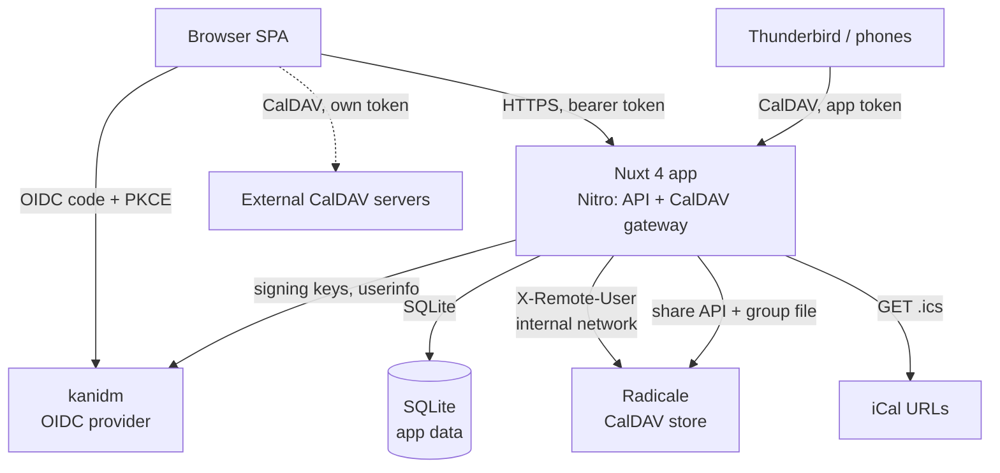
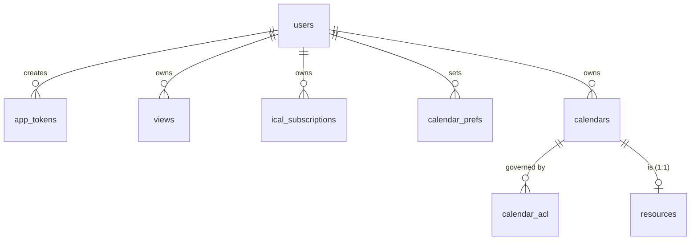
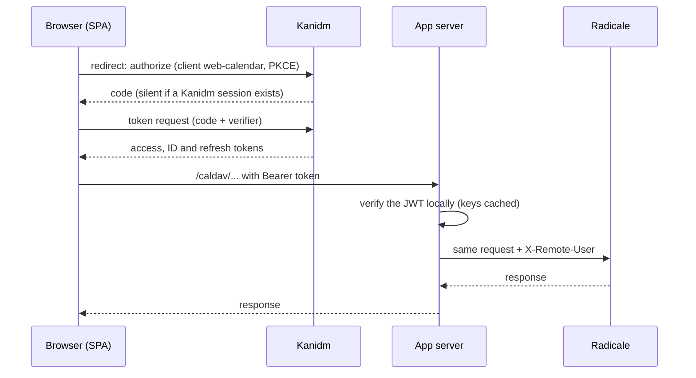

# Web Calendar — Design

> Status: **Draft v1.2** — companion to `requirements.md` (Draft v1.4).
> This document turns the requirements into a concrete technical design.
> v1.2 (2026-10-29), after spike S1: the app bundles Radicale and exposes its own authenticated
> `/caldav/` endpoint (bearer tokens verified locally, app tokens for other clients). Access rules
> are administered in the app and enforced by Radicale. External CalDAV servers are reached from the
> browser. Earlier versions are in git history (v1.1: commit `f7bdfc8`; v1.0: `97a8e44` and earlier).

---

## 1. Overview

A **standalone, self-hosted**, web-based calendar for teams/organizations
(30–50 users) whose defining strength is **aggregating entries from multiple
calendars into a single, unified view**. It replaces GroupOffice calendar.

Key decisions (from the requirements review and the 2026-10-29 interviews):

- **License** — **AGPLv3** (frontend + backend fully AGPLv3-compliant), which lets
  us use **FullCalendar Premium** under its AGPLv3 license.
- **Stack** — **Nuxt 4** (Vue 3 frontend + Nitro backend). The logged-in app is a
  **SPA** (`ssr: false`); Nitro serves the API and the CalDAV gateway. Deployed with
  **Radicale** in one `docker-compose.yml`.
- **Authentication** — **generic OIDC** (currently **kanidm**) with the app's **own
  OAuth2 client**. The SPA runs the login in the browser and keeps its tokens there.
  The server **verifies every token locally** (signature, issuer, audience, expiry
  and scope) against an **allow-list of clients** and stores none.
- **CalDAV** — **Radicale** is the calendar store and is reachable **only** through
  the app. The app's server is the **gateway**: `/caldav/` accepts OIDC bearer
  tokens (the SPA) or Basic auth with **app tokens** (Thunderbird, phones), sets
  `X-Remote-User`, and proxies to Radicale. OpenCloud is not in the CalDAV path.
- **Access control** — administered **in the app** (users, groups, per calendar) and
  **enforced by Radicale** through shares and group files the app maintains, for every client. The app
  never filters events itself.
- **External accounts** — the user can add other CalDAV servers (OIDC, basic or no
  auth). They are called **from the browser**, with tokens kept there.
- **Database** — **SQLite** for **app-level data only**: calendars, access rules,
  views, categories, filters, subscriptions, app tokens and preferences. Events are
  **not** stored.
- **Data freshness** — events are read **live** from Radicale; the browser keeps fetched
  events in memory for 30 s. **No stale data** is ever served: an unreachable source
  shows an error.
- **UI components** — **Nuxt UI v4** (MIT; Reka UI + Tailwind CSS v4), **adopted**
  after trial S3, with the conditions in §9 and §12. Not yet installed in the repo.
- **Events** — recurring events are common; the organization uses **one time zone**
  (`Europe/Berlin`). Editing a recurring event asks what to change (§7).

---

## 2. Licensing

- The project is licensed **AGPLv3**. Both the frontend and backend are fully
  AGPLv3-compliant.
- **FullCalendar Premium** is used under its **AGPLv3 license** (FullCalendar v7),
  with the license key:
  ```js
  schedulerLicenseKey: 'AGPL-My-Frontend-And-Backend-Are-Open-Source'
  ```
- **Implication** — all dependencies must be **AGPLv3-compatible**. AGPLv3 is
  compatible with GPLv3 and permissive licenses (MIT, BSD, Apache-2.0). We must
  **audit any new dependency** for AGPLv3 compatibility before adding it (see §12).
  That includes the transitive dependencies of Nuxt UI (about 60 direct
  dependencies). Trial S3 checked them: see §12 for the result and the one open
  license gap (`vaul-vue`).
- The app is currently run **internally** by the org, so the AGPLv3 network-use
  copyleft is not yet a distribution concern — but we keep the project
  AGPLv3-compliant so the FullCalendar Premium license is valid and so we can
  distribute later if we choose.

---

## 3. Tech Stack

| Layer                   | Choice                                      | Notes                                                                                                                                         |
| ----------------------- | ------------------------------------------- | --------------------------------------------------------------------------------------------------------------------------------------------- |
| Framework               | **Nuxt 4** (Vue 3)                          | Nitro backend and Vue SPA in one codebase; `ssr: false` for the app, SSR only per route if the public view needs it                           |
| UI components           | **Nuxt UI v4** (Reka UI, Tailwind CSS v4)   | Adopted after trial S3. Slideover, dropdown menu, modal, date inputs; keyboard and screen-reader behavior for NFR-3. MIT. Skip `UDrawer` (§9) |
| Calendar UI             | **FullCalendar v7** (Premium, AGPLv3)       | `@fullcalendar/vue3` (subpath plugins); Premium resource views for the split view are under evaluation (S2); package name and key TBC         |
| Database                | **SQLite** via `better-sqlite3`             | App-level data only; WAL mode; migrations are numbered `.sql` files applied by a small runner at startup, with hand-written types             |
| Login (browser)         | An OIDC client library, code flow with PKCE | Candidate `oidc-client-ts` (unverified, licence to check). Tokens in memory or `sessionStorage`; renewal by silent redirect or refresh grant  |
| Token check (server)    | A JOSE library, ES256 JWTs                  | Candidate `jose` (unverified, licence to check). Verifies against each allowed client's published keys (cached); no Kanidm call per request   |
| CalDAV store            | **Radicale** (3.9 in the test stack)        | Bundled in compose, internal network only; `http_x_remote_user` auth; static rights file, sharing by map, `htgroup` groups                    |
| CalDAV gateway          | A **Nitro route** (`/caldav/**`)            | Proxies any WebDAV method with streamed bodies (h3 `proxyRequest`, untested). Header hygiene is security-critical (§7)                        |
| CalDAV client (browser) | `ts-caldav` or `tsdav`                      | _To be verified in a browser_ (custom auth header, XML parsing, bundle size)                                                                  |
| iCal parsing            | **`ical.js`**                               | `.ics` URL subscriptions (read-only), and recurrence expansion where Radicale cannot do it                                                    |
| Caching                 | In-process, short TTL                       | Kanidm signing keys and iCal fetches on the server; fetched events for 30 s in the SPA. No stale fallback                                     |
| Runtime                 | **Node.js** (LTS)                           | Nitro runtime                                                                                                                                 |
| Packaging               | **Docker Compose**                          | `web-calendar` and `radicale`; Kanidm is external                                                                                             |

---

## 4. Architecture

A single Nuxt 4 process serves the **SPA**, the **app API** and the **CalDAV
gateway**. It talks to Radicale on an internal network, to Kanidm for token checks,
to plain iCal URLs, and to a local SQLite file. Browsers and third-party CalDAV
clients only ever talk to the app.



**Components inside the app:**

- **SPA** — sidebar, view types, FullCalendar, split view, account settings, app
  tokens, access administration.
- **App API** (`/api/**`) — views, categories, filters, iCal subscriptions,
  resources, calendars and access rules, app tokens. Every call carries a bearer
  token that is checked as described in §6.
- **CalDAV gateway** (`/caldav/**`, `/.well-known/caldav`) — §7.
- **Sharing writer** — keeps Radicale's map shares and group file in line with the
  access rules (§8).
- **iCal proxy** — fetches `.ics` subscriptions for the browser, which cannot read
  arbitrary URLs cross-origin.
- **Caches** — Kanidm signing keys and iCal fetches (server); fetched events for
  30 s (SPA). Nothing is served stale.

**Why a gateway in the app** — Radicale has no OIDC of its own, and OpenCloud's
proxy accepts tokens from one Kanidm client only (spike S1). With the gateway in the
app, the one trusted party checks tokens, and the same endpoint serves the SPA and
third-party clients.

---

## 5. Data Model

SQLite (single file) holds **app-level data only**. Calendars and events live in
Radicale (or in iCal files and external servers) and are identified by the
calendar's collection path and the event's iCal `UID`; events are never copied
into SQLite.

**Why SQLite (not no-DB)** — we need to persist _and query_ calendars, access
rules, views, categories, filters, subscriptions and app tokens. SQLite (a single
file, WAL mode) does this cleanly and handles the expected concurrency (≤10)
without a separate database server.



**Tables** (key columns; all have `created_at`/`updated_at`):

- **users** — `id` (PK), `oidc_sub` (unique), `username`, `name`, `email`,
  `is_admin`, `last_seen_at`. Created on first use. There is no roles table: admin
  comes from Kanidm group membership (§6).
- **app_tokens** — `id` (PK), `user_id` (FK), `label`, `token_hash`, `expires_at`,
  `last_used_at`. Only the hash is stored; the token is shown once (FR-31).
- **calendars** — `id` (PK), `name`, `kind` (`personal` | `shared` | `resource`),
  `owner_id` (FK, nullable: shared and resource calendars have no personal owner),
  `color`, `collection_path` (where Radicale stores it).
- **calendar_acl** — `id` (PK), `calendar_id` (FK), `principal_type` (`user` |
  `group` | `authenticated` | `public`), `principal` (Kanidm username or group
  name), `permission` (`free_busy` | `read` | `write` | `admin`). Source of truth
  for the rules in §8.
- **views** — `id` (PK), `name`, `icon`, `owner_id` (FK, nullable), `is_admin`
  (bool), `definition` (JSON: ordered list of calendar refs — a `calendars.id`, an
  `ical_subscriptions.id` or an external account's calendar URL — plus colors).
  Admin views are visible to everyone; calendars the viewer cannot access are
  omitted.
- **calendar_prefs** — `user_id` (FK), `calendar_ref`, `color`, `visible`. Per-user
  sidebar toggles and color overrides.
- **categories** — `id` (PK), `name`, `color`, `owner_id` (FK, nullable). Events
  carry categories through the iCal `CATEGORIES` property.
- **filters** — `id` (PK), `owner_id` (FK), `name`, `kind` (`text` | `category` |
  `status`), `value`.
- **ical_subscriptions** — `id` (PK), `owner_id` (FK, nullable = shared), `name`,
  `url`, `color`.
- **resources** — `id` (PK), `calendar_id` (FK, 1:1: the resource's own calendar),
  `name`, `type` (`room` | `car` | `equipment`), `location`, `capacity`.
- **published_calendars** _(planned, FR-26/27)_ — `calendar_id`, `published_by`
  (FK), publish settings.

**Not stored on the server:** external CalDAV accounts (URL, auth mode, tokens).
They live in the user's browser. An admin can ship **preset accounts** through
runtime config.

Compared with v1.1, `sessions` is gone (no server-side tokens) and `calendars`,
`calendar_acl` and `app_tokens` are back or new. `shared/types/calendar.ts` and the
mock data still follow the v1.0 model (local ids, `etag`, `isBlocked`) and are
adapted in Phase 2.

**Resource model (Q12 — hybrid):**

- A **resource is its own calendar** (`kind = resource`, plus a `resources`
  metadata row). It holds **booking events** that mark it unavailable for a time
  range.
- An event in **another** calendar **references/books** a resource. The mechanism
  is decided in Phase 3 (for example `ATTENDEE;CUTYPE=RESOURCE`, or a custom
  property). Booking also creates a block in the resource calendar.
- Radicale grants permissions per collection, not per event. To satisfy FR-18, the
  block in the resource calendar is **opaque**: busy time only, with no title or
  description, plus a back-reference to the booking calendar's event. Everyone who
  may see the resource gets `free_busy` or `read` on it, and the SPA reads details
  from the booking calendar only if the viewer has access to it. Otherwise the
  block stays "blocked".
- **Consequences** — bookers need write access to the resource calendar. FR-19
  (accept/decline) needs a mechanism, either CalDAV scheduling (RFC 6638) or
  app-side state, decided in Phase 3.

---

## 6. Authentication

Standard OIDC **authorization code flow with PKCE**, provider-agnostic via
**discovery**. Currently pointed at **kanidm**; switching providers is a config
change. Three kinds of callers reach the app:

**1. The SPA (own login).** It uses the app's own Kanidm client, **`web-calendar`**
(public, PKCE, consent shown once). The browser is redirected to Kanidm; with an
existing Kanidm session the redirect is silent, otherwise Kanidm shows its login.
The SPA then exchanges the code for tokens itself (Kanidm sends CORS headers on its
OAuth2 endpoints) and keeps them in memory or `sessionStorage`. It sends the access
token as `Authorization: Bearer` to same-origin `/api/**` and `/caldav/**`.



**2. Third-party CalDAV clients.** HTTP **Basic** with the username and an **app
token** the user created in the SPA (FR-31). The server hashes the presented token
and looks it up. Clients that support OIDC may use a bearer token instead.

**3. External CalDAV accounts (generic).** The browser calls the other server
directly, with that account's own login (OIDC, basic or none). Tokens stay in the
browser and never reach the app's server. This needs CORS headers on that server
(verified for Kanidm's endpoints and for Radicale with a `[headers]` setting).

**Server-side token check** (SPA and bearer clients) — decided: **local JWT
verification only**, with no introspection and no per-request call to Kanidm:

- Kanidm's access tokens are ES256 JWTs (`typ: at+jwt`) signed with a key **per
  client**, published at `<issuer>/public_key.jwk`. The config holds an **allow-list**
  of clients, each with its issuer (`https://<kanidm>/oauth2/openid/<client>`); the
  initial list is `web-calendar`. The allow-list is the audience restriction: a token
  from any other client is rejected, however valid it is.
- Checks on every request: algorithm is ES256; signature against the allowed
  client's key (selected by `kid`); `iss` equals the allowed issuer; `aud`/`client_id`
  equals the allowed client; `exp` and `nbf` (with 60 s tolerance); the `caldav`
  **scope** is present. Kanidm accepts a custom scope name in a scope map and returns
  it in the token (tested).
- Keys are cached and refetched, rate-limited, when a token names an unknown `kid`
  (key rotation). Once keys are cached, a Kanidm outage does not affect bearer
  requests.
- **Revocation:** a revoked token keeps working until it expires, at most **15
  minutes**. This is the accepted trade-off for no cache and no Kanidm call per
  request. App tokens are looked up in SQLite and are revoked immediately.
- Introspection (a confidential client sees `active: true` for tokens of any client)
  was tested in S1 and would add revocation checks; it was not chosen.
- **User mapping** — the token's `sub` is the stable key: look up or create the
  `users` row. App tokens map to their owner directly.
- **Radicale user id** — decided: the Kanidm **`sub`** goes into `X-Remote-User`. It
  survives renames; the UUID paths are only seen by the app and by clients'
  discovery.
- **Groups and admin** — Kanidm puts groups in the **ID token and the userinfo
  response**, not in the access token (tested). The scopes `groups`, `groups_name`
  and `groups_spn` add them (tested together; `groups` mixes UUIDs, SPNs and short
  names). For **admin** routes only, the server calls the client's userinfo endpoint
  (`/oauth2/openid/web-calendar/userinfo`) with the caller's bearer token, uncached,
  and checks for the Kanidm group `calendar_admins`. Radicale's group file needs the
  members of whole groups, which come from Kanidm's directory (§8).

**Token lifetime** — access tokens last 900 s. The SPA renews by a silent redirect
(loses unsaved UI state, so the app must save state first) or by the refresh grant,
which works with Kanidm. Keeping a refresh token in the browser raises the impact of
an XSS bug, so it is kept in memory only.

**Libraries** — the browser login uses an OIDC client library (candidate
`oidc-client-ts`, unverified, licence to check). The server verifies JWTs with a JOSE
library (candidate `jose`, unverified, licence to check).

**Security** — `state` and PKCE on the code flow; strict CSP and no third-party
scripts in the SPA; the token-hashing key and the group-sync credential come from the
environment; app tokens are long random strings, hashed, expiring and revocable.

---

## 7. CalDAV gateway and access

The app is the **only** way to Radicale. It is also a **CalDAV client** (in the SPA)
and an **iCal reader**. Events are read **live** and no long-lived copy is kept.

**Gateway (`/caldav/**`, `/.well-known/caldav`)**

- Authenticates as in §6, then forwards to Radicale with `X-Remote-User` set to the
  resolved user and `X-Script-Name: /caldav`.
- **Header hygiene (security-critical):** drop any inbound `X-Remote-User`,
  `X-Script-Name` and `Authorization` before forwarding; never forward cookies;
  allow only the WebDAV/CalDAV methods (`OPTIONS`, `GET`, `HEAD`, `PUT`, `DELETE`,
  `PROPFIND`, `PROPPATCH`, `REPORT`, `MKCOL`, `MKCALENDAR`, `COPY`, `MOVE`); only the
  `/caldav/` prefix reaches Radicale; limit body sizes.
- `/.well-known/caldav` redirects to `/caldav/` so clients can discover the service
  from the host name.
- **No CORS** for the SPA (same origin). An optional allow-list of origins serves
  external browser apps. Unauthenticated `OPTIONS` preflights are answered by the
  gateway; its 401 responses carry the same CORS headers, so a browser sees the
  status instead of a network error.
- The SPA tracks token expiry itself and renews before it lapses.

**SPA reads and writes**

- **Discovery** — `PROPFIND` the user's principal and `calendar-home-set` (the
  principal path is whatever Radicale returns; read it from
  `current-user-principal`). Cached for a few minutes.
- **Event reads** — a `calendar-query` `REPORT` with a `time-range` for the visible
  range, one request per visible calendar, in parallel with a concurrency limit.
  Kept in the SPA's memory for **30 s** per calendar and range (decided), cleared on
  refresh and after the user's own writes. Cost: 10–20 requests per view change.
- **Recurrence (FR-28)** — prefer Radicale's server-side `expand` if it works
  (untested, S4); otherwise expand `RRULE`, `EXDATE` and `RECURRENCE-ID` overrides
  with `ical.js`.
- **Time zone (FR-29)** — all times are shown in the organization time zone,
  `Europe/Berlin` (`TZ`).
- **Writes** — `PUT`/`DELETE` with `If-Match` ETags. On `412` (changed meanwhile)
  tell the user and reload the event. **Editing a recurring event asks what to
  change** (decided): this instance, this and following, or the whole series, with
  "this instance" preselected.
- **iCal subscriptions** — fetched by the server (conditional `GET`, cached for a
  few minutes, read-only) because browsers cannot read arbitrary URLs.
- **External accounts** — the SPA calls them directly, per account.
- **Graceful degradation** (NFR-4) — a failing calendar shows an error with a retry
  and never blocks the others. **No stale data is served** (decided). Once the
  signing keys are cached, a Kanidm outage does not affect bearer requests, and app
  tokens never involve Kanidm.

---

## 8. Access Control

**Administered in the app, enforced by Radicale.** The `calendar_acl` table is the
source of truth. The app turns it into Radicale's own mechanisms, so the web app and
third-party clients behave identically and the gateway only has to authenticate. A
transparent proxy cannot filter individual events, which is why Radicale is the
enforcement point. The mechanics below were **tested in spike S5** (Radicale 3.9.0,
2026-10-29).

| Radicale mechanism                           | Tested behavior                                                                                                                                                                                                                                                               |
| -------------------------------------------- | ----------------------------------------------------------------------------------------------------------------------------------------------------------------------------------------------------------------------------------------------------------------------------- |
| Rights file (`from_file`)                    | Read **once at startup**. A new rule had no effect until a restart; `SIGHUP` stops the server instead of reloading. Keep the file **static**                                                                                                                                  |
| Group file (`htgroup`)                       | Re-read on every request: adding or removing a member took effect immediately                                                                                                                                                                                                 |
| Free/busy permission `f` (rights file)       | The user gets the calendar's metadata and `free-busy-query` (a `VFREEBUSY` without titles), while `calendar-query` and `GET` return 403. This is the "blocked" view of FR-18                                                                                                  |
| Sharing by map (`/.sharing/v1/map/<action>`) | **Live**, no restart. Maps a calendar into another user's home, or into every member of a group (`User: ':group'`, `PathOrToken: '/{user}/name/'`), with per-share permissions. Writes through a `rw` share land in the owner's calendar                                      |
| Share visibility                             | A mapped share appears in `PROPFIND` of the member's home as an ordinary calendar collection, and disappears when the member leaves the group. A **user** share first needs the owner to enable it and the user to accept and unhide it; a **group** share needs none of that |

**Design**

- **Static rights file** — owner-only rules, as in Phase 2 (the stack's
  `radicale/rights`). It is never edited per share.
- **Calendar access** — for each `calendar_acl` entry the app creates a **map share**
  through Radicale's sharing API, acting as the calendar's owner (`X-Remote-User`),
  with `Enabled: true` and `Hidden: false`. `read` → `r`, `write` → `rw`.
- **Groups** — the app writes Radicale's group file from Kanidm's membership: it
  reads the members of the groups used for sharing from Kanidm with a read-only
  **service account**, on a short interval, and also refreshes the caller's groups
  from userinfo (§6). A stale file means stale access, so the interval is a
  security setting. The service account and its read-only token are in
  [kanidm-setup.md](kanidm-setup.md) §3.
- **Team and resource calendars** — owned by a service principal that is not a
  Kanidm user (for example `_team`, `_resources`) and shared to groups. A resource
  calendar is shared so that users see "blocked" entries only (FR-18). The `f`
  permission was tested in the rights file; whether a map share accepts it is
  untested (S5 follow-up).
- **Everyone** — a Kanidm group that contains all users (for example
  `web_calendar_users`) works as the "all users" principal.
- **Third-party clients** — they see shared calendars in their home listing like any
  other calendar. Real clients (Thunderbird, DAVx5, iOS) are untested (S7).
- **Resource rule (Q12)** — §5: opaque busy blocks, details from the booking
  calendar only for users who can read it.
- **App-level permissions** — **admin** (the Kanidm group `calendar_admins`) may
  create admin views, manage calendars and access rules, and edit resource
  metadata. Users own their personal views, filters, categories, subscriptions and
  app tokens.
- **Public view** _(planned)_ — no logged-in user, so it reads **only** the calendars
  in `published_calendars` with a service credential, read-only. Decided when the
  feature is scheduled.
- **Defense in depth** — Radicale listens only on the internal network. A bug in the
  gateway's header handling would let a caller pick their own identity, so the header
  rules in §7 are tested explicitly.
- **Limits** — shares are rows in a CSV database (or files); behavior with many
  shares is untested.

---

## 9. Frontend / UI

Built on the **GroupOffice** baseline (FR-21…FR-25), mobile-friendly (FR-20).

- **Left sidebar** (top → bottom): **views** (icon + `⋯` menu), **calendars**
  (visibility toggle), **resources** (visibility toggle), **categories** (add
  control), **filters** (add control + chooser).
- **View-type switcher** (FR-22): **day, 5-day, week, month, year, split, list**.
- **Date navigation** (FR-23): previous / **today** / next.
- **Quick-add** (FR-24) and **overflow (`⋮`) menu** (FR-25).
- **Accounts and tokens** — Settings shows the **built-in calendar service** (preconfigured, same
  origin), **external CalDAV accounts** (URL plus OIDC, basic or no auth; their tokens stay in
  the browser), **app tokens** for Thunderbird and phones (FR-31) and, for admins, **calendars
  and access rules** (Phase 3).
- **SPA** — the logged-in app runs with `ssr: false`: no hydration mismatches, and
  no server/browser difference in what "today" is. FullCalendar needs no
  `<ClientOnly>` on SPA routes.
- **Components (NFR-3)** — **Nuxt UI v4** (adopted, trial S3) supplies the
  slideover (mobile sidebar drawer), dropdown menus (`⋯`, `⋮`), the modal for
  quick-add and the event sheet, and date inputs. The trial confirmed focus moving
  into an opened dialog, `aria-labelledby`/`aria-describedby`, page scroll lock,
  Escape to close, focus returning to the trigger, and menu roles with arrow-key
  navigation. Conditions:
  - Wrap the app's global element rules (`button`, `a`, …) in `@layer base`. They
    are unlayered, so they override Nuxt UI's layered styles and leave its buttons
    unstyled.
  - Do **not** use `UDrawer`: it depends on `vaul-vue`, which is unmaintained and
    ships no license metadata (§12). Use `USlideover` and `UModal`.
  - Defaults are 32 px high (buttons, menu items, close buttons), below the 44 px
    tap-target rule. Override the sizes before Step 8; not yet tested.
  - Wrap the app in `<UApp>` and import Tailwind and Nuxt UI in the main CSS file.

  Fallback if a blocker appears: Reka UI (headless) with the existing CSS tokens.

- **FullCalendar v7** (`@fullcalendar/vue3`, plugins via subpath imports) renders
  the day/week/month/list views.
- **Split view (FR-6)** — **every** calendar in the selected view gets its **own
  horizontal band** (no overlap); a band that is **empty for the current view** is
  **hidden**. Direction (decided 2026-10-29): **evaluate FullCalendar Premium
  resource views**, with each calendar as a resource row/band (spike S2). Fallback:
  **one FullCalendar instance per calendar**, stacked vertically, with
  **synchronized date navigation**. Either way it must stay readable at 10–20
  calendars (NFR-1) and on a 360 px phone; whether a resource timeline does is
  part of S2. Extending split to **all** view types is a **planned experiment**
  (post-initial-release), not a requirement.
- **Mobile** — responsive layout; the sidebar collapses; the split view stacks
  bands vertically.
- **Editability (Phase 1)** — the mock-up is **read-only rendering plus
  quick-add**; clicking/tapping an event opens the event details/edit sheet.
  Drag/resize editing is **not** a Phase 1 acceptance criterion and is deferred
  to Phase 2 (FR-9, two-way writes), where it must be backed by the real API.
  Quick-add (FR-24) is the Phase 1 creation path.

### FullCalendar v7 integration notes

- **Imports** — v7 moved the plugins into the framework package. Import from
  subpaths: `@fullcalendar/vue3/daygrid`, `@fullcalendar/vue3/timegrid`,
  `@fullcalendar/vue3/list`, `@fullcalendar/vue3/interaction`,
  `@fullcalendar/vue3/multimonth`, … `@fullcalendar/core` is a v7 types stub;
  do **not** depend on it directly. `temporal-polyfill` is required.
- **SSR** — FullCalendar renders **empty on the server**. The app is an SPA, so
  this only matters for a server-rendered route (for example the public view);
  there, mount it inside `<ClientOnly>` to avoid hydration mismatches.
- **CSS** — import `skeleton.css` **and** one theme stylesheet (for example
  `@fullcalendar/vue3/themes/classic/theme.css`); without the theme the calendar
  is unstyled. With Tailwind v4 (S3), FullCalendar rendered correctly: its CSS is
  unlayered, so it wins over Tailwind's layered base styles.
- **Interaction** — `editable` and `selectable` default to **`false`**. Dragging,
  resizing and selection require the **`interaction`** plugin; date clicks and
  selections are registered by the same plugin.
- **Touch** — v7 uses `PointerDragging`. Long-press starts drag/selection:
  `longPressDelay` defaults to **1000 ms**; `eventLongPressDelay` and
  `selectLongPressDelay` override it per interaction. Long-press is **not
  discoverable**, so every touch flow needs a visible alternative.
- **Sizing** — v7 resizes automatically via `ResizeObserver`;
  `handleWindowResize` no longer exists. Use `height`/`contentHeight`,
  `aspectRatio`, `expandRows`, `dayMaxEvents`/`dayMaxEventRows`, `dayNarrowWidth`,
  `eventMinWidth`, `eventMinHeight`, `eventShortHeight`, `slotMinWidth`, and
  per-view `views` overrides instead of viewport media queries inside the
  calendar.
- **Mobile** — drag/resize on touch is error-prone. Provide **explicit edit
  affordances** (tap event → sheet with Edit/Delete; quick-add button) and keep
  tap targets ≥ 44 px. Never make long-press the only path to an action.

---

## 10. Deployment

A **`docker-compose.yml`** with two services: the app (Nuxt 4 / Nitro) and Radicale.
Kanidm is an existing external service. Radicale has **no published port**: only the
app can reach it. The SQLite file and Radicale's data live on named volumes.

```yaml
# docker-compose.yml (example)
services:
  web-calendar:
    image: web-calendar:latest
    restart: unless-stopped
    ports:
      - '127.0.0.1:3000:3000'
    environment:
      # OIDC (generic; currently kanidm)
      NUXT_OIDC_ISSUER: 'https://idm.example.com/oauth2/openid/web-calendar'
      NUXT_OIDC_CLIENT_ID: 'web-calendar' # public client used by the SPA
      NUXT_OIDC_ALLOWED_CLIENTS: 'web-calendar' # clients whose JWTs the gateway accepts
      # Group membership for Radicale's group file: read-only Kanidm API token (kanidm-setup.md §3)
      NUXT_GROUP_SYNC_TOKEN: '${NUXT_GROUP_SYNC_TOKEN}'
      NUXT_GROUP_SYNC_INTERVAL_SEC: '60'
      # CalDAV store (internal)
      NUXT_RADICALE_URL: 'http://radicale:5232'
      TZ: 'Europe/Berlin'
    volumes:
      - web-calendar-data:/data # SQLite file
      - radicale-rules:/rules # rights and group files written by the app
  radicale:
    image: ghcr.io/kozea/radicale:3.9.0 # the project's own image
    restart: unless-stopped
    volumes:
      - radicale-data:/var/lib/radicale
      - radicale-rules:/etc/radicale/rules:ro
volumes:
  web-calendar-data:
  radicale-data:
  radicale-rules:
```

- **Config via env vars.** Secrets (the group-sync credential, the token-hashing key)
  are injected at runtime, not baked into the image. The server needs no Kanidm
  client secret: it only verifies public-key signatures.
- **Kanidm setup** — the commands for the groups, the public client and its scopes are
  in [kanidm-setup.md](kanidm-setup.md).
- **Radicale config** — `auth.type = http_x_remote_user`; `rights.type = from_file`
  with a static owner-only file; `[group] type = htgroup` and `[sharing] type = csv`
  with `collection_by_map = true` (§8); no CORS headers (same origin). The volume
  `radicale-rules` holds the group file the app writes.
- **Obsolete settings** — `NUXT_SYNC_INTERVAL_MIN` belongs to the v1.0 sync worker.
  `NUXT_CALDAV_BASE_URL` becomes the internal Radicale URL. The example in the repo
  (`docker-compose.yml`, `.env.example`, `nuxt.config.ts`,
  `server/validate-config.mjs`) still carries the old names; it is replaced with the
  Phase 2 work (§12).
- **Persistence and backup** — the SQLite file and Radicale's data are the two things
  to back up.
- **Build** — a multi-stage Dockerfile (build the Nuxt app, then run it on a slim
  Node image). `better-sqlite3` ships prebuilt binaries, so no native build is
  needed in the image.
- **Test stack** — `dev/spike-s1` runs Kanidm and Radicale (the project's own image) for
  experiments (it earlier also ran OpenCloud and oauth2-proxy, spike S1). It is not
  part of the app.

---

## 11. Phasing

Aligned with the requirements' delivery phasing (all requirements are in scope;
this is the **order**):

| Phase                        | Focus                                                                                 | Key requirements                                         | Design pieces                                                                                                                     |
| ---------------------------- | ------------------------------------------------------------------------------------- | -------------------------------------------------------- | --------------------------------------------------------------------------------------------------------------------------------- |
| **1 — UI shell / mock-up**   | The webpage + a mock-up of all UI (sidebar with views at top, view types incl. split) | FR-21…FR-25, FR-6, FR-20                                 | §9 (sidebar, view types, split view mock-up, mobile); trial S2                                                                    |
| **2 — Core calendar + auth** | Calendar features, authentication, the CalDAV gateway (owner-only access)             | FR-7…FR-13, FR-30, FR-31, FR-3…FR-5, FR-20, FR-28, FR-29 | §6 (login, local JWT verification, app tokens), §7 (gateway, reads, writes, recurrence), §5 (users, tokens, calendars); S4, S6–S8 |
| **3 — Organizational**       | Grouping/views, resources, sharing and access administration                          | FR-1…FR-2, FR-14…FR-19                                   | §8 (access rules, rules writer, sharing), §5 (views, resources, ACL); S5                                                          |

---

## 12. Open Items / Risks

### Spikes

- **S1 — Calendar access with Kanidm tokens. Done 2026-10-29.** Test stack:
  `dev/spike-s1` (Kanidm 1.11.2, OpenCloud 9.0.0, Radicale 3.9.0, oauth2-proxy
  7.15.5); details in its README.
  - OpenCloud's `/caldav/` accepts OIDC bearer tokens, but **only from the one
    Kanidm client it is configured with** (`web`). A token from another client gets
    401: `key ID was not found in the JWKS`. Userinfo verification fails the same
    way. Kanidm scopes the issuer, signing keys and userinfo endpoint per client;
    OpenCloud has a single issuer. Kanidm's token exchange returned
    `invalid_request` for every request shape tried.
  - Kanidm's **introspection** endpoint, called by a confidential client, reports
    `active: true` for tokens of other clients (`client_id`, `aud`, `username`, `sub`,
    `scope`, `exp`). oauth2-proxy with extra JWT issuers also accepted both clients.
  - Kanidm access tokens are ES256 JWTs valid for 900 s and carry only `sub`; name,
    email and groups are in the ID token. The refresh grant works.
  - **Browser:** Kanidm sends `Access-Control-Allow-Origin: *` on discovery, JWKS,
    userinfo and the token endpoint (including successful token responses).
    OpenCloud sends no CORS headers on `/caldav/`; Radicale's `[headers]` setting
    fixes that, but OpenCloud's own 401s carry none. An nginx gateway handled CORS
    on 401s too. Checked with `Origin` headers, not in a real browser (the browser
    does not trust the test CA).
  - **Radicale 3.9.0:** rights backends `authenticated`, `owner_only` (default),
    `owner_write`, `from_file` (regex rules, first match wins, permission letters
    `R r W w f` and more); `[group]` backends `none`, `from_auth`, `htgroup`;
    `[sharing]` (by token or by map, `csv` or `files` database). No WebDAV ACL is
    documented. Not tested.
  - **Decision (this design):** the app is the gateway and verifies tokens locally
    against an allow-list of Kanidm clients (§6); OpenCloud is not in the CalDAV
    path. It can still be added as a generic external account using its own client
    `web`.
- **S2 — FullCalendar Premium split view (before Step 7).** Confirm the v7 Premium
  package and subpath names (v1.0 named `@fullcalendar/vue3-scheduler`; the README
  says only `@fullcalendar/vue3` is installed), wire the AGPL license key, and
  prototype resource views with calendars as rows at 10–20 calendars. Check
  readability at 360×640 and 640×360, empty-band hiding and sticky labels.
  _Fallback:_ one instance per calendar (§9).
- **S3 — Nuxt UI trial. Done 2026-10-29: adopt.** Run in a throwaway copy inside the
  Dev Container (the repo was not changed): `@nuxt/ui` 4.12.0 and Tailwind CSS v4 on
  the current Nuxt 4.6 / FullCalendar 7.1 project, with a page using a slideover,
  drawer, modal, dropdown menu and a FullCalendar month grid.
  - _Works:_ `nuxt build`; `npm run check` (Prettier, ESLint 10, `nuxt typecheck`);
    FullCalendar renders correctly next to Tailwind; keyboard and focus behavior of
    the slideover and dropdown menu (§9); icons are served by the app itself
    (`/api/_nuxt_icon`), with no request to `api.iconify.design` observed.
  - _Size_ (client, raw / gzip): the current app is 195 kB / 70 kB JS and 7 kB / 2 kB
    CSS. Adding a FullCalendar month page gives 432 kB / 141 kB JS and 23 kB / 6 kB
    CSS. Adding Nuxt UI with four overlay components gives 822 kB / 258 kB JS and
    223 kB / 32 kB CSS.
  - _Dependencies:_ 195 packages added (176 MIT, 12 MPL-2.0 `lightningcss` binaries
    that are build-time only, 5 Apache-2.0, 1 CC0, 1 without license metadata). The
    server runtime in `.output` has 42 packages: MIT, Apache-2.0 and BSD, plus
    `vaul-vue`. MPL-2.0 is compatible with AGPLv3 through its secondary-license
    clause.
  - _Audit:_ 7 low and 1 high before, 8 low and 1 high after, in the same
    Nuxt/Nitro chain.
  - _Install scripts:_ npm 11 asks for `allowScripts` entries for a second `esbuild`
    (0.27.7) and `vue-demi`.
  - _Not tested:_ touch behavior, screen readers, colour contrast, `UDrawer`
    swiping, and the 44 px tap-target overrides.
  - _Open license gap:_ `vaul-vue` 0.4.1 (pulled in by `UDrawer`) has no `license`
    field and no license file in its npm package. Its GitHub repository (unovue)
    states MIT and says the package is no longer maintained, recommending Reka UI's
    Drawer. Treat it as unverified until the AGPL audit in §2 is signed off, and
    avoid `UDrawer`.
- **S4 — Radicale and recurrence.** Does Radicale support `expand` in
  `calendar-query`? Does its `time-range` filter handle recurring events correctly?
  Is `free-busy-query` available (useful for resources)? Test in the bundled stack.
- **S5 — Radicale access mechanics. Done 2026-10-29.** Tested directly against
  Radicale 3.9.0 in `dev/spike-s1` with `X-Remote-User` set to Kanidm `sub` values;
  results are in the table in §8.
  - The rights file is static (restart needed); group files and map shares are live;
    `f` gives the free/busy-only view; group and user shares list in a member's
    home as calendars and honor `r` and `rw`.
  - _Still open:_ `f` as a share permission; real clients (S7); how the app reads
    group membership from Kanidm (service account, interval); behavior with many
    shares.
- **S6 — Gateway prototype (start of Phase 2).** In Nitro: proxy `PROPFIND`/`REPORT`
  with streamed bodies; header hygiene tests (a client-sent `X-Remote-User` must not
  survive); local JWT verification (algorithm, `typ`, `kid` rotation, `iss`, `aud`,
  `exp`/`nbf`, `caldav` scope, rejection of tokens from non-listed clients and of
  ID tokens used as access tokens); behavior with Kanidm unreachable and with a cold
  key cache. Already tested on the stack: the `caldav` scope appears in tokens, and
  groups are in the ID token and userinfo, not in the access token.
- **S7 — Third-party clients.** Thunderbird, DAVx5 and iOS against `/caldav/` with
  app tokens (Basic) and via `/.well-known/caldav`; discovery of personal and shared
  calendars; OIDC-capable clients with bearer tokens.
- **S8 — Real-browser login.** The SPA code + PKCE flow with a certificate the
  browser trusts (for example mkcert): consent, silent renewal, state preservation,
  CORS to an external account, and whether `ts-caldav` or `tsdav` work in the
  browser.
- **S9 — Reading group membership from Kanidm. Done 2026-10-29.** A fresh service
  account cannot read groups: `GET /v1/group/<name>` returned `null`, also in
  `idm_service_desk`. Kanidm 1.11.2 has no CLI or API for custom access profiles and
  no read-only group-read group. **Working route:** put the service account in
  `idm_group_admins` and use its **read-only API token** (the default): the token
  lists group members (`member` attribute) and a write attempt returns 403 with the
  membership unchanged. The `groups` scope does not help here: it only puts the
  _caller's_ groups into that user's own tokens. _Residual:_ the account's group has
  write power, so the read-only flag is the only barrier; use an expiry and never a
  `--readwrite` token. _Alternative to try later:_ Kanidm's LDAP interface with a
  service-account bind.

### Risks and decisions still open

- **Group membership from Kanidm** — decided: a service account polled every **60 s**.
  The group file needs whole-group membership, which tokens do not carry, and the
  account reads them with a read-only token (S9, residual risk: the account's group
  has write power). The interval is a security setting: a removed member keeps
  access for up to 60 s. Needs handling of Kanidm being unreachable
  (keep the last file, log loudly).
- **Gateway is security-critical** — header spoofing, open-proxy paths and request
  limits must be tested (S6).
- **Revocation latency** — a revoked bearer token works until it expires, at most 15
  minutes (decided: local JWT verification only). App tokens are revoked at once.
- **Tokens in the browser** — XSS exposure; strict CSP, no third-party scripts,
  refresh token in memory only. App tokens are long-lived secrets: hashed, expiring.
- **Share and group writer correctness** — reconcile the desired state from
  `calendar_acl` against Radicale's share list and group file; atomic file writes;
  retries when Radicale is unreachable; stale membership. Test with fixtures.
- **Live-fetch latency** — 10–20 requests per view change, and no local copy when
  Radicale is down (decided: an error, no stale data). Measure with the 30 s
  in-browser cache.
- **Recurring edits** — decided: ask each time, "this instance" preselected. The
  mechanics ("this and following" splits a series with `UNTIL` and a new `UID`;
  "this instance" writes a `RECURRENCE-ID` override) need a design before Phase 2
  writes.
- **Resource booking mechanism and FR-19** — how events reference a resource, and
  how accept/decline works (CalDAV scheduling or app-side state). Phase 3.
- **Public view credentials** — service credential and published list. Decided
  when the feature is scheduled.
- **AGPLv3 dependency audit** — confirm every dependency is AGPLv3-compatible before
  adding it (the core stack above is; new deps must be checked, including the
  browser OIDC library and CalDAV client).
- **Touch interaction gap** — long-press is the only built-in touch gesture for
  drag/selection and is not discoverable. Every action needs a visible,
  keyboard-reachable alternative; verify at 360×640 portrait and 640×360
  landscape.
- **FullCalendar licensing** — Premium views (resources/timeline) need the
  FullCalendar Premium license. §2 records the intended **AGPLv3** key, but the
  key is not wired into the app yet and no Premium view is used in Phase 1. Wire
  it in S2.
- **Editing scope** — Phase 1 is read-only + quick-add. Enabling `editable`
  without a real store would fake persistence; drag/resize stays off until
  Phase 2 wires the API.
- **Dependency audit** — the S3 baseline showed 7 low and 1 high findings in the
  Nuxt/Nitro chain (`node-forge` via `listhen`); no patched version exists yet. Do
  not run `npm audit fix --force` (it downgrades Nuxt). Re-check on every upstream
  release.
- **Quality tooling** — Vite+ was removed on 2026-10-29 (too new: it forced `vite`
  to a fork through `overrides`). Replacement: ESLint 10 (`@nuxt/eslint`) +
  Prettier (single quotes, no semicolons, 100 columns) + `nuxt typecheck`, with
  `npm test` running plain `vitest run`. `npm run check` and `npm test` pass in the
  Dev Container. TypeScript is held at 5.9 until `vue-tsc` support for TypeScript 7
  is verified.
- **Startup config validation** — `server/validate-config.mjs` exits when the OIDC
  or CalDAV variables are empty, so the Phase 1 container only starts with
  placeholder values (copy `.env.example`). Update it for the new variable names
  (§10) when Phase 2 starts, or relax it until then.
- **SPA switch** — `ssr: false` is decided but not yet applied to the code; the
  stray `ssrStreaming` flag has already been removed.
- **Browser-level tests** — only unit tests exist; nothing checks the responsive
  matrix (360×640, 640×360, 768×1024, 1280×800). Pick a browser test tool before
  Step 8.
- **Database migrations** — decided: numbered `.sql` files and a small runner
  applied at startup, with hand-written TypeScript types. Revisit Drizzle if the
  types drift.
- **SQLite under concurrency** — app data is small and WAL handles the expected
  load (≤10 concurrent); if load grows, migrate to Postgres (the data model is
  portable).

---

## 13. Phase 1 — Implementation Steps

Phase 1 is the **UI shell / mock-up**: a working mock-up of **all** the UI
(sidebar with views at the top, every view type incl. split, mobile), driven by
**mock data** — no real backend, auth, or CalDAV calls yet. It satisfies
**FR-21…FR-25, FR-6, FR-20** (design §9).

Trial **S3** (Nuxt UI) is done and adopted (§12); run trial **S2** (Premium split
view) before Step 7, because its outcome changes that step.

| Step | What                       | Requirements               |
| ---- | -------------------------- | -------------------------- |
| 1    | Project scaffolding        | —                          |
| 2    | Mock data layer            | —                          |
| 3    | App shell / layout         | FR-20                      |
| 4    | Sidebar                    | FR-21                      |
| 5    | Top bar                    | FR-22, FR-23, FR-24, FR-25 |
| 6    | Main area — standard views | FR-22                      |
| 7    | Split view                 | FR-6                       |
| 8    | Mobile                     | FR-20                      |
| 9    | Polish / review            | all of the above           |

**Step 1 — Project scaffolding**

- Initialize a **Nuxt 4** project; add **FullCalendar v7** (`@fullcalendar/vue3`;
  Premium packages only once a license key is available, §2).
- Add the **Docker** container + `docker-compose.yml` (§10) and a dev workflow
  (`npm run dev`).
- _Acceptance:_ `npm run dev` serves the app; `docker compose up` builds and runs
  the container.

**Step 2 — Mock data layer**

- A single mock-data module that provides **views, calendars, resources,
  categories, filters, and events** — enough to populate every UI section and to
  exercise the split view (incl. some **empty** calendars to test band-hiding).
- _Acceptance:_ the module exports the mock data; the UI can import it.

**Step 3 — App shell / layout**

- The overall layout: **left sidebar + top bar + main area**, responsive.
- Run the app as a **SPA** (`ssr: false`). Once switched, the SSR-only workarounds
  (the `useState` date anchor in `useMockData`) are no longer needed.
- Sidebar: fixed on desktop, **off-canvas drawer** (with a visible toggle and
  backdrop) below 768 px. Top bar wraps or scrolls horizontally instead of
  clipping. The main area fills the remaining viewport height so the calendar
  scrolls internally rather than the page.
- Keep the viewport meta tag (`width=device-width, initial-scale=1`) and use
  CSS breakpoints; do not branch layout on user-agent.
- _Acceptance:_ the three regions render; **no horizontal page scroll** at
  360×640, 640×360 (landscape), 768×1024 and 1280×800; the sidebar toggle is
  reachable and closes the drawer; content is not clipped at 200 % zoom.

**Step 4 — Sidebar (FR-21)**

- Sections top → bottom: **views** (icon + `⋯` menu), **calendars** (visibility
  toggle), **resources** (visibility toggle), **categories** (add control),
  **filters** (add control + chooser) — all from mock data.
- Build the drawer and menus with Nuxt UI (adopted; conditions in §9): install
  `@nuxt/ui` and Tailwind, wrap the app in `<UApp>`, and move the global element
  rules into `@layer base`. Replace the hand-rolled mobile drawer from Step 3 with
  `USlideover`.
- _Acceptance:_ every section renders with mock data; toggles/menus are
  interactive.

**Step 5 — Top bar (FR-22, FR-23, FR-24, FR-25)**

- **View-type switcher** (day, 5-day, week, month, year, split, list), **date
  navigation** (prev / today / next), **quick-add**, **overflow (`⋮`) menu**.
- Quick-add opens a form (title, calendar, start/end) and appends the event to
  the **in-memory mock store**, so the new event appears in the current view.
- The switcher exposes the current view (`aria-pressed` or a tablist); the
  overflow menu closes on Escape/outside click and returns focus to its trigger.
- On mobile, keep all controls reachable: the switcher scrolls horizontally and
  every control has a **≥ 44 px** tap target. Quick-add must be a visible button
  or FAB, never a long-press or hover action.
- _Acceptance:_ switching view type and navigating dates updates the main area;
  quick-add adds a visible event; overflow opens and closes by keyboard; all
  controls are keyboard-operable (touch-only verification is Step 8).

**Step 6 — Main area, standard views (FR-22)**

- Integrate **FullCalendar v7**; register the `daygrid`, `timegrid`, `list` and
  `interaction` plugins via their `@fullcalendar/vue3/*` subpaths; import
  `skeleton.css` plus a theme stylesheet. In the SPA, `<ClientOnly>` is not
  needed.
- Set `editable: false` and `selectable: false` in Phase 1. Event click/tap
  opens the event details/edit sheet; date click may open quick-add.
- Use the sizing options from §9 (`height`/`contentHeight`, `dayMaxEvents`,
  `dayNarrowWidth`, `eventMinHeight`, per-view overrides) so month and time-grid
  views stay legible on narrow screens.
- _Acceptance:_ day, 5-day, week, month, year and list render mock events;
  switching views preserves the selected date; **no console errors**; event click
  opens the sheet; nothing is editable by accident (no drag/resize handlers
  registered while `editable` is off).

**Step 7 — Split view (FR-6)**

- Implement the direction chosen in spike S2: **Premium resource views** with the
  calendars as rows, or the fallback of **one FullCalendar instance per
  calendar**, stacked vertically, with **synchronized date navigation**. Either
  way, **hide bands that are empty** for the current view.
- Give each band a **sticky calendar label** (name + colour) so bands stay
  identifiable while scrolling; share one date/view state and push it to every
  instance (fallback) instead of letting each band navigate independently.
- Keep the options consistent (`height`, `dayMaxEvents`, view overrides); avoid a
  nested page scroll.
- _Acceptance:_ every non-empty calendar in the selected view gets its own band;
  empty bands are hidden; prev/today/next and view switches stay synchronized
  across bands; 9 calendars remain scrollable without layout breakage on desktop
  and mobile.

**Step 8 — Mobile (FR-20)**

- Responsive layout (sidebar drawer, top bar from Step 5); the split view stacks
  bands vertically (the natural mobile layout).
- Touch model: **tap** opens the event sheet; **long-press** is only a
  supplementary shortcut (default 1000 ms), never the only path. Provide visible
  Edit/Delete actions in the sheet, and keep drag/resize disabled until Phase 2.
- Tune FullCalendar for narrow widths (`dayMaxEvents`, `dayNarrowWidth`,
  `eventMinWidth`, `eventMinHeight`, `eventShortHeight`, `slotMinWidth`,
  `aspectRatio`) and verify both portrait and landscape.
- _Acceptance:_ on 360×640 and 640×360 touch viewports, every user-facing Phase 1
  task is doable **with touch only**: switch views, navigate dates, open the
  sidebar, quick-add an event, open an event sheet. No horizontal page scroll,
  no hover-only action, tap targets ≥ 44 px, and the split view remains readable.

**Step 9 — Polish / review**

- Review the mock-up against **FR-21…FR-25, FR-6, FR-20**; polish styling and
  spacing. Check keyboard reachability, focus visibility, colour contrast,
  `aria` labels, and reduced-motion preferences.
- Re-check the §9 integration notes: subpath imports only, no direct
  `@fullcalendar/core`, theme CSS, no console errors.
- Record any new findings in this document and the README.
- _Acceptance:_ the mock-up matches the requirements; `npm run check`,
  `npm test` and `npm run build` pass in the Dev Container; the responsive
  matrix (360×640, 640×360, 768×1024, 1280×800) and keyboard/touch paths are
  verified;
  `npm audit` output is unchanged or explained.

**Definition of done (Phase 1)** — a single Docker container runs a Nuxt 4 SPA
that shows the full sidebar (views/calendars/resources/categories/filters), the
top bar (view-type switcher, date nav, quick-add, overflow), every standard view
plus the split view (with empty-band hiding), all from mock data and with only
placeholder OIDC/CalDAV configuration. Quick-add creates an in-memory event,
events open the event details/edit sheet, and every user-facing Phase 1 task is
usable with touch only on 360×640 portrait and 640×360 landscape viewports.
