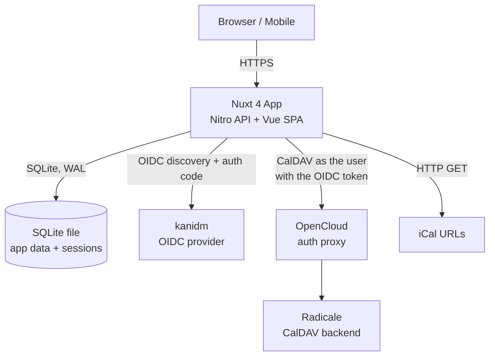
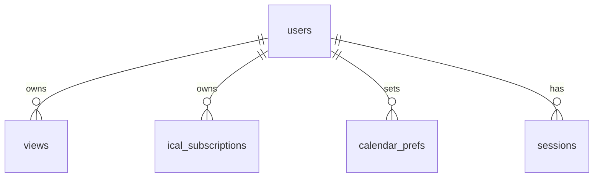
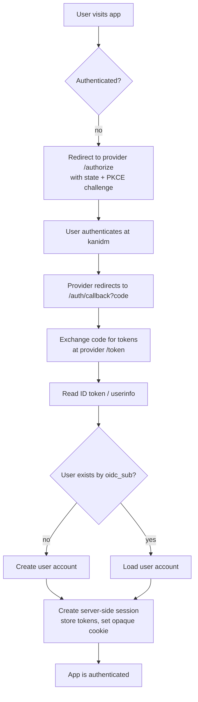
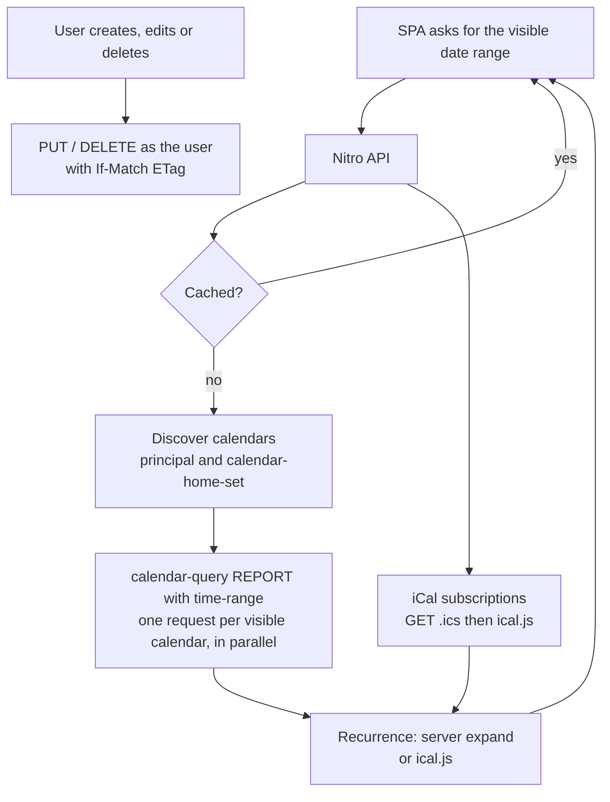

# Web Calendar — Design

> Status: **Draft v1.1** — companion to `requirements.md` (Draft v1.3).
> This document turns the requirements into a concrete technical design.
> v1.1 (2026-10-29): access control moves to the CalDAV backend, background sync is
> replaced by live fetch, the app becomes an SPA, and the spikes in §12 are added.
> The v1.0 design is in git history (commit `97a8e44` and earlier).

---

## 1. Overview

A **standalone, self-hosted**, web-based calendar for teams/organizations
(30–50 users) whose defining strength is **aggregating entries from multiple
calendars into a single, unified view**. It replaces GroupOffice calendar.

Key decisions (from the requirements review and the 2026-10-29 interview):

- **License** — **AGPLv3** (frontend + backend fully AGPLv3-compliant), which lets
  us use **FullCalendar Premium** under its AGPLv3 license.
- **Stack** — **Nuxt 4** (Vue 3 frontend + Nitro backend) in a **single Docker
  container**. The logged-in app is a **SPA** (`ssr: false`); Nitro serves the API.
  The planned public view may opt into SSR per route.
- **Database** — **SQLite** (single file) for **app-level data only**: views,
  categories, filters, iCal subscriptions, resource metadata, preferences and
  server-side sessions. Calendars and events are **not** stored.
- **Auth** — **generic OIDC** (currently **kanidm**). The user's OIDC token is also
  used to call the CalDAV backend.
- **CalDAV backend** — **Radicale** behind **OpenCloud** as an auth proxy. The app
  is a **CalDAV client** that calls it **as the signed-in user** and **fetches
  live** with a short cache. The **backend enforces access control**, and two-way
  writes (planned for the initial release, may slip) go straight through to it.
  Whether OpenCloud/Radicale accepts the user's token is **unverified** (spike S1);
  the fallback is in §8.
- **UI components** — **Nuxt UI v4** (MIT; Reka UI + Tailwind CSS v4) for the drawer,
  menus and dialogs, **pending trial S3**.
- **Events** — recurring events are common; the organization uses **one time
  zone**.

---

## 2. Licensing

- The project is licensed **AGPLv3**. Both the frontend and backend are fully
  AGPLv3-compliant.
- **FullCalendar Premium** is used under its **AGPLv3 license** (FullCalendar v7),
  with the license key:
  ```js
  schedulerLicenseKey: 'AGPL-My-Frontend-And-Backend-Are-Open-Source'
  ```
- **Implication** — all dependencies must be **AGPLv3-compatible**. AGPLv3 is
  compatible with GPLv3 and permissive licenses (MIT, BSD, Apache-2.0). We must
  **audit any new dependency** for AGPLv3 compatibility before adding it (see §12).
  That includes the transitive dependencies of Nuxt UI (about 60 direct
  dependencies); the license check is part of trial S3.
- The app is currently run **internally** by the org, so the AGPLv3 network-use
  copyleft is not yet a distribution concern — but we keep the project
  AGPLv3-compliant so the FullCalendar Premium license is valid and so we can
  distribute later if we choose.

---

## 3. Tech Stack

| Layer         | Choice                                                                   | Notes                                                                                                                                 |
| ------------- | ------------------------------------------------------------------------ | ------------------------------------------------------------------------------------------------------------------------------------- |
| Framework     | **Nuxt 4** (Vue 3)                                                       | Nitro backend and Vue SPA in one codebase/deployable; `ssr: false` for the app, SSR only per route if the public view needs it        |
| UI components | **Nuxt UI v4** (Reka UI, Tailwind CSS v4) — _pending trial S3_           | Drawer/slideover, dropdown menu, modal, date inputs; keyboard and screen-reader behavior for NFR-3. MIT                               |
| Calendar UI   | **FullCalendar v7** (Premium, AGPLv3)                                    | `@fullcalendar/vue3` (subpath plugins); Premium resource views for the split view are under evaluation (S2); package name and key TBC |
| Database      | **SQLite** via `better-sqlite3`                                          | App-level data and sessions only; WAL mode; migration approach TBD                                                                    |
| Auth          | **OIDC** via `nuxt-auth-utils` https://github.com/atinux/nuxt-auth-utils | _To be verified:_ needs generic discovery, PKCE and access to the user's tokens; otherwise use a dedicated OIDC client library        |
| CalDAV client | **`ts-caldav`** https://github.com/KlautNet/ts-caldav                    | _To be verified (S1, S4)_ against Radicale behind OpenCloud. Called as the user: queries by time range, `PUT`/`DELETE` with ETag      |
| iCal parsing  | **`ical.js`**                                                            | `.ics` URL subscriptions (read-only), and recurrence expansion where the server cannot do it                                          |
| Caching       | In-process, short TTL                                                    | Per user + calendar + date range; no scheduler, no worker                                                                             |
| Runtime       | **Node.js** (LTS)                                                        | Nitro runtime                                                                                                                         |
| Packaging     | **Docker** (single container)                                            | + `docker-compose.yml` example                                                                                                        |

---

## 4. Architecture

A single Nuxt 4 process serves the **frontend** (a SPA) and the **backend**
(Nitro server routes). It talks to four external systems: the OIDC provider
(kanidm), the CalDAV backend (Radicale via OpenCloud), plain iCal URLs, and a
local SQLite file.



**Components inside the container:**

- **Nitro server routes** — the API: auth (OIDC callback, session), calendar list
  and events (proxied to CalDAV as the user), views, categories, filters, iCal
  subscriptions, resource metadata.
- **Vue SPA** — the UI: sidebar, view types, FullCalendar, split view.
- **Short-TTL cache** — in-process; holds recent CalDAV/iCal responses.
- **SQLite** — a single file on a mounted volume (persists across container
  restarts).

**Why one container** — the app is self-hosted and small (30–50 users, minimal
concurrency). One container keeps deployment simple (a single `docker run` /
`docker compose up`). The external systems (kanidm, Radicale/OpenCloud) are
separate services the app connects to.

---

## 5. Data Model

SQLite (single file) holds **app-level data only**. Calendars and events live in
the CalDAV backend (or in iCal files) and are identified by the calendar's CalDAV
`href` and the event's iCal `UID`; they are never copied into SQLite.

**Why SQLite (not no-DB)** — we still need to persist _and query_ views,
categories, filters, subscriptions and sessions. SQLite (a single file, WAL mode)
does this cleanly and handles the expected concurrency (≤10) without a separate
database server. A flat-file approach is possible but messier for concurrent
access.



**Tables** (key columns; all have `created_at`/`updated_at`):

- **users** — `id` (PK), `oidc_sub` (unique), `name`, `email`, `last_login_at`.
  The owner key for per-user data. There is no roles table: **admin** is derived
  from a configurable OIDC claim (for example `groups`) at login.
- **sessions** — `id` (random, opaque cookie value), `user_id` (FK), `access_token`,
  `refresh_token` (nullable), `expires_at`. Tokens are encrypted at rest (§6).
- **views** — `id` (PK), `name`, `icon`, `owner_id` (FK, nullable), `is_admin`
  (bool), `definition` (JSON: ordered list of calendar refs — a CalDAV `href` or an
  `ical_subscriptions.id` — plus colors). Admin views are visible to everyone;
  calendars the viewer cannot access are omitted (§8).
- **calendar_prefs** — `user_id` (FK), `calendar_ref`, `color`, `visible`. Per-user
  sidebar toggles and color overrides.
- **categories** — `id` (PK), `name`, `color`, `owner_id` (FK, nullable). Events
  carry categories through the iCal `CATEGORIES` property.
- **filters** — `id` (PK), `owner_id` (FK), `name`, `kind` (`text` | `category` |
  `status`), `value`.
- **ical_subscriptions** — `id` (PK), `owner_id` (FK, nullable = shared), `name`,
  `url`, `color`.
- **resources** — `id` (PK), `calendar_href` (the resource's own CalDAV calendar),
  `name`, `type` (`room` | `car` | `equipment`), `location`, `capacity`. Metadata
  only.
- **published_calendars** _(planned, FR-26/27)_ — `calendar_ref`, `published_by`
  (FK), publish settings.

Compared with v1.0, the `teams`, `team_members`, `roles`, `user_roles`,
`caldav_accounts`, `calendars`, `events` and `acls` tables are gone: the backend
owns that data. `shared/types/calendar.ts` and the mock data still follow the v1.0
model (local ids, `etag`, `isBlocked`) and are adapted in Phase 2.

**Resource model (Q12 — hybrid), without app-side ACLs:**

- A **resource is its own CalDAV calendar** (plus a `resources` metadata row). It
  holds **booking events** that mark it unavailable for a time range.
- An event in **another** calendar **references/books** a resource. The mechanism
  is decided in Phase 3 (for example `ATTENDEE;CUTYPE=RESOURCE`, or a custom
  property). Booking also creates a block in the resource calendar.
- To satisfy FR-18 without ACL tables, the block in the resource calendar is
  **opaque**: busy time only, with no title or description, plus a back-reference
  to the booking calendar's event. The app shows details by reading the booking
  event **as the viewer**. If the backend denies access, the block stays
  "blocked".
- **Consequences** — bookers need write access to the resource calendar in the
  backend. FR-19 (accept/decline) needs a mechanism, either CalDAV scheduling
  (RFC 6638) or app-side state, decided in Phase 3.

---

## 6. Authentication (generic OIDC)

Standard OIDC **authorization code flow with PKCE**, provider-agnostic via
**discovery** (`/.well-known/openid-configuration`). Currently pointed at
**kanidm**; switching providers is a config change.



- **User mapping** — the OIDC `sub` is the stable key. On first login, create a
  `users` row; on later logins, look up by `sub`.
- **Admin** — read from an OIDC claim (configurable name, for example
  `groups`/`roles`). It only gates admin-defined views, resource metadata and the
  published list; it does not grant calendar access.
- **Session** — a **server-side session** in the `sessions` table. The CalDAV calls
  need the user's access token (and refresh token, if the provider issues one);
  those are too large and too sensitive for a cookie. The cookie holds only a
  random session id (`HttpOnly`, `Secure`, `SameSite=Lax`). Tokens are encrypted at
  rest with a key from the environment.
- **Token lifetime** — when the access token expires, refresh it if a refresh token
  exists, otherwise send the user through login again. There is no background
  sync, so no offline access is needed. Provider support for refresh tokens is
  part of spike S1.
- **Library** — `nuxt-auth-utils` is the planned choice but not yet verified for
  generic OIDC discovery with PKCE and for exposing the tokens server-side. If it
  falls short, use a dedicated OIDC client library (checked for AGPL
  compatibility).
- **Security** — `state` for CSRF protection; PKCE for the code; validate the ID
  token signature and `aud`/`iss`.

---

## 7. CalDAV / iCal access

The app is a **CalDAV client** (read and, later, write) and an **iCal reader**
(read-only). It reads **live** on every view change and keeps no long-lived copy.



- **Calendar discovery** — `PROPFIND` the user's principal, then the
  `calendar-home-set`, and list the calendars the backend exposes to this user.
  Cached per user for a few minutes.
- **Event reads** — a `calendar-query` `REPORT` with a `time-range` for the visible
  range, one request per visible calendar, run in parallel with a concurrency
  limit. Responses are cached per (user, calendar, range) for a short TTL
  (proposal: 30–60 s) and invalidated by the app's own writes.
- **Recurrence (FR-28)** — prefer server-side expansion (`expand` in
  `calendar-data`) if Radicale supports it (unverified, S4); otherwise expand
  `RRULE`, `EXDATE` and `RECURRENCE-ID` overrides with `ical.js`. iCal
  subscriptions are always expanded in the app.
- **Time zone (FR-29)** — all times are converted to the organization time zone
  (`TZ`) for display.
- **Writes** (two-way, planned for the initial release) — `PUT`/`DELETE` as the
  user with an `If-Match` ETag. On `412` (the event changed meanwhile) tell the
  user and reload the event. This replaces v1.0's last-write-wins, because there
  is no local copy to compare against. Editing one instance versus the whole
  series needs its own design.
- **iCal subscriptions** — fetched by the app with conditional `GET`
  (ETag/Last-Modified), cached for a few minutes, read-only.
- **No sync worker** — no `sync-collection`, no `node-cron`, no stored
  credentials. The refresh control bypasses the cache.
- **Graceful degradation** (NFR-4) — a failing calendar shows an error state with
  a retry; it never blocks the others. Serving the last cached response (flagged
  as stale) for a bounded time is an option to decide in Phase 2.
- **Cost** — one request per visible calendar per view change (10–20 at the
  target scale); latency is measured in spike S1.

---

## 8. Access Control

**Delegated to the CalDAV backend.** The app never decides who may see a
calendar; it asks the backend **as the signed-in user** and shows what comes back.

- **Granularity** (FR-14) — per-user, per-team, per-role and per-calendar sharing
  is whatever Radicale/OpenCloud supports. Sharing is managed there, not in this
  app.
- **Enforcement** (FR-15) — the app only lists calendars returned by the user's
  own discovery and only reads events with the user's own token. A view that
  references an inaccessible calendar omits it.
- **App-level permissions** — the only ones the app keeps: **admin** (from an OIDC
  claim) may create admin-defined views, edit resource metadata and manage the
  published list. Users own their personal views, filters, categories and
  subscriptions.
- **Resource rule (Q12)** — see §5: opaque busy blocks in the resource calendar,
  with details read from the booking calendar as the viewer.
- **Public view** _(planned)_ — no logged-in user, so it reads **only** the calendars
  in `published_calendars` with a service credential, read-only and with details
  limited by the publish settings. Decided when the feature is scheduled.
- **Fallback if S1 fails** (the backend cannot be called with the user's token) —
  return to the v1.0 model: a service account reads the calendars, the app caches
  events in SQLite with background sync, and an `acls` table (principals `user`,
  `team`, `role`, `public`; permissions `read`, `write`, `admin`; targets
  `calendar`, `resource`, `view`) filters per user. This brings back the
  `caldav_accounts`, `calendars`, `events`, `acls`, `teams` and `roles` tables and
  the sync worker. See the v1.0 text in git history.

---

## 9. Frontend / UI

Built on the **GroupOffice** baseline (FR-21…FR-25), mobile-friendly (FR-20).

- **Left sidebar** (top → bottom): **views** (icon + `⋯` menu), **calendars**
  (visibility toggle), **resources** (visibility toggle), **categories** (add
  control), **filters** (add control + chooser).
- **View-type switcher** (FR-22): **day, 5-day, week, month, year, split, list**.
- **Date navigation** (FR-23): previous / **today** / next.
- **Quick-add** (FR-24) and **overflow (`⋮`) menu** (FR-25).
- **SPA** — the logged-in app runs with `ssr: false`: no hydration mismatches, and
  no server/browser difference in what "today" is. FullCalendar needs no
  `<ClientOnly>` on SPA routes.
- **Components (NFR-3)** — Nuxt UI (pending trial S3) supplies the drawer,
  dropdown menus, modal/slideover for the event sheet and quick-add, and date
  inputs, including focus trapping, Escape handling and ARIA. The fallback is
  Reka UI (headless) with the existing CSS tokens.
- **FullCalendar v7** (`@fullcalendar/vue3`, plugins via subpath imports) renders
  the day/week/month/list views.
- **Split view (FR-6)** — **every** calendar in the selected view gets its **own
  horizontal band** (no overlap); a band that is **empty for the current view** is
  **hidden**. Direction (decided 2026-10-29): **evaluate FullCalendar Premium
  resource views**, with each calendar as a resource row/band (spike S2). Fallback:
  **one FullCalendar instance per calendar**, stacked vertically, with
  **synchronized date navigation**. Either way it must stay readable at 10–20
  calendars (NFR-1) and on a 360 px phone; whether a resource timeline does is
  part of S2. Extending split to **all** view types is a **planned experiment**
  (post-initial-release), not a requirement.
- **Mobile** — responsive layout; the sidebar collapses; the split view stacks
  bands vertically.
- **Editability (Phase 1)** — the mock-up is **read-only rendering plus
  quick-add**; clicking/tapping an event opens the event details/edit sheet.
  Drag/resize editing is **not** a Phase 1 acceptance criterion and is deferred
  to Phase 2 (FR-9, two-way writes), where it must be backed by the real API.
  Quick-add (FR-24) is the Phase 1 creation path.

### FullCalendar v7 integration notes

- **Imports** — v7 moved the plugins into the framework package. Import from
  subpaths: `@fullcalendar/vue3/daygrid`, `@fullcalendar/vue3/timegrid`,
  `@fullcalendar/vue3/list`, `@fullcalendar/vue3/interaction`,
  `@fullcalendar/vue3/multimonth`, … `@fullcalendar/core` is a v7 types stub;
  do **not** depend on it directly. `temporal-polyfill` is required.
- **SSR** — FullCalendar renders **empty on the server**. The app is an SPA, so
  this only matters for a server-rendered route (for example the public view);
  there, mount it inside `<ClientOnly>` to avoid hydration mismatches.
- **CSS** — import `skeleton.css` **and** one theme stylesheet (for example
  `@fullcalendar/vue3/themes/classic/theme.css`); without the theme the calendar
  is unstyled. If Tailwind is adopted (S3), check its base styles against this
  theme.
- **Interaction** — `editable` and `selectable` default to **`false`**. Dragging,
  resizing and selection require the **`interaction`** plugin; date clicks and
  selections are registered by the same plugin.
- **Touch** — v7 uses `PointerDragging`. Long-press starts drag/selection:
  `longPressDelay` defaults to **1000 ms**; `eventLongPressDelay` and
  `selectLongPressDelay` override it per interaction. Long-press is **not
  discoverable**, so every touch flow needs a visible alternative.
- **Sizing** — v7 resizes automatically via `ResizeObserver`;
  `handleWindowResize` no longer exists. Use `height`/`contentHeight`,
  `aspectRatio`, `expandRows`, `dayMaxEvents`/`dayMaxEventRows`, `dayNarrowWidth`,
  `eventMinWidth`, `eventMinHeight`, `eventShortHeight`, `slotMinWidth`, and
  per-view `views` overrides instead of viewport media queries inside the
  calendar.
- **Mobile** — drag/resize on touch is error-prone. Provide **explicit edit
  affordances** (tap event → sheet with Edit/Delete; quick-add button) and keep
  tap targets ≥ 44 px. Never make long-press the only path to an action.

---

## 10. Deployment

A **single Docker container** (Nuxt 4 / Nitro) + a **`docker-compose.yml`**
example. The SQLite file lives on a mounted volume so it persists across restarts.

```yaml
# docker-compose.yml (example)
services:
  web-calendar:
    image: web-calendar:latest
    restart: unless-stopped
    ports:
      - '3000:3000'
    environment:
      # OIDC (generic; currently kanidm)
      NUXT_OIDC_ISSUER: 'https://kanidm.example.com'
      NUXT_OIDC_CLIENT_ID: 'web-calendar'
      NUXT_OIDC_CLIENT_SECRET: '${NUXT_OIDC_CLIENT_SECRET}'
      NUXT_OIDC_REDIRECT_URI: 'http://localhost:3000/auth/callback'
      # CalDAV backend (Radicale behind OpenCloud)
      NUXT_CALDAV_BASE_URL: 'https://opencloud.example.com/radicale'
      # Sync
      NUXT_SYNC_INTERVAL_MIN: '5'
    volumes:
      - web-calendar-data:/data # SQLite file
volumes:
  web-calendar-data:
```

- **Config via env vars** (OIDC issuer/credentials, CalDAV base URL). Secrets (OIDC
  client secret, the token-encryption key) are injected at runtime, not baked into
  the image.
- **Obsolete setting** — `NUXT_SYNC_INTERVAL_MIN` belongs to the v1.0 sync worker.
  Under live fetch it becomes a cache TTL. The example above, `docker-compose.yml`,
  `.env.example`, `nuxt.config.ts` and `server/validate-config.mjs` still carry it;
  they are cleaned up with the Phase 2 work (§12).
- **Persistence** — the SQLite file is on a named volume (`/data`).
- **Build** — a multi-stage Dockerfile (build the Nuxt app, then run it on a slim
  Node image). `better-sqlite3` ships prebuilt binaries, so no native build is
  needed in the image.

---

## 11. Phasing

Aligned with the requirements' delivery phasing (all requirements are in scope;
this is the **order**):

| Phase                        | Focus                                                                                 | Key requirements                           | Design pieces                                                                                                                  |
| ---------------------------- | ------------------------------------------------------------------------------------- | ------------------------------------------ | ------------------------------------------------------------------------------------------------------------------------------ |
| **1 — UI shell / mock-up**   | The webpage + a mock-up of all UI (sidebar with views at top, view types incl. split) | FR-21…FR-25, FR-6, FR-20                   | §9 (sidebar, view types, split view mock-up, mobile); trials S2 and S3                                                         |
| **2 — Core calendar + auth** | Calendar features + authentication                                                    | FR-7…FR-15, FR-3…FR-5, FR-20, FR-28, FR-29 | §6 (OIDC, server-side sessions), §7 (live CalDAV/iCal reads, writes, recurrence), §8 (delegated access), §5 (app data); S1, S4 |
| **3 — Organizational**       | Grouping/views (templates for calendar groups), resources                             | FR-1…FR-2, FR-16…FR-19                     | §5 (views, resources, resource model), §8 (resource rule)                                                                      |

---

## 12. Open Items / Risks

### Spikes

- **S1 — Token pass-through (blocks Phase 2).** With a real kanidm token, call
  OpenCloud/Radicale: `PROPFIND` the principal and `calendar-home-set`, list
  calendars, run a `calendar-query` with a `time-range`, and `PUT`/`DELETE` an
  event. Check whether the bearer token is accepted, which claim maps to the
  Radicale user, kanidm's access/refresh token lifetimes, that `ts-caldav` works
  through the proxy, and the latency for 20 calendars. _Outcome:_ confirm §7/§8, or
  take the fallback in §8.
- **S2 — FullCalendar Premium split view (before Step 7).** Confirm the v7 Premium
  package and subpath names (v1.0 named `@fullcalendar/vue3-scheduler`; the README
  says only `@fullcalendar/vue3` is installed), wire the AGPL license key, and
  prototype resource views with calendars as rows at 10–20 calendars. Check
  readability at 360×640 and 640×360, empty-band hiding and sticky labels.
  _Fallback:_ one instance per calendar (§9).
- **S3 — Nuxt UI trial (before Step 4).** In the Dev Container, install `@nuxt/ui`
  v4 and Tailwind CSS v4. Check: the build with `@tailwindcss/vite`; Tailwind's
  base styles against the FullCalendar theme;
  bundle size; `npm audit`; the AGPL-compatibility of its dependency tree; Drawer
  and DropdownMenu behavior with keyboard and touch. _Outcome:_ adopt or reject;
  _fallback:_ Reka UI with the existing CSS.
- **S4 — CalDAV server capabilities (with S1).** Does Radicale support `expand` in
  `calendar-query`? Does its `time-range` filter handle recurring events
  correctly? Is `free-busy-query` available (useful for resources)?

### Risks and decisions still open

- **AGPLv3 dependency audit** — confirm every dependency is AGPLv3-compatible
  before adding it (the core stack above is; new deps must be checked).
- **Live-fetch latency and reliability** — 10–20 requests per view change, and no
  local copy when the backend is down (NFR-4 is weaker than in v1.0). Measure in
  S1; tune the TTL; decide on bounded stale-on-error.
- **Recurring edits** — "this instance / this and following / all" semantics for
  two-way writes need a design before Phase 2 writes.
- **Resource booking mechanism and FR-19** — how events reference a resource, and
  how accept/decline works (CalDAV scheduling or app-side state). Phase 3.
- **Public view credentials** — service credential and published list. Decided
  when the feature is scheduled.
- **Touch interaction gap** — long-press is the only built-in touch gesture for
  drag/selection and is not discoverable. Every action needs a visible,
  keyboard-reachable alternative; verify at 360×640 portrait and 640×360
  landscape.
- **FullCalendar licensing** — Premium views (resources/timeline) need the
  FullCalendar Premium license. §2 records the intended **AGPLv3** key, but the
  key is not wired into the app yet and no Premium view is used in Phase 1. Wire
  it in S2.
- **Editing scope** — Phase 1 is read-only + quick-add. Enabling `editable`
  without a real store would fake persistence; drag/resize stays off until
  Phase 2 wires the API.
- **Dependency audit** — 7 high-severity findings remain in the
  Nuxt/Nitro chain (`node-forge` via `listhen`); no patched version exists yet.
  Do not run `npm audit fix --force` (it downgrades Nuxt). Re-check on every
  upstream release.
- **Quality tooling** — Vite+ was removed on 2026-10-29 (too new: it forced `vite`
  to a fork through `overrides`). Replacement: ESLint (`@nuxt/eslint`) + Prettier
  (single quotes, no semicolons, 100 columns) + `nuxt typecheck`, with `npm test`
  running plain `vitest run`. Configured but **not yet run**: install the new
  dependencies in the Dev Container, run `npm run check`, and fix what it reports.
  TypeScript is held at 5.9 until `vue-tsc` support for TypeScript 7 is verified.
- **Startup config validation** — `server/validate-config.mjs` exits when the OIDC
  or CalDAV variables are empty, so the Phase 1 container only starts with
  placeholder values (copy `.env.example`). Relax it until Phase 2, or keep using
  the placeholders.
- **Stray config flag** — the uncommitted `experimental.ssrStreaming: true` in
  `nuxt.config.ts` has no recorded reason; remove it together with the switch to
  `ssr: false`.
- **Browser-level tests** — only unit tests exist; nothing checks the responsive
  matrix (360×640, 640×360, 768×1024, 1280×800). Pick a browser test tool before
  Step 8.
- **Database migrations** — no migration approach is chosen yet. Decide before the
  first Phase 2 table.
- **SQLite under concurrency** — app data is small and WAL handles the expected
  load (≤10 concurrent); if load grows, migrate to Postgres (the data model is
  portable).

---

## 13. Phase 1 — Implementation Steps

Phase 1 is the **UI shell / mock-up**: a working mock-up of **all** the UI
(sidebar with views at the top, every view type incl. split, mobile), driven by
**mock data** — no real backend, auth, or CalDAV calls yet. It satisfies
**FR-21…FR-25, FR-6, FR-20** (design §9).

Run trial **S3** (Nuxt UI) before Step 4 and trial **S2** (Premium split view)
before Step 7; their outcomes change those steps.

| Step | What                       | Requirements               |
| ---- | -------------------------- | -------------------------- |
| 1    | Project scaffolding        | —                          |
| 2    | Mock data layer            | —                          |
| 3    | App shell / layout         | FR-20                      |
| 4    | Sidebar                    | FR-21                      |
| 5    | Top bar                    | FR-22, FR-23, FR-24, FR-25 |
| 6    | Main area — standard views | FR-22                      |
| 7    | Split view                 | FR-6                       |
| 8    | Mobile                     | FR-20                      |
| 9    | Polish / review            | all of the above           |

**Step 1 — Project scaffolding**

- Initialize a **Nuxt 4** project; add **FullCalendar v7** (`@fullcalendar/vue3`;
  Premium packages only once a license key is available, §2).
- Add the **Docker** container + `docker-compose.yml` (§10) and a dev workflow
  (`npm run dev`).
- _Acceptance:_ `npm run dev` serves the app; `docker compose up` builds and runs
  the container.

**Step 2 — Mock data layer**

- A single mock-data module that provides **views, calendars, resources,
  categories, filters, and events** — enough to populate every UI section and to
  exercise the split view (incl. some **empty** calendars to test band-hiding).
- _Acceptance:_ the module exports the mock data; the UI can import it.

**Step 3 — App shell / layout**

- The overall layout: **left sidebar + top bar + main area**, responsive.
- Run the app as a **SPA** (`ssr: false`). Once switched, the SSR-only workarounds
  (the `useState` date anchor in `useMockData`) are no longer needed.
- Sidebar: fixed on desktop, **off-canvas drawer** (with a visible toggle and
  backdrop) below 768 px. Top bar wraps or scrolls horizontally instead of
  clipping. The main area fills the remaining viewport height so the calendar
  scrolls internally rather than the page.
- Keep the viewport meta tag (`width=device-width, initial-scale=1`) and use
  CSS breakpoints; do not branch layout on user-agent.
- _Acceptance:_ the three regions render; **no horizontal page scroll** at
  360×640, 640×360 (landscape), 768×1024 and 1280×800; the sidebar toggle is
  reachable and closes the drawer; content is not clipped at 200 % zoom.

**Step 4 — Sidebar (FR-21)**

- Sections top → bottom: **views** (icon + `⋯` menu), **calendars** (visibility
  toggle), **resources** (visibility toggle), **categories** (add control),
  **filters** (add control + chooser) — all from mock data.
- Build the drawer and menus with Nuxt UI if trial S3 adopts it.
- _Acceptance:_ every section renders with mock data; toggles/menus are
  interactive.

**Step 5 — Top bar (FR-22, FR-23, FR-24, FR-25)**

- **View-type switcher** (day, 5-day, week, month, year, split, list), **date
  navigation** (prev / today / next), **quick-add**, **overflow (`⋮`) menu**.
- Quick-add opens a form (title, calendar, start/end) and appends the event to
  the **in-memory mock store**, so the new event appears in the current view.
- The switcher exposes the current view (`aria-pressed` or a tablist); the
  overflow menu closes on Escape/outside click and returns focus to its trigger.
- On mobile, keep all controls reachable: the switcher scrolls horizontally and
  every control has a **≥ 44 px** tap target. Quick-add must be a visible button
  or FAB, never a long-press or hover action.
- _Acceptance:_ switching view type and navigating dates updates the main area;
  quick-add adds a visible event; overflow opens and closes by keyboard; all
  controls are keyboard-operable (touch-only verification is Step 8).

**Step 6 — Main area, standard views (FR-22)**

- Integrate **FullCalendar v7**; register the `daygrid`, `timegrid`, `list` and
  `interaction` plugins via their `@fullcalendar/vue3/*` subpaths; import
  `skeleton.css` plus a theme stylesheet. In the SPA, `<ClientOnly>` is not
  needed.
- Set `editable: false` and `selectable: false` in Phase 1. Event click/tap
  opens the event details/edit sheet; date click may open quick-add.
- Use the sizing options from §9 (`height`/`contentHeight`, `dayMaxEvents`,
  `dayNarrowWidth`, `eventMinHeight`, per-view overrides) so month and time-grid
  views stay legible on narrow screens.
- _Acceptance:_ day, 5-day, week, month, year and list render mock events;
  switching views preserves the selected date; **no console errors**; event click
  opens the sheet; nothing is editable by accident (no drag/resize handlers
  registered while `editable` is off).

**Step 7 — Split view (FR-6)**

- Implement the direction chosen in spike S2: **Premium resource views** with the
  calendars as rows, or the fallback of **one FullCalendar instance per
  calendar**, stacked vertically, with **synchronized date navigation**. Either
  way, **hide bands that are empty** for the current view.
- Give each band a **sticky calendar label** (name + colour) so bands stay
  identifiable while scrolling; share one date/view state and push it to every
  instance (fallback) instead of letting each band navigate independently.
- Keep the options consistent (`height`, `dayMaxEvents`, view overrides); avoid a
  nested page scroll.
- _Acceptance:_ every non-empty calendar in the selected view gets its own band;
  empty bands are hidden; prev/today/next and view switches stay synchronized
  across bands; 9 calendars remain scrollable without layout breakage on desktop
  and mobile.

**Step 8 — Mobile (FR-20)**

- Responsive layout (sidebar drawer, top bar from Step 5); the split view stacks
  bands vertically (the natural mobile layout).
- Touch model: **tap** opens the event sheet; **long-press** is only a
  supplementary shortcut (default 1000 ms), never the only path. Provide visible
  Edit/Delete actions in the sheet, and keep drag/resize disabled until Phase 2.
- Tune FullCalendar for narrow widths (`dayMaxEvents`, `dayNarrowWidth`,
  `eventMinWidth`, `eventMinHeight`, `eventShortHeight`, `slotMinWidth`,
  `aspectRatio`) and verify both portrait and landscape.
- _Acceptance:_ on 360×640 and 640×360 touch viewports, every user-facing Phase 1
  task is doable **with touch only**: switch views, navigate dates, open the
  sidebar, quick-add an event, open an event sheet. No horizontal page scroll,
  no hover-only action, tap targets ≥ 44 px, and the split view remains readable.

**Step 9 — Polish / review**

- Review the mock-up against **FR-21…FR-25, FR-6, FR-20**; polish styling and
  spacing. Check keyboard reachability, focus visibility, colour contrast,
  `aria` labels, and reduced-motion preferences.
- Re-check the §9 integration notes: subpath imports only, no direct
  `@fullcalendar/core`, theme CSS, no console errors.
- Record any new findings in this document and the README.
- _Acceptance:_ the mock-up matches the requirements; `npm run check`,
  `npm test` and `npm run build` pass in the Dev Container; the responsive
  matrix (360×640, 640×360, 768×1024, 1280×800) and keyboard/touch paths are
  verified;
  `npm audit` output is unchanged or explained.

**Definition of done (Phase 1)** — a single Docker container runs a Nuxt 4 SPA
that shows the full sidebar (views/calendars/resources/categories/filters), the
top bar (view-type switcher, date nav, quick-add, overflow), every standard view
plus the split view (with empty-band hiding), all from mock data and with only
placeholder OIDC/CalDAV configuration. Quick-add creates an in-memory event,
events open the event details/edit sheet, and every user-facing Phase 1 task is
usable with touch only on 360×640 portrait and 640×360 landscape viewports.
